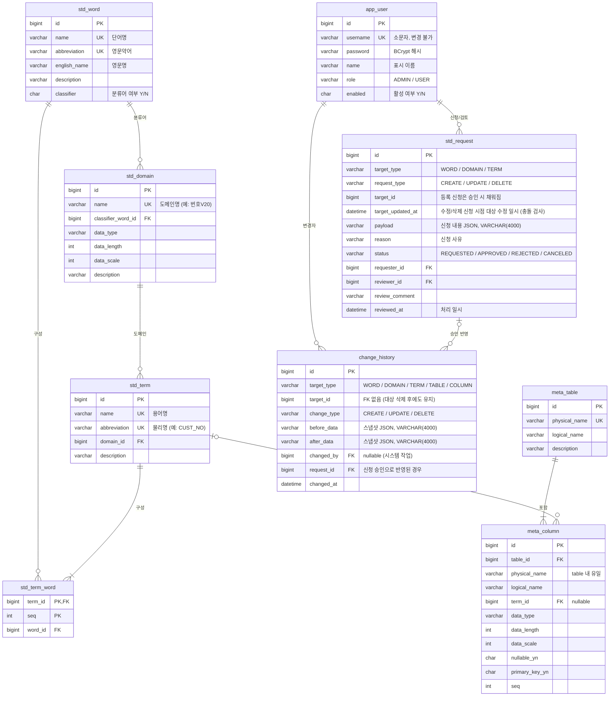

# 설계: 데이터 표준 용어사전 관리

테이블 설계에 쓰는 표준 단어, 도메인, 용어를 관리한다. 테이블/컬럼 정의가 표준을 지키는지 점검한다.

## 핵심 개념

| 개념 | 설명 | 예시 |
|---|---|---|
| 표준 단어 | 용어를 구성하는 최소 단위. 한글명, 영문약어, 영문명을 가진다. | 고객 / CUST / Customer |
| 분류어 | 용어 끝에 붙어 데이터 성격을 나타내는 단어 (단어의 속성) | 번호, 명, 일자, 금액, 여부 |
| 표준 도메인 | 분류어별 데이터 타입, 길이 규칙 | 번호V20 = VARCHAR(20) |
| 표준 용어 | 단어 조합 + 도메인. 컬럼명의 기준이 된다. | 고객번호 = 고객+번호 → CUST_NO, 번호V20 |
| 테이블/컬럼 정의 | 실제 테이블과 컬럼을 등록하고 컬럼을 표준 용어에 매핑한다. | TB_CUSTOMER.CUST_NO → 고객번호 |

## 업무 규칙 (초안, 각 단계 구현 시 확정)

- 단어명과 영문약어는 각각 유일하다. 영문약어는 대문자로 저장한다. **(1단계 구현됨)**
- 도메인은 분류어 단어에 속한다. 도메인명은 유일하다(사용자가 입력, 자동 생성하지 않음). **(2단계 구현됨)**
  - 분류어가 아닌 단어에는 도메인을 연결할 수 없다.
  - 데이터 타입: `CHAR`(길이 1~255), `VARCHAR`(1~65535), `DECIMAL`(길이 1~65, 소수점 0~min(길이, 30), 생략 시 0), `INTEGER`, `BIGINT`, `DATE`, `DATETIME`, `TEXT`(길이/소수점 입력 불가). 소수점 자리수는 `DECIMAL`만 쓴다.
  - 도메인에서 분류어로 쓰는 단어는 삭제할 수 없고(`WORD_IN_USE`), 분류어 여부도 해제할 수 없다(`CLASSIFIER_WORD_IN_USE`).
- 용어의 영문약어(물리명)는 구성 단어 약어를 `_`로 이어 자동 생성한다 (고객+번호 → `CUST_NO`). 용어명도 단어명을 이어 자동 생성한다 (`고객번호`). 둘 다 유일하다. **(3단계 구현됨)**
  - 입력은 구성 단어 ID 목록(조합 순서, 1~10개, 같은 단어 반복 가능)과 도메인 ID다.
  - 영문약어는 컬럼명의 기준이므로 64자(MySQL 식별자 한도), 용어명은 200자를 넘을 수 없다(`TERM_TOO_LONG`).
  - 용어에서 쓰는 단어는 단어명·영문약어를 바꿀 수 없다(`WORD_USED_BY_TERM`). 영문명·설명은 바꿀 수 있다.
  - 용어에서 쓰는 도메인은 분류어를 바꿀 수 없다(`DOMAIN_CLASSIFIER_IN_USE`). 타입·길이 변경은 허용하며 용어 조회 결과에 바로 반영된다.
- 용어의 마지막 단어는 분류어여야 하고(`TERM_LAST_WORD_NOT_CLASSIFIER`), 연결된 도메인의 분류어와 같아야 한다(`TERM_DOMAIN_MISMATCH`). **(3단계 구현됨)**
- 다른 곳에서 참조 중인 단어, 도메인, 용어는 삭제할 수 없다. 단어는 도메인·용어 참조를(`WORD_IN_USE`), 도메인은 용어 참조를(`DOMAIN_IN_USE`), 용어는 컬럼 매핑을(`TERM_IN_USE`) 검사한다.
- 테이블/컬럼 정의 **(4단계 구현됨)**
  - 테이블·컬럼 물리명은 대문자로 저장한다. 영문자로 시작하는 영문/숫자/`_`, 64자 이하. 테이블 물리명은 전체에서, 컬럼 물리명은 테이블 안에서 유일하다.
  - 컬럼의 타입/길이/소수점은 도메인과 같은 `DataType` 규칙으로 검증하고, DECIMAL 소수점 생략은 0으로 저장한다. 기본키 컬럼은 NULL을 허용할 수 없다(`PRIMARY_KEY_NULLABLE`).
  - 용어 매핑은 선택이다. 테이블을 삭제하면 그 컬럼 정의도 함께 삭제한다.
- 비표준 컬럼 검출 기준 **(4단계 구현됨)**: 조회할 때마다 현재 용어/도메인 기준으로 계산하므로 용어·도메인 변경이 바로 반영된다. 사유는 여러 개 동시에 나올 수 있다.
  - `NO_TERM`: 용어 매핑이 없다 (이때 나머지는 검사하지 않음)
  - `NAME_MISMATCH`: 컬럼 물리명이 용어 영문약어와 다르다
  - `TYPE_MISMATCH`: 데이터 타입이 도메인과 다르다
  - `LENGTH_MISMATCH`: 길이 또는 소수점 자리수가 도메인과 다르다 (NULL끼리는 같다고 본다)
- 로그인/권한 **(5단계 구현됨)**
  - JWT(HS256) 액세스 토큰 방식이다. `POST /api/auth/login`으로 발급받아 `Authorization: Bearer <토큰>`으로 보낸다. 서버 세션은 없고 리프레시 토큰도 없다(기본 유효 1시간, `app.jwt.expiration`).
  - 역할은 `ADMIN`, `USER` 두 가지다. 로그인과 Swagger 문서만 공개이고 나머지 API는 로그인이 필요하다.
  - 표준 단어/도메인/용어의 조회는 모든 사용자, 등록/수정/삭제는 ADMIN만 한다(USER는 6단계에서 신청). 테이블/컬럼 정의는 USER도 등록/수정/삭제한다. 사용자 관리(`/api/users`)는 ADMIN만 한다.
  - 공개 회원가입은 없다. 사용자 테이블이 비어 있으면 기동 시 `app.initial-admin.*` 설정으로 최초 관리자를 만든다(비밀번호 설정이 없으면 만들지 않음). 이후 계정은 ADMIN이 만든다.
  - 아이디는 소문자로 저장하고 유일하며 바꿀 수 없다(토큰 subject). 비밀번호는 8~64자, 공백 없는 ASCII 문자다(BCrypt 72바이트 한도 때문).
  - 계정은 삭제하지 않고 비활성화한다. 비활성 계정은 로그인할 수 없다(`USER_DISABLED`). 활성 관리자가 한 명도 남지 않게 되는 강등/비활성화는 막는다(`LAST_ADMIN_REQUIRED`).
  - 로그인 실패는 아이디 없음과 비밀번호 틀림을 구분하지 않는다(`INVALID_CREDENTIALS`). 비활성 여부는 비밀번호가 맞을 때만 알려준다.
  - 이미 발급된 토큰에는 발급 당시 역할이 들어 있어, 역할 변경·비활성화·비밀번호 변경은 그 토큰이 만료된 뒤 완전히 반영된다.
  - 인증 오류는 토큰 없음(`UNAUTHORIZED` 401), 토큰 검증 실패·만료(`INVALID_TOKEN` 401), 권한 부족(`FORBIDDEN` 403)으로 나누며, 다른 오류와 같은 JSON 형식이다.
- 신청/승인 **(6단계 구현됨)**: 일반 사용자는 단어, 도메인, 용어의 등록/수정/삭제를 신청하고 관리자가 승인하면 반영된다. 관리자는 기존 API로 직접 반영할 수 있다.
  - 로그인한 사용자는 누구나 신청할 수 있다(ADMIN 포함). 신청 내용(payload)은 직접 등록/수정 API의 요청 본문과 같고, 신청 시점에 같은 형식 검증을 한다.
  - 신청 종류별 입력: 등록은 payload만, 수정은 대상 ID와 payload, 삭제는 대상 ID만 (`INVALID_CHANGE_REQUEST`). 수정/삭제 대상이 없으면 대상별 404.
  - 같은 대상에 대기 중인 수정/삭제 신청은 하나만 둔다(`REQUEST_ALREADY_PENDING`). 등록 신청은 대상이 없어 제한하지 않는다.
  - 상태: `REQUESTED` → `APPROVED`(승인) / `REJECTED`(반려) / `CANCELED`(취소). 대기 중인 신청만 처리할 수 있다(`REQUEST_NOT_PENDING`).
  - 승인/반려는 ADMIN만 한다. 반려는 의견이 필수다. 취소는 신청자 본인만 한다(`REQUEST_NOT_OWNED`, 관리자도 남의 신청은 취소 불가).
  - 수정/삭제 신청은 신청 시점 대상의 수정 일시를 기록하고, 승인 시점과 다르면(대상이 바뀌거나 삭제됨) 승인하지 않는다(`REQUEST_TARGET_CHANGED`). 신청자는 반려 후 최신 값으로 다시 신청한다.
  - 승인은 기존 서비스(`WordService` 등)를 호출해 반영하며 반영과 상태 변경이 한 트랜잭션이다. 업무 규칙 위반(예: `DUPLICATE_WORD_NAME`)이면 그 오류를 반환하고 신청은 대기 상태로 남는다.
  - USER는 자기 신청만 조회한다(남의 신청은 404). ADMIN은 모든 신청을 조회한다.
- 변경 이력 **(7단계 구현됨)**: 표준 단어/도메인/용어와 테이블/컬럼 정의가 바뀔 때마다 변경 전후 값, 변경자, 시각을 남긴다.
  - 변경 전후 값은 대상의 스냅샷 JSON이다. 대상에 저장된 값과 참조 대상의 ID·이름(예: 용어의 구성 단어 ID, 도메인명)만 담고, 수정 일시나 비표준 검출 결과처럼 계산·자동 값은 넣지 않는다.
  - 등록은 변경 후만, 삭제는 변경 전만 남는다. 값이 하나도 바뀌지 않은 수정은 이력을 남기지 않는다.
  - 이력은 변경과 같은 트랜잭션에서 저장된다. 업무 규칙 위반 등으로 변경이 실패하면 이력도 남지 않는다.
  - 변경자는 요청한 로그인 사용자다. 신청 승인으로 반영된 변경은 승인한 관리자가 변경자이고, 신청 ID가 함께 남아 신청자를 추적할 수 있다.
  - 테이블을 삭제하면 함께 삭제되는 컬럼마다 삭제 이력이 남는다.
  - 대상이 삭제돼도 이력은 남는다. 이력은 수정·삭제할 수 없고, 로그인한 사용자 누구나 조회한다.
  - 응답의 `changedFields`는 조회할 때 전후 스냅샷을 비교해 계산한다(null과 필드 없음은 같게 보고, `id`는 제외).
- 엑셀 업로드/다운로드 **(8단계 구현됨)**: 단어, 도메인, 용어, 테이블/컬럼 정의를 .xlsx로 내려받고 올린다.
  - 다운로드는 목록 API와 같은 검색 조건과 정렬을 쓰며 최대 10,000건이다(넘으면 조건을 좁히도록 400). 헤더만 있는 업로드 양식도 받을 수 있다.
  - 다운로드와 업로드는 같은 열 배치를 쓴다. "(참고)" 열(용어명·영문약어, 비표준 사유)은 다운로드에서만 채우고 업로드에서는 무시한다. 업로드 파일의 1행 헤더는 양식과 같아야 한다.
  - 업로드는 등록만 한다. 이미 있는 이름이면 기존 중복 오류가 난다. 참조 대상은 이름으로 지정하며 이미 등록돼 있어야 한다(도메인의 분류어 단어명, 용어의 구성 단어명(쉼표 구분)과 도메인명, 컬럼의 용어명).
  - 행마다 API 요청 본문과 같은 검증을 하고 기존 서비스로 반영하므로 업무 규칙과 변경 이력은 직접 API와 같다.
  - 전부 반영하거나 전혀 반영하지 않는다. 모든 행을 끝까지 검사해 오류를 `{"field": "3행 영문약어", "reason": ...}` 형식으로 최대 100건 돌려주고, 하나라도 있으면 아무것도 반영하지 않는다(`EXCEL_INVALID_ROWS`).
  - 표준 데이터 업로드: ADMIN은 바로 등록하고, USER는 행마다 등록 신청을 만든다(신청 사유에 파일명과 행 번호). 신청은 형식만 검증하므로 이름 중복은 승인할 때 드러나고, 승인 안 된 단어/도메인은 참조할 수 없다.
  - 테이블/컬럼 업로드: 역할과 관계없이 바로 등록한다. 한 행이 컬럼 하나이고 같은 테이블 물리명(대소문자 무시)의 행을 한 테이블로 묶는다. 테이블 논리명/설명은 첫 행 값을 쓰고, 컬럼 열이 모두 빈 행은 컬럼 없는 테이블이다. 컬럼 순서를 비우면 나온 순서, Y/N을 비우면 N이다.
  - 업로드는 최대 1,000행, 10MB. Y/N 열은 대소문자와 TRUE/FALSE도 받고, 데이터 타입은 대소문자를 구분하지 않는다.

## ERD (전체 계획)

모든 표준/메타 테이블은 `created_at`, `updated_at`을 가진다 (`BaseTimeEntity`).

## 구현 단계

| 단계 | 내용 | 상태 |
|---|---|---|
| 1 | 프로젝트 뼈대 + 표준 단어사전 CRUD/검색 + 테스트 | 완료 (H2 테스트 + 로컬 MySQL 8.4 실행 검증) |
| 2 | 표준 도메인 (분류어 연결, 참조 시 단어 삭제 차단) | 완료 (H2 테스트 + 로컬 MySQL 8.4 실행 검증) |
| 3 | 표준 용어 (단어 조합, 물리명 자동 생성, 도메인 검증) | 완료 (H2 테스트 + 로컬 MySQL 8.4 실행 검증) |
| 4 | 테이블/컬럼 정의 + 비표준 컬럼 검출 | 완료 (H2 테스트 + 로컬 MySQL 8.4 실행 검증) |
| 5 | 로그인/권한 (Spring Security, ADMIN/USER) | 완료 (H2 테스트 + 로컬 MySQL 8.4 실행 검증) |
| 6 | 신청/승인 워크플로 | 완료 (H2 테스트 + 로컬 MySQL 8.4 실행 검증) |
| 7 | 변경 이력 | 완료 (H2 테스트 + 로컬 MySQL 8.4 실행 검증) |
| 8 | 엑셀 업로드/다운로드 (Apache POI) | 완료 (H2 테스트 + 로컬 MySQL 8.4 실행 검증) |

## API (1단계)

| Method | Path | 설명 |
|---|---|---|
| POST | `/api/words` | 단어 등록 (201 + Location) |
| GET | `/api/words/{id}` | 단건 조회 |
| GET | `/api/words?keyword=&classifier=&page=&size=` | 검색 (단어명 오름차순) |
| PUT | `/api/words/{id}` | 수정 |
| DELETE | `/api/words/{id}` | 삭제 (204). 도메인에서 사용 중이면 409 |

## API (2단계)

| Method | Path | 설명 |
|---|---|---|
| POST | `/api/domains` | 도메인 등록 (201 + Location) |
| GET | `/api/domains/{id}` | 단건 조회 (분류어 단어 ID/이름 포함) |
| GET | `/api/domains?keyword=&classifierWordId=&dataType=&page=&size=` | 검색 (도메인명 오름차순) |
| PUT | `/api/domains/{id}` | 수정 |
| DELETE | `/api/domains/{id}` | 삭제 (204). 용어에서 사용 중이면 409 |

요청 본문: `{"name", "classifierWordId", "dataType", "dataLength", "dataScale", "description"}`

## API (3단계)

| Method | Path | 설명 |
|---|---|---|
| POST | `/api/terms` | 용어 등록 (201 + Location). 용어명/영문약어 자동 생성 |
| GET | `/api/terms/{id}` | 단건 조회 (구성 단어 목록, 도메인 타입/길이 포함) |
| GET | `/api/terms?keyword=&domainId=&wordId=&page=&size=` | 검색 (용어명 오름차순). `wordId`는 그 단어를 포함하는 용어 |
| PUT | `/api/terms/{id}` | 수정. 구성 단어가 바뀌면 용어명/영문약어 재생성 |
| DELETE | `/api/terms/{id}` | 삭제 (204) |

요청 본문: `{"wordIds": [고객 ID, 번호 ID], "domainId", "description"}`

## API (4단계)

| Method | Path | 설명 |
|---|---|---|
| POST | `/api/tables` | 테이블 등록 (201 + Location) |
| GET | `/api/tables/{id}` | 단건 조회 |
| GET | `/api/tables?keyword=&page=&size=` | 검색 (물리명 오름차순) |
| PUT | `/api/tables/{id}` | 수정 |
| DELETE | `/api/tables/{id}` | 삭제 (204). 컬럼 정의도 함께 삭제 |
| POST | `/api/tables/{tableId}/columns` | 컬럼 등록 (201 + Location) |
| GET | `/api/tables/{tableId}/columns` | 테이블 컬럼 전체 (seq 오름차순, 페이징 없음) |
| GET | `/api/tables/{tableId}/columns/{columnId}` | 단건 조회. 다른 테이블의 컬럼이면 404 |
| PUT | `/api/tables/{tableId}/columns/{columnId}` | 수정 |
| DELETE | `/api/tables/{tableId}/columns/{columnId}` | 삭제 (204) |
| GET | `/api/columns/non-standard?tableId=&issue=&page=&size=` | 비표준 컬럼 검색 (테이블 물리명, seq 순) |

컬럼 요청 본문: `{"physicalName", "logicalName", "termId"(선택), "dataType", "dataLength", "dataScale", "nullable", "primaryKey", "seq"}`

컬럼 응답에는 검출 결과가 포함된다: `standard`(사유 없음 여부), `issues`(사유 목록), `expected`(매핑 용어 기준 표준 값 `{physicalName, dataType, dataLength, dataScale}`, 용어가 없으면 null).

## API (5단계)

| Method | Path | 권한 | 설명 |
|---|---|---|---|
| POST | `/api/auth/login` | 공개 | 로그인. `{"username", "password"}` → `{"accessToken", "tokenType": "Bearer", "expiresIn"}` |
| GET | `/api/auth/me` | 로그인 | 내 정보 |
| PUT | `/api/auth/me/password` | 로그인 | 내 비밀번호 변경 (204). `{"currentPassword", "newPassword"}` |
| POST | `/api/users` | ADMIN | 계정 생성 (201 + Location). `{"username", "password", "name", "role"}` |
| GET | `/api/users/{id}` | ADMIN | 단건 조회 |
| GET | `/api/users?keyword=&role=&enabled=&page=&size=` | ADMIN | 검색 (아이디 오름차순) |
| PUT | `/api/users/{id}` | ADMIN | 수정. `{"name", "role", "enabled"}` |
| PUT | `/api/users/{id}/password` | ADMIN | 비밀번호 초기화 (204). `{"password"}` |

기존 API 권한: 단어/도메인/용어 `GET`은 로그인, 그 밖의 메서드는 ADMIN. 테이블/컬럼 API는 모두 로그인. Swagger(`/swagger-ui/**`, `/v3/api-docs/**`)는 공개.

사용자 응답에는 비밀번호가 포함되지 않는다: `{id, username, name, role, enabled, createdAt, updatedAt}`.

## API (6단계)

| Method | Path | 권한 | 설명 |
|---|---|---|---|
| POST | `/api/requests/words` | 로그인 | 단어 변경 신청 (201 + Location) |
| POST | `/api/requests/domains` | 로그인 | 도메인 변경 신청 |
| POST | `/api/requests/terms` | 로그인 | 용어 변경 신청 |
| GET | `/api/requests?status=&targetType=&requestType=&requester=&page=&size=` | 로그인 | 검색 (최신순). USER는 자기 신청만 |
| GET | `/api/requests/{id}` | 로그인 | 단건 조회. USER가 남의 신청을 조회하면 404 |
| POST | `/api/requests/{id}/approve` | ADMIN | 승인 + 반영. 본문 선택 `{"comment"}` |
| POST | `/api/requests/{id}/reject` | ADMIN | 반려. `{"comment"}` 필수 |
| POST | `/api/requests/{id}/cancel` | 신청자 | 취소 |

신청 본문: `{"requestType": "CREATE|UPDATE|DELETE", "targetId", "payload": {대상별 등록/수정 요청 본문}, "reason"}`

신청 응답: `{id, targetType, requestType, targetId, payload(JSON 객체), reason, status, requesterUsername, requesterName, reviewerUsername, reviewerName, reviewComment, reviewedAt, createdAt, updatedAt}`

## API (7단계)

| Method | Path | 권한 | 설명 |
|---|---|---|---|
| GET | `/api/histories?targetType=&targetId=&changeType=&changedBy=&requestId=&from=&to=&page=&size=` | 로그인 | 검색 (최신순). `from`/`to`는 `yyyy-MM-dd`, 양 끝 날짜 포함 |
| GET | `/api/histories/{id}` | 로그인 | 단건 조회 |

이력은 기존 API로 데이터를 바꿀 때 자동으로 쌓이며 등록/수정/삭제 API는 없다. 특정 대상의 이력은 `targetType`과 `targetId`를 함께 지정한다.

이력 응답: `{id, targetType, targetId, changeType, before(JSON 객체), after(JSON 객체), changedFields, changedByUsername, changedByName, requestId, changedAt}`

## API (8단계)

| Method | Path | 권한 | 설명 |
|---|---|---|---|
| GET | `/api/excel/words?keyword=&classifier=` | 로그인 | 단어 다운로드 (`단어_yyyyMMdd.xlsx`) |
| GET | `/api/excel/domains?keyword=&classifierWordId=&dataType=` | 로그인 | 도메인 다운로드 |
| GET | `/api/excel/terms?keyword=&domainId=&wordId=` | 로그인 | 용어 다운로드 |
| GET | `/api/excel/tables?keyword=` | 로그인 | 테이블/컬럼 정의 다운로드 (비표준 사유 포함) |
| GET | `/api/excel/{words\|domains\|terms\|tables}/template` | 로그인 | 업로드 양식 (헤더만) |
| POST | `/api/excel/words` | 로그인 | 단어 업로드 (multipart `file`). ADMIN 등록 / USER 신청 |
| POST | `/api/excel/domains` | 로그인 | 도메인 업로드. ADMIN 등록 / USER 신청 |
| POST | `/api/excel/terms` | 로그인 | 용어 업로드. ADMIN 등록 / USER 신청 |
| POST | `/api/excel/tables` | 로그인 | 테이블/컬럼 정의 업로드. 모두 등록 |

시트 열:
- 단어: 단어명, 영문약어, 영문명, 분류어 여부(Y/N), 설명
- 도메인: 도메인명, 분류어 단어명, 데이터 타입, 길이, 소수점, 설명
- 용어: 구성 단어명(쉼표 구분), 도메인명, 설명, 용어명(참고), 영문약어(참고)
- 테이블 정의: 테이블 물리명, 테이블 논리명, 테이블 설명, 컬럼 순서, 컬럼 물리명, 컬럼 논리명, 용어명, 데이터 타입, 길이, 소수점, NULL 허용(Y/N), 기본키(Y/N), 비표준 사유(참고)

업로드 응답: `{mode: "APPLIED" | "REQUESTED", rowCount, ids}` (`ids`는 등록된 대상 ID 또는 신청 ID, 테이블 정의는 테이블 ID)

오류 응답 형식: `{"code": "ErrorCode 이름", "message": "...", "fieldErrors": [{"field", "reason"}]}`
