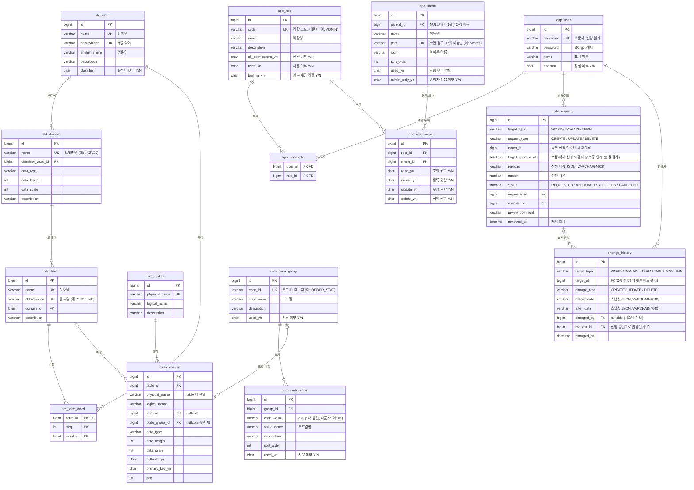
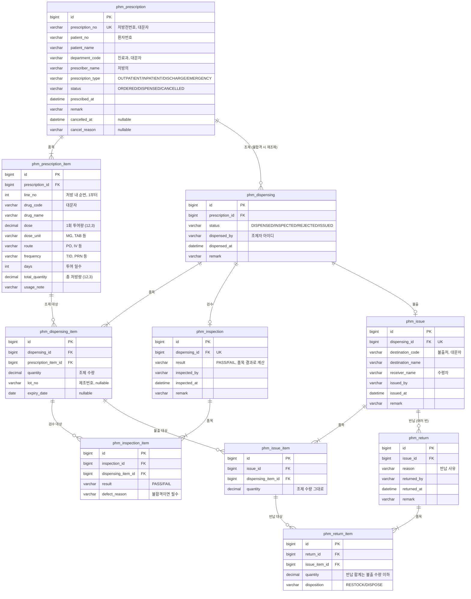

# 설계: 데이터 표준 용어사전 관리

테이블 설계에 쓰는 표준 단어, 도메인, 용어를 관리한다. 테이블/컬럼 정의가 표준을 지키는지 점검한다.

## 핵심 개념

| 개념 | 설명 | 예시 |
|---|---|---|
| 표준 단어 | 용어를 구성하는 최소 단위. 한글명, 영문약어, 영문명을 가진다. | 고객 / CUST / Customer |
| 분류어 | 용어 끝에 붙어 데이터 성격을 나타내는 단어 (단어의 속성) | 번호, 명, 일자, 금액, 여부 |
| 표준 도메인 | 분류어별 데이터 타입, 길이 규칙 | 번호V20 = VARCHAR(20) |
| 표준 용어 | 단어 조합 + 도메인. 컬럼명의 기준이 된다. | 고객번호 = 고객+번호 → CUST_NO, 번호V20 |
| 테이블/컬럼 정의 | 실제 테이블과 컬럼을 등록하고 컬럼을 표준 용어에 매핑한다. | TB_CUSTOMER.CUST_NO → 고객번호 |

## 업무 규칙 (초안, 각 단계 구현 시 확정)

- 단어명과 영문약어는 각각 유일하다. 영문약어는 대문자로 저장한다. **(1단계 구현됨)**
- 도메인은 분류어 단어에 속한다. 도메인명은 유일하다(사용자가 입력, 자동 생성하지 않음). **(2단계 구현됨)**
  - 분류어가 아닌 단어에는 도메인을 연결할 수 없다.
  - 데이터 타입: `CHAR`(길이 1~255), `VARCHAR`(1~65535), `DECIMAL`(길이 1~65, 소수점 0~min(길이, 30), 생략 시 0), `INTEGER`, `BIGINT`, `DATE`, `DATETIME`, `TEXT`(길이/소수점 입력 불가). 소수점 자리수는 `DECIMAL`만 쓴다.
  - 도메인에서 분류어로 쓰는 단어는 삭제할 수 없고(`WORD_IN_USE`), 분류어 여부도 해제할 수 없다(`CLASSIFIER_WORD_IN_USE`).
- 용어의 영문약어(물리명)는 구성 단어 약어를 `_`로 이어 자동 생성한다 (고객+번호 → `CUST_NO`). 용어명도 단어명을 이어 자동 생성한다 (`고객번호`). 둘 다 유일하다. **(3단계 구현됨)**
  - 입력은 구성 단어 ID 목록(조합 순서, 1~10개, 같은 단어 반복 가능)과 도메인 ID다.
  - 영문약어는 컬럼명의 기준이므로 64자(MySQL 식별자 한도), 용어명은 200자를 넘을 수 없다(`TERM_TOO_LONG`).
  - 용어에서 쓰는 단어는 단어명·영문약어를 바꿀 수 없다(`WORD_USED_BY_TERM`). 영문명·설명은 바꿀 수 있다.
  - 용어에서 쓰는 도메인은 분류어를 바꿀 수 없다(`DOMAIN_CLASSIFIER_IN_USE`). 타입·길이 변경은 허용하며 용어 조회 결과에 바로 반영된다.
- 용어의 마지막 단어는 분류어여야 하고(`TERM_LAST_WORD_NOT_CLASSIFIER`), 연결된 도메인의 분류어와 같아야 한다(`TERM_DOMAIN_MISMATCH`). **(3단계 구현됨)**
- 다른 곳에서 참조 중인 단어, 도메인, 용어는 삭제할 수 없다. 단어는 도메인·용어 참조를(`WORD_IN_USE`), 도메인은 용어 참조를(`DOMAIN_IN_USE`), 용어는 컬럼 매핑을(`TERM_IN_USE`) 검사한다.
- 테이블/컬럼 정의 **(4단계 구현됨)**
  - 테이블·컬럼 물리명은 대문자로 저장한다. 영문자로 시작하는 영문/숫자/`_`, 64자 이하. 테이블 물리명은 전체에서, 컬럼 물리명은 테이블 안에서 유일하다.
  - 컬럼의 타입/길이/소수점은 도메인과 같은 `DataType` 규칙으로 검증하고, DECIMAL 소수점 생략은 0으로 저장한다. 기본키 컬럼은 NULL을 허용할 수 없다(`PRIMARY_KEY_NULLABLE`).
  - 용어 매핑은 선택이다. 테이블을 삭제하면 그 컬럼 정의도 함께 삭제한다.
- 비표준 컬럼 검출 기준 **(4단계 구현됨)**: 조회할 때마다 현재 용어/도메인 기준으로 계산하므로 용어·도메인 변경이 바로 반영된다. 사유는 여러 개 동시에 나올 수 있다.
  - `NO_TERM`: 용어 매핑이 없다 (이때 나머지는 검사하지 않음)
  - `NAME_MISMATCH`: 컬럼 물리명이 용어 영문약어와 다르다
  - `TYPE_MISMATCH`: 데이터 타입이 도메인과 다르다
  - `LENGTH_MISMATCH`: 길이 또는 소수점 자리수가 도메인과 다르다 (NULL끼리는 같다고 본다)
- 로그인/권한 **(5단계 구현됨)**
  - JWT(HS256) 액세스 토큰 방식이다. `POST /api/auth/login`으로 발급받아 `Authorization: Bearer <토큰>`으로 보낸다. 서버 세션은 없고 리프레시 토큰도 없다(기본 유효 1시간, `app.jwt.expiration`).
  - 역할은 `ADMIN`, `USER` 두 가지다. 로그인과 Swagger 문서만 공개이고 나머지 API는 로그인이 필요하다.
  - 표준 단어/도메인/용어의 조회는 모든 사용자, 등록/수정/삭제는 ADMIN만 한다(USER는 6단계에서 신청). 테이블/컬럼 정의는 USER도 등록/수정/삭제한다. 사용자 관리(`/api/users`)는 ADMIN만 한다.
  - 공개 회원가입은 없다. 사용자 테이블이 비어 있으면 기동 시 `app.initial-admin.*` 설정으로 최초 관리자를 만든다(비밀번호 설정이 없으면 만들지 않음). 이후 계정은 ADMIN이 만든다.
  - 아이디는 소문자로 저장하고 유일하며 바꿀 수 없다(토큰 subject). 비밀번호는 8~64자, 공백 없는 ASCII 문자다(BCrypt 72바이트 한도 때문).
  - 계정은 삭제하지 않고 비활성화한다. 비활성 계정은 로그인할 수 없다(`USER_DISABLED`). 활성 관리자가 한 명도 남지 않게 되는 강등/비활성화는 막는다(`LAST_ADMIN_REQUIRED`).
  - 로그인 실패는 아이디 없음과 비밀번호 틀림을 구분하지 않는다(`INVALID_CREDENTIALS`). 비활성 여부는 비밀번호가 맞을 때만 알려준다.
  - 이미 발급된 토큰에는 발급 당시 역할이 들어 있어, 역할 변경·비활성화·비밀번호 변경은 그 토큰이 만료된 뒤 완전히 반영된다.
  - 인증 오류는 토큰 없음(`UNAUTHORIZED` 401), 토큰 검증 실패·만료(`INVALID_TOKEN` 401), 권한 부족(`FORBIDDEN` 403)으로 나누며, 다른 오류와 같은 JSON 형식이다.
- 신청/승인 **(6단계 구현됨)**: 일반 사용자는 단어, 도메인, 용어의 등록/수정/삭제를 신청하고 관리자가 승인하면 반영된다. 관리자는 기존 API로 직접 반영할 수 있다.
  - 로그인한 사용자는 누구나 신청할 수 있다(ADMIN 포함). 신청 내용(payload)은 직접 등록/수정 API의 요청 본문과 같고, 신청 시점에 같은 형식 검증을 한다.
  - 신청 종류별 입력: 등록은 payload만, 수정은 대상 ID와 payload, 삭제는 대상 ID만 (`INVALID_CHANGE_REQUEST`). 수정/삭제 대상이 없으면 대상별 404.
  - 같은 대상에 대기 중인 수정/삭제 신청은 하나만 둔다(`REQUEST_ALREADY_PENDING`). 등록 신청은 대상이 없어 제한하지 않는다.
  - 상태: `REQUESTED` → `APPROVED`(승인) / `REJECTED`(반려) / `CANCELED`(취소). 대기 중인 신청만 처리할 수 있다(`REQUEST_NOT_PENDING`).
  - 승인/반려는 ADMIN만 한다. 반려는 의견이 필수다. 취소는 신청자 본인만 한다(`REQUEST_NOT_OWNED`, 관리자도 남의 신청은 취소 불가).
  - 수정/삭제 신청은 신청 시점 대상의 수정 일시를 기록하고, 승인 시점과 다르면(대상이 바뀌거나 삭제됨) 승인하지 않는다(`REQUEST_TARGET_CHANGED`). 신청자는 반려 후 최신 값으로 다시 신청한다.
  - 승인은 기존 서비스(`WordService` 등)를 호출해 반영하며 반영과 상태 변경이 한 트랜잭션이다. 업무 규칙 위반(예: `DUPLICATE_WORD_NAME`)이면 그 오류를 반환하고 신청은 대기 상태로 남는다.
  - USER는 자기 신청만 조회한다(남의 신청은 404). ADMIN은 모든 신청을 조회한다.
- 변경 이력 **(7단계 구현됨)**: 표준 단어/도메인/용어와 테이블/컬럼 정의가 바뀔 때마다 변경 전후 값, 변경자, 시각을 남긴다.
  - 변경 전후 값은 대상의 스냅샷 JSON이다. 대상에 저장된 값과 참조 대상의 ID·이름(예: 용어의 구성 단어 ID, 도메인명)만 담고, 수정 일시나 비표준 검출 결과처럼 계산·자동 값은 넣지 않는다.
  - 등록은 변경 후만, 삭제는 변경 전만 남는다. 값이 하나도 바뀌지 않은 수정은 이력을 남기지 않는다.
  - 이력은 변경과 같은 트랜잭션에서 저장된다. 업무 규칙 위반 등으로 변경이 실패하면 이력도 남지 않는다.
  - 변경자는 요청한 로그인 사용자다. 신청 승인으로 반영된 변경은 승인한 관리자가 변경자이고, 신청 ID가 함께 남아 신청자를 추적할 수 있다.
  - 테이블을 삭제하면 함께 삭제되는 컬럼마다 삭제 이력이 남는다.
  - 대상이 삭제돼도 이력은 남는다. 이력은 수정·삭제할 수 없고, 로그인한 사용자 누구나 조회한다.
  - 응답의 `changedFields`는 조회할 때 전후 스냅샷을 비교해 계산한다(null과 필드 없음은 같게 보고, `id`는 제외).
- 엑셀 업로드/다운로드 **(8단계 구현됨)**: 단어, 도메인, 용어, 테이블/컬럼 정의를 .xlsx로 내려받고 올린다.
  - 다운로드는 목록 API와 같은 검색 조건과 정렬을 쓰며 최대 10,000건이다(넘으면 조건을 좁히도록 400). 헤더만 있는 업로드 양식도 받을 수 있다.
  - 다운로드와 업로드는 같은 열 배치를 쓴다. "(참고)" 열(용어명·영문약어, 비표준 사유)은 다운로드에서만 채우고 업로드에서는 무시한다. 업로드 파일의 1행 헤더는 양식과 같아야 한다.
  - 업로드는 등록만 한다. 이미 있는 이름이면 기존 중복 오류가 난다. 참조 대상은 이름으로 지정하며 이미 등록돼 있어야 한다(도메인의 분류어 단어명, 용어의 구성 단어명(쉼표 구분)과 도메인명, 컬럼의 용어명).
  - 행마다 API 요청 본문과 같은 검증을 하고 기존 서비스로 반영하므로 업무 규칙과 변경 이력은 직접 API와 같다.
  - 전부 반영하거나 전혀 반영하지 않는다. 모든 행을 끝까지 검사해 오류를 `{"field": "3행 영문약어", "reason": ...}` 형식으로 최대 100건 돌려주고, 하나라도 있으면 아무것도 반영하지 않는다(`EXCEL_INVALID_ROWS`).
  - 표준 데이터 업로드: ADMIN은 바로 등록하고, USER는 행마다 등록 신청을 만든다(신청 사유에 파일명과 행 번호). 신청은 형식만 검증하므로 이름 중복은 승인할 때 드러나고, 승인 안 된 단어/도메인은 참조할 수 없다.
  - 테이블/컬럼 업로드: 역할과 관계없이 바로 등록한다. 한 행이 컬럼 하나이고 같은 테이블 물리명(대소문자 무시)의 행을 한 테이블로 묶는다. 테이블 논리명/설명은 첫 행 값을 쓰고, 컬럼 열이 모두 빈 행은 컬럼 없는 테이블이다. 컬럼 순서를 비우면 나온 순서, Y/N을 비우면 N이다.
  - 업로드는 최대 1,000행, 10MB. Y/N 열은 대소문자와 TRUE/FALSE도 받고, 데이터 타입은 대소문자를 구분하지 않는다.
- 공통 코드 **(9단계 구현됨)**: 코드 그룹(코드ID) 하나에 코드값 여러 개가 속한다 (예: `ORDER_STAT` 주문상태 → `01` 접수, `02` 결제완료). 코드성 컬럼은 컬럼 정의에서 코드 그룹에 매핑한다.
  - 코드ID는 영문자로 시작하는 영문/숫자/`_`(50자), 코드값은 영문/숫자/`_`/`-`(50자)이며 둘 다 대문자로 저장한다. 코드ID는 전체에서(`DUPLICATE_CODE_ID`), 코드값은 그룹 안에서(`DUPLICATE_CODE_VALUE`) 유일하다. 다른 그룹에는 같은 코드값이 있어도 된다.
  - 코드값은 정렬 순서(1 이상, 중복 허용)와 사용 여부를 가진다. 목록은 정렬 순서, 같으면 등록 순이며 미사용 값도 함께 조회된다.
  - 조회는 로그인한 사용자 누구나, 등록·수정·삭제는 ADMIN만 한다. 신청/승인 대상이 아니다. 엑셀 업·다운로드도 없다.
  - 코드 그룹을 삭제하면 코드값도 함께 삭제한다. 컬럼에 매핑된 그룹은 삭제할 수 없다(`CODE_GROUP_IN_USE`). 그룹마다 매핑된 컬럼 목록을 조회할 수 있다.
  - 컬럼 매핑은 선택이며 그룹 ID로 연결되므로 코드ID·코드명을 바꿔도 매핑이 유지되고 컬럼 조회 결과에 바로 반영된다. 비표준 검출과는 무관하다.
  - 미사용 그룹은 컬럼에 새로 매핑할 수 없다(`CODE_GROUP_NOT_USED`). 이미 매핑된 컬럼은 그룹이 미사용으로 바뀌어도 매핑을 유지한 채 수정하거나 해제할 수 있다.
  - 컬럼 매핑은 컬럼 정의 API로 하므로 USER도 할 수 있다. 엑셀 테이블 정의 양식에는 코드 열이 없어 업로드한 컬럼은 매핑 없이 등록된다.
  - 예시 데이터: `src/main/resources/db/seed/common_code_seed.sql`에 일반적인 코드 그룹 19개(주문상태, 결제수단, 은행, 회원등급 등)와 코드값 100개가 있다. Flyway가 읽지 않는 위치이므로 필요할 때 직접 넣는다.
  - 코드 그룹·코드값 변경도 변경 이력(`CODE_GROUP`, `CODE_VALUE`)을 남기고, 그룹을 삭제하면 코드값마다 삭제 이력이 남는다. 컬럼 스냅샷에 매핑 코드 그룹 ID·코드ID가 추가됐다.
- 화면 메뉴 **(10단계 구현됨)**: 화면 위쪽(TOP) 상위 메뉴와 그 아래 왼쪽(LEFT) 하위 메뉴를 DB에서 관리한다. 관리자가 메뉴 관리 화면에서 등록·수정·삭제한다.
  - 상위-하위 2단까지만 둔다(`INVALID_MENU_PARENT`). 상위 메뉴는 하위를 묶는 이름이라 화면 경로가 없고, 하위 메뉴는 경로가 필요하다(`INVALID_MENU_PATH`). 경로는 전체에서 유일하다(`DUPLICATE_MENU_PATH`).
  - 경로는 앞의 `/`가 없으면 붙여 저장한다. 하위 메뉴가 있는 메뉴는 삭제할 수 없고(`MENU_HAS_CHILDREN`), 하위를 가진 메뉴를 다른 메뉴 밑으로 옮길 수도 없다.
  - 메뉴는 사용 여부와 관리자 전용 여부를 가진다. 화면 표시용 조회(`GET /api/menus`)는 사용 중인 메뉴만, 관리자 전용은 ADMIN에게만 돌려주고 보여줄 하위가 없는 상위 메뉴는 뺀다. 관리용 조회(`GET /api/menus/all`)는 전부 돌려준다.
  - 조회는 로그인한 사용자, 관리(전체 조회 포함)는 ADMIN이다. 메뉴의 관리자 전용 여부는 화면에 보이는지의 문제이고, 실제 권한 검사는 각 API가 그대로 한다.
  - 아이콘은 이름만 저장하고(`book`, `table` 등) 화면이 실제 아이콘으로 바꾼다. 경로가 화면으로 등록되지 않았으면 메뉴는 만들어지되 "준비 중" 화면이 나온다.
  - 메뉴가 하나도 없으면 기동 시 기본 메뉴(상위 6개·하위 25개, 초급 개발자 온보딩용 "샘플" 묶음 포함)를 만든다. 이미 있으면 건드리지 않아 관리자가 고친 메뉴가 유지된다.
  - 메뉴는 화면 구성이라 변경 이력을 남기지 않는다.
- 사용자별 메뉴 권한 **(11단계 구현됨)**: 관리자가 사용자마다 보여줄 메뉴를 지정한다(`app_user_menu`).
  - 지정이 없는 사용자는 기본 규칙(사용 중 + 역할)대로 본다. 지정하면 그 메뉴만 본다.
  - 지정은 좁히는 쪽으로만 동작한다. 지정했더라도 미사용 메뉴와 관리자 전용 메뉴 규칙은 그대로 적용된다.
  - 지정은 하위(LEFT) 메뉴 단위다. 상위 메뉴는 보여줄 하위가 남아 있으면 자동으로 보인다.
  - 관리자에게도 똑같이 적용된다. 메뉴가 사라져도 주소로는 들어갈 수 있고, 기능 권한은 각 API가 그대로 검사한다.
  - 권한은 통째로 교체한다. 메뉴를 삭제하면 그 메뉴에 걸린 권한도 함께 지운다.
- 역할과 권한 **(12단계 구현됨)**: 고정돼 있던 ADMIN/USER 역할을 DB에서 관리하는 역할로 바꿨다. 한 사용자는 역할을 여러 개 가지며 권한은 합집합이다.
  - `app_role`(코드·이름·전권 여부·사용 여부·기본 제공 여부), `app_role_menu`(역할×메뉴 = 조회/등록/수정/삭제), `app_user_role`(사용자×역할).
  - **권한 단위는 메뉴별 조회/등록/수정/삭제**다. 조회 권한이 없으면 메뉴가 보이지 않고, 나머지는 화면의 버튼과 서버 검사에 함께 쓰인다.
  - **서버도 같은 권한으로 요청을 검사한다.** 요청 경로를 메뉴와 동작으로 옮기는 표(`ApiPermissionRules`)를 두고, 규칙이 없는 경로는 막는다. 메서드가 곧 동작이다(GET=조회, POST=등록, PUT/PATCH=수정, DELETE=삭제). 예외는 표 위쪽에 따로 적는다(신청 승인=수정, 신청 취소=조회+본인 검사, 엑셀=대상 메뉴 기준).
  - 로그인·내 정보·비밀번호 변경과 화면 메뉴 조회(`GET /api/menus`)는 로그인만 하면 된다.
  - **전권 역할**(`all_permissions_yn`)은 메뉴 권한과 무관하게 모두 통과한다. 권한 설정 실수로 아무도 관리할 수 없게 되는 것을 막는 장치이며 기본 제공 ADMIN 역할이 이에 해당한다.
  - 기본 제공 역할(ADMIN, USER)은 삭제·코드 변경·전권 변경이 막힌다(`BUILT_IN_ROLE`). 사용자에게 부여된 역할은 삭제할 수 없다(`ROLE_IN_USE`).
  - 사용자에게는 역할이 하나 이상 있어야 하고(`USER_ROLE_REQUIRED`), 전권 역할을 가진 활성 사용자가 한 명도 남지 않는 변경은 막는다(`LAST_ADMIN_REQUIRED`).
  - 표준 데이터는 그 메뉴의 등록·수정·삭제 권한이 있으면 직접 반영하고, 없으면 기존처럼 변경 신청이 된다(화면과 엑셀 업로드 모두).
  - 권한은 요청마다 DB에서 다시 계산하므로 역할·권한 변경이 바로 반영된다(토큰 재발급 불필요). 토큰의 `roles`는 표시용이다.
  - 마이그레이션(V11)은 기존 `app_user.role` 값을 `app_user_role`로 옮기고 컬럼을 지운다. 메뉴의 관리자 전용 표시(`admin_only_yn`)도 역할 권한으로 대체돼 사라졌다.
  - 사용자별 메뉴 지정(11단계)은 그대로 남아 역할 권한을 더 좁히는 설정으로 동작한다.
- 약제 업무 **(13단계 구현됨)**: 처방 → 조제 → 검수 → 불출 → 반납을 업무마다 마스터 + 하위(품목) 테이블로 관리한다(`phm_*`, V12).
  - 처방(`phm_prescription` + `phm_prescription_item`): 처방전번호는 대문자로 저장하며 유일하다(`DUPLICATE_PRESCRIPTION_NO`). 품목 순번은 요청 순서대로 1부터 매긴다. 처방은 수정하지 않고, 조제 전(ORDERED)에만 취소한다(`PRESCRIPTION_NOT_CANCELLABLE`).
  - 조제(`phm_dispensing` + `phm_dispensing_item`): 조제 품목은 처방 품목을 빠짐없이 한 번씩 다룬다(`INVALID_DISPENSING_ITEMS`). 취소된 처방은 조제할 수 없다(`PRESCRIPTION_CANCELLED`). 처방에 검수 불합격이 아닌 조제가 있으면 다시 조제할 수 없다(`DISPENSING_ALREADY_EXISTS`). 조제하면 처방은 DISPENSED가 된다.
  - 검수(`phm_inspection` + `phm_inspection_item`): 조제 상태(DISPENSED)인 조제만 검수한다(`DISPENSING_NOT_INSPECTABLE`). 검수 품목도 조제 품목을 빠짐없이 다루고(`INVALID_INSPECTION_ITEMS`), 불합격 품목은 불량 사유가 필요하다(`DEFECT_REASON_REQUIRED`). 전 품목 합격이면 조제가 INSPECTED, 아니면 REJECTED(같은 처방으로 재조제)가 된다.
  - 불출(`phm_issue` + `phm_issue_item`): 검수 합격(INSPECTED)한 조제만 불출한다(`DISPENSING_NOT_ISSUABLE`). 품목은 요청으로 받지 않고 조제 품목을 수량 그대로 옮긴다. 불출하면 조제는 ISSUED가 된다.
  - 반납(`phm_return` + `phm_return_item`): 불출 하나에 여러 번, 일부 품목만 반납할 수 있다. 품목은 그 불출의 것이어야 하고 중복될 수 없으며(`INVALID_RETURN_ITEMS`), 품목별 반납 합계는 불출 수량을 넘을 수 없다(`RETURN_QUANTITY_EXCEEDED`). 처리 방법은 재입고(RESTOCK) 또는 폐기(DISPOSE)다.
  - 등록자(조제자·검수자·불출자·반납자)는 로그인 아이디, 일시는 등록 시각으로 서버가 채운다. 처방 일시만 요청으로 받는다.
  - 수량은 `DECIMAL(12,3)`이며 응답도 항상 소수 3자리다(`Quantities`). 코드성 값(진료과·약품코드·단위·경로·빈도·불출처)은 대문자로 저장한다.
  - 약품 마스터는 아직 없어 품목에 약품코드·약품명을 직접 저장한다. 업무 기록 자체가 이력이라 변경 이력(`change_history`)은 남기지 않는다.
  - 권한: 메뉴 `/prescriptions`, `/dispensings`, `/inspections`, `/issues`, `/returns`(상위 메뉴 "약제"). 처방 취소는 처방 메뉴의 수정 권한이다. USER 기본 권한은 조회만이며, 업무 담당자에게는 관리자가 역할을 만들어 등록 권한을 준다.
  - 동시에 같은 불출 품목을 반납하면 두 요청이 모두 한도 검사를 통과할 수 있다(잠금 없음). 필요해지면 불출 행을 비관적 잠금으로 읽는다.

## ERD (전체 계획)

모든 표준/메타 테이블은 `created_at`, `updated_at`을 가진다 (`BaseTimeEntity`).

### 약제 업무 ERD (13단계)

마스터 테이블은 `created_at`, `updated_at`을 가지고, 하위(품목) 테이블은 마스터와 함께 저장되므로 갖지 않는다.

## 구현 단계

| 단계 | 내용 | 상태 |
|---|---|---|
| 1 | 프로젝트 뼈대 + 표준 단어사전 CRUD/검색 + 테스트 | 완료 (H2 테스트 + 로컬 MySQL 8.4 실행 검증) |
| 2 | 표준 도메인 (분류어 연결, 참조 시 단어 삭제 차단) | 완료 (H2 테스트 + 로컬 MySQL 8.4 실행 검증) |
| 3 | 표준 용어 (단어 조합, 물리명 자동 생성, 도메인 검증) | 완료 (H2 테스트 + 로컬 MySQL 8.4 실행 검증) |
| 4 | 테이블/컬럼 정의 + 비표준 컬럼 검출 | 완료 (H2 테스트 + 로컬 MySQL 8.4 실행 검증) |
| 5 | 로그인/권한 (Spring Security, ADMIN/USER) | 완료 (H2 테스트 + 로컬 MySQL 8.4 실행 검증) |
| 6 | 신청/승인 워크플로 | 완료 (H2 테스트 + 로컬 MySQL 8.4 실행 검증) |
| 7 | 변경 이력 | 완료 (H2 테스트 + 로컬 MySQL 8.4 실행 검증) |
| 8 | 엑셀 업로드/다운로드 (Apache POI) | 완료 (H2 테스트 + 로컬 MySQL 8.4 실행 검증) |
| 9 | 공통 코드 (코드 그룹·코드값, 컬럼 코드 그룹 매핑) + 화면 | 완료 (H2 테스트 + 로컬 MySQL 8.4 실행 검증) |
| 10 | 화면 메뉴 관리 (TOP/LEFT 2단 메뉴, 메뉴 관리 화면) | 완료 (H2 테스트 + 로컬 MySQL 8.4 실행 검증) |
| 11 | 사용자별 메뉴 권한 (메뉴 권한 화면) | 완료 (H2 테스트 + 로컬 MySQL 8.4 실행 검증) |
| 12 | 역할 관리 (메뉴별 조회/등록/수정/삭제 권한, 서버 검사, 역할 관리 화면) | 완료 (H2 테스트 + 로컬 MySQL 8.4 실행 검증) |
| 13 | 약제 업무: 처방·조제·검수·불출·반납 마스터/품목 테이블과 API | 백엔드 완료 (H2 테스트 + 로컬 MySQL 8.4 마이그레이션·기동 검증). 화면은 17단계 |
| 14 | 데이터 접근 기술 전환: JPA·Querydsl → MyBatis (스키마·API 변경 없음, 리포지토리가 매퍼로 애그리거트 저장·조회) | 완료 (H2 테스트 331건 + 로컬 MySQL 8.4 기동·조회 API 검증) |
| 15 | 테이블·컬럼 설명(Description) 전체 작성 (V14, 처음에는 MySQL·H2 DB 종류별로 작성했고 16단계에서 COMMENT ON 하나로 합침) | 완료 (테이블 26개·컬럼 205개, 로컬 MySQL 8.4 반영·정의 변경 없음 확인) |
| 16 | DB 전환: MySQL 8.4 → Oracle 21c XE (마이그레이션 Oracle 문법으로 재작성, 테스트 H2 MODE=Oracle, 매퍼 페이징·대소문자·IN 1000개 대응, 외래 키 인덱스 V15, 데이터 이관, 시드 sqlplus용 변환) | 완료 (H2 테스트 + Oracle 21c: 테이블 26개·22,658건 이관 후 내용 일치 확인, 임시 스키마에서 쓰기 시나리오 60건·시드 4종 실행 확인) |
| 17 | 약제 화면: 처방(목록·상세·등록·취소), 조제·검수·불출·반납(목록·상세·등록). 앞 단계 상세의 버튼으로 다음 단계 모달을 열고(조제→검수/불출/재조제, 불출→반납), 목록의 등록 버튼은 앞 단계 기록을 서버 검색으로 고른다. 설명서 `document/prescription-program-spec.md`, `document/pharmacy-workflow-program-spec.md` | 완료 (tsc·build + 로컬 Oracle에 화면과 같은 요청 본문으로 처방→조제→불합격→재조제→합격→불출→부분 반납 2회→초과 반납 거부 확인. 브라우저 조작은 미확인) |

## API (1단계)

| Method | Path | 설명 |
|---|---|---|
| POST | `/api/words` | 단어 등록 (201 + Location) |
| GET | `/api/words/{id}` | 단건 조회 |
| GET | `/api/words?keyword=&classifier=&page=&size=` | 검색 (단어명 오름차순) |
| PUT | `/api/words/{id}` | 수정 |
| DELETE | `/api/words/{id}` | 삭제 (204). 도메인에서 사용 중이면 409 |

## API (2단계)

| Method | Path | 설명 |
|---|---|---|
| POST | `/api/domains` | 도메인 등록 (201 + Location) |
| GET | `/api/domains/{id}` | 단건 조회 (분류어 단어 ID/이름 포함) |
| GET | `/api/domains?keyword=&classifierWordId=&dataType=&page=&size=` | 검색 (도메인명 오름차순) |
| PUT | `/api/domains/{id}` | 수정 |
| DELETE | `/api/domains/{id}` | 삭제 (204). 용어에서 사용 중이면 409 |

요청 본문: `{"name", "classifierWordId", "dataType", "dataLength", "dataScale", "description"}`

## API (3단계)

| Method | Path | 설명 |
|---|---|---|
| POST | `/api/terms` | 용어 등록 (201 + Location). 용어명/영문약어 자동 생성 |
| GET | `/api/terms/{id}` | 단건 조회 (구성 단어 목록, 도메인 타입/길이 포함) |
| GET | `/api/terms?keyword=&domainId=&wordId=&page=&size=` | 검색 (용어명 오름차순). `wordId`는 그 단어를 포함하는 용어 |
| PUT | `/api/terms/{id}` | 수정. 구성 단어가 바뀌면 용어명/영문약어 재생성 |
| DELETE | `/api/terms/{id}` | 삭제 (204) |

요청 본문: `{"wordIds": [고객 ID, 번호 ID], "domainId", "description"}`

## API (4단계)

| Method | Path | 설명 |
|---|---|---|
| POST | `/api/tables` | 테이블 등록 (201 + Location) |
| GET | `/api/tables/{id}` | 단건 조회 |
| GET | `/api/tables?keyword=&page=&size=` | 검색 (물리명 오름차순) |
| PUT | `/api/tables/{id}` | 수정 |
| DELETE | `/api/tables/{id}` | 삭제 (204). 컬럼 정의도 함께 삭제 |
| POST | `/api/tables/{tableId}/columns` | 컬럼 등록 (201 + Location) |
| GET | `/api/tables/{tableId}/columns` | 테이블 컬럼 전체 (seq 오름차순, 페이징 없음) |
| GET | `/api/tables/{tableId}/columns/{columnId}` | 단건 조회. 다른 테이블의 컬럼이면 404 |
| PUT | `/api/tables/{tableId}/columns/{columnId}` | 수정 |
| DELETE | `/api/tables/{tableId}/columns/{columnId}` | 삭제 (204) |
| GET | `/api/columns/non-standard?tableId=&issue=&page=&size=` | 비표준 컬럼 검색 (테이블 물리명, seq 순) |

컬럼 요청 본문: `{"physicalName", "logicalName", "termId"(선택), "dataType", "dataLength", "dataScale", "nullable", "primaryKey", "seq"}`

컬럼 응답에는 검출 결과가 포함된다: `standard`(사유 없음 여부), `issues`(사유 목록), `expected`(매핑 용어 기준 표준 값 `{physicalName, dataType, dataLength, dataScale}`, 용어가 없으면 null).

## API (5단계)

| Method | Path | 권한 | 설명 |
|---|---|---|---|
| POST | `/api/auth/login` | 공개 | 로그인. `{"username", "password"}` → `{"accessToken", "tokenType": "Bearer", "expiresIn"}` |
| GET | `/api/auth/me` | 로그인 | 내 정보 |
| PUT | `/api/auth/me/password` | 로그인 | 내 비밀번호 변경 (204). `{"currentPassword", "newPassword"}` |
| POST | `/api/users` | ADMIN | 계정 생성 (201 + Location). `{"username", "password", "name", "role"}` |
| GET | `/api/users/{id}` | ADMIN | 단건 조회 |
| GET | `/api/users?keyword=&role=&enabled=&page=&size=` | ADMIN | 검색 (아이디 오름차순) |
| PUT | `/api/users/{id}` | ADMIN | 수정. `{"name", "role", "enabled"}` |
| PUT | `/api/users/{id}/password` | ADMIN | 비밀번호 초기화 (204). `{"password"}` |

기존 API 권한: 단어/도메인/용어 `GET`은 로그인, 그 밖의 메서드는 ADMIN. 테이블/컬럼 API는 모두 로그인. Swagger(`/swagger-ui/**`, `/v3/api-docs/**`)는 공개.

사용자 응답에는 비밀번호가 포함되지 않는다: `{id, username, name, role, enabled, createdAt, updatedAt}`.

## API (6단계)

| Method | Path | 권한 | 설명 |
|---|---|---|---|
| POST | `/api/requests/words` | 로그인 | 단어 변경 신청 (201 + Location) |
| POST | `/api/requests/domains` | 로그인 | 도메인 변경 신청 |
| POST | `/api/requests/terms` | 로그인 | 용어 변경 신청 |
| GET | `/api/requests?status=&targetType=&requestType=&requester=&page=&size=` | 로그인 | 검색 (최신순). USER는 자기 신청만 |
| GET | `/api/requests/{id}` | 로그인 | 단건 조회. USER가 남의 신청을 조회하면 404 |
| POST | `/api/requests/{id}/approve` | ADMIN | 승인 + 반영. 본문 선택 `{"comment"}` |
| POST | `/api/requests/{id}/reject` | ADMIN | 반려. `{"comment"}` 필수 |
| POST | `/api/requests/{id}/cancel` | 신청자 | 취소 |

신청 본문: `{"requestType": "CREATE|UPDATE|DELETE", "targetId", "payload": {대상별 등록/수정 요청 본문}, "reason"}`

신청 응답: `{id, targetType, requestType, targetId, payload(JSON 객체), reason, status, requesterUsername, requesterName, reviewerUsername, reviewerName, reviewComment, reviewedAt, createdAt, updatedAt}`

## API (7단계)

| Method | Path | 권한 | 설명 |
|---|---|---|---|
| GET | `/api/histories?targetType=&targetId=&changeType=&changedBy=&requestId=&from=&to=&page=&size=` | 로그인 | 검색 (최신순). `from`/`to`는 `yyyy-MM-dd`, 양 끝 날짜 포함 |
| GET | `/api/histories/{id}` | 로그인 | 단건 조회 |

이력은 기존 API로 데이터를 바꿀 때 자동으로 쌓이며 등록/수정/삭제 API는 없다. 특정 대상의 이력은 `targetType`과 `targetId`를 함께 지정한다.

이력 응답: `{id, targetType, targetId, changeType, before(JSON 객체), after(JSON 객체), changedFields, changedByUsername, changedByName, requestId, changedAt}`

## API (8단계)

| Method | Path | 권한 | 설명 |
|---|---|---|---|
| GET | `/api/excel/words?keyword=&classifier=` | 로그인 | 단어 다운로드 (`단어_yyyyMMdd.xlsx`) |
| GET | `/api/excel/domains?keyword=&classifierWordId=&dataType=` | 로그인 | 도메인 다운로드 |
| GET | `/api/excel/terms?keyword=&domainId=&wordId=` | 로그인 | 용어 다운로드 |
| GET | `/api/excel/tables?keyword=` | 로그인 | 테이블/컬럼 정의 다운로드 (비표준 사유 포함) |
| GET | `/api/excel/{words\|domains\|terms\|tables}/template` | 로그인 | 업로드 양식 (헤더만) |
| POST | `/api/excel/words` | 로그인 | 단어 업로드 (multipart `file`). ADMIN 등록 / USER 신청 |
| POST | `/api/excel/domains` | 로그인 | 도메인 업로드. ADMIN 등록 / USER 신청 |
| POST | `/api/excel/terms` | 로그인 | 용어 업로드. ADMIN 등록 / USER 신청 |
| POST | `/api/excel/tables` | 로그인 | 테이블/컬럼 정의 업로드. 모두 등록 |

시트 열:
- 단어: 단어명, 영문약어, 영문명, 분류어 여부(Y/N), 설명
- 도메인: 도메인명, 분류어 단어명, 데이터 타입, 길이, 소수점, 설명
- 용어: 구성 단어명(쉼표 구분), 도메인명, 설명, 용어명(참고), 영문약어(참고)
- 테이블 정의: 테이블 물리명, 테이블 논리명, 테이블 설명, 컬럼 순서, 컬럼 물리명, 컬럼 논리명, 용어명, 데이터 타입, 길이, 소수점, NULL 허용(Y/N), 기본키(Y/N), 비표준 사유(참고)

업로드 응답: `{mode: "APPLIED" | "REQUESTED", rowCount, ids}` (`ids`는 등록된 대상 ID 또는 신청 ID, 테이블 정의는 테이블 ID)

## API (9단계)

| Method | Path | 권한 | 설명 |
|---|---|---|---|
| POST | `/api/code-groups` | ADMIN | 코드 그룹 등록 (201 + Location) |
| GET | `/api/code-groups/{id}` | 로그인 | 단건 조회 |
| GET | `/api/code-groups?keyword=&used=&page=&size=` | 로그인 | 검색 (코드ID 오름차순). `keyword`는 코드ID/코드명 부분 일치 |
| PUT | `/api/code-groups/{id}` | ADMIN | 수정 |
| DELETE | `/api/code-groups/{id}` | ADMIN | 삭제 (204). 코드값도 함께 삭제. 컬럼에 매핑돼 있으면 409 |
| GET | `/api/code-groups/{id}/columns` | 로그인 | 매핑된 컬럼 목록 (테이블 물리명, 컬럼 순서. 페이징 없음) |
| POST | `/api/code-groups/{groupId}/values` | ADMIN | 코드값 등록 (201 + Location) |
| GET | `/api/code-groups/{groupId}/values` | 로그인 | 그룹의 코드값 전체 (정렬 순서, 페이징 없음) |
| GET | `/api/code-groups/{groupId}/values/{valueId}` | 로그인 | 단건 조회. 다른 그룹의 코드값이면 404 |
| PUT | `/api/code-groups/{groupId}/values/{valueId}` | ADMIN | 수정 |
| DELETE | `/api/code-groups/{groupId}/values/{valueId}` | ADMIN | 삭제 (204) |

코드 그룹 요청: `{"codeId", "codeName", "description", "used"}` / 응답: `{id, codeId, codeName, description, used, createdAt, updatedAt}`

코드값 요청: `{"codeValue", "valueName", "description", "sortOrder", "used"}` / 응답: `{id, groupId, codeId, codeValue, valueName, description, sortOrder, used, createdAt, updatedAt}`

매핑 컬럼 응답: `{columnId, tableId, tablePhysicalName, tableLogicalName, physicalName, logicalName}`

컬럼 정의 API 변경: 요청에 `codeGroupId`(선택)가 추가되고, 응답에 `codeGroupId`, `codeId`, `codeName`이 추가됐다. PUT은 전체 교체라 `codeGroupId`를 빼면 매핑이 해제된다.

## API (10단계)

| Method | Path | 권한 | 설명 |
|---|---|---|---|
| GET | `/api/menus` | 로그인 | 화면 표시용 메뉴 트리 (사용 중 + 역할에 맞는 메뉴, 하위 없는 상위 제외) |
| GET | `/api/menus/all` | ADMIN | 관리용 전체 메뉴 트리 (미사용·관리자 전용 포함) |
| GET | `/api/menus/{id}` | 로그인 | 단건 조회 (하위 메뉴 없이) |
| POST | `/api/menus` | ADMIN | 메뉴 등록 (201 + Location). `parentId`가 없으면 상위(TOP) 메뉴 |
| PUT | `/api/menus/{id}` | ADMIN | 수정. 상위 메뉴를 바꾸면 다른 묶음으로 옮겨진다 |
| DELETE | `/api/menus/{id}` | ADMIN | 삭제 (204). 하위 메뉴가 있으면 409 |

요청 본문: `{"parentId", "name", "path", "icon", "sortOrder", "used", "adminOnly"}`

응답: `{id, parentId, name, path, icon, sortOrder, used, adminOnly, children[], createdAt, updatedAt}` (하위 메뉴 응답의 `children`은 항상 빈 배열)

## API (11단계)

| Method | Path | 권한 | 설명 |
|---|---|---|---|
| GET | `/api/users/{userId}/menus` | ADMIN | 사용자 메뉴 권한 조회 |
| PUT | `/api/users/{userId}/menus` | ADMIN | 사용자 메뉴 권한 저장 (통째로 교체) |

요청 본문: `{"useDefault": true|false, "menuIds": [메뉴 ID]}` (`useDefault`면 지정을 모두 지우고 기본 규칙으로 되돌린다)

응답: `{userId, username, name, role, useDefault, menuIds}`

`GET /api/menus`는 이 지정을 반영해 그 사용자에게 보여줄 메뉴만 돌려준다.

## API (12단계)

| Method | Path | 권한 | 설명 |
|---|---|---|---|
| GET | `/api/roles` | 역할 관리 조회 | 역할 목록 (코드 오름차순, 페이징 없음) |
| GET | `/api/roles/{id}` | 역할 관리 조회 | 단건 조회 |
| POST | `/api/roles` | 역할 관리 등록 | 역할 등록 (201 + Location) |
| PUT | `/api/roles/{id}` | 역할 관리 수정 | 수정. 기본 제공 역할은 코드·전권을 바꿀 수 없다 |
| DELETE | `/api/roles/{id}` | 역할 관리 삭제 | 삭제 (204). 기본 제공이거나 부여된 역할이면 거부 |
| GET | `/api/roles/{id}/menus` | 역할 관리 조회 | 역할의 메뉴 권한 목록 |
| PUT | `/api/roles/{id}/menus` | 역할 관리 수정 | 역할의 메뉴 권한 통째로 교체 |

역할 요청: `{"code", "name", "description", "superAdmin", "used"}`

권한 저장 요청: `{"permissions": [{"menuId", "canRead", "canCreate", "canUpdate", "canDelete"}]}` (네 권한이 모두 false면 저장하지 않는다)

사용자 API 변경: 생성·수정 요청이 `role` 대신 `roleIds`(하나 이상)를 받고, 응답에 `roles[]`와 `superAdmin`이 들어간다. 검색 조건도 `role` 대신 `roleId`다.

메뉴 조회 변경: `GET /api/menus`, `GET /api/menus/all`의 각 메뉴에 그 사용자의 권한(`canRead`, `canCreate`, `canUpdate`, `canDelete`)이 함께 담긴다.

## API (13단계)

모든 등록은 201 + Location을 돌려준다. 목록은 품목을 뺀 요약이고 단건 조회에 품목이 들어간다. 목록 검색의 `keyword`는 처방전번호·환자번호·환자명 **앞부분 일치**(인덱스를 타게 하려고 `%키워드%`를 쓰지 않는다. 환자명 인덱스는 V13), `from`/`to`는 그 업무의 일자(yyyy-MM-dd, 양끝 포함)이며 최신순이다.

| Method | Path | 권한 | 설명 |
|---|---|---|---|
| POST | `/api/prescriptions` | 처방 등록 | 처방 등록 (품목 포함) |
| GET | `/api/prescriptions?keyword=&status=&prescriptionType=&departmentCode=&from=&to=` | 처방 조회 | 검색 |
| GET | `/api/prescriptions/{id}` | 처방 조회 | 단건 조회 (품목 포함) |
| POST | `/api/prescriptions/{id}/cancel` | 처방 수정 | 취소 `{"reason"}`. 조제 전에만 |
| POST | `/api/dispensings` | 조제 등록 | `{"prescriptionId", "remark", "items": [{"prescriptionItemId", "quantity", "lotNo", "expiryDate"}]}` |
| GET | `/api/dispensings?keyword=&prescriptionId=&status=&from=&to=` | 조제 조회 | 검색 |
| GET | `/api/dispensings/{id}` | 조제 조회 | 단건 조회 |
| POST | `/api/inspections` | 검수 등록 | `{"dispensingId", "remark", "items": [{"dispensingItemId", "result", "defectReason"}]}` |
| GET | `/api/inspections?keyword=&result=&from=&to=` | 검수 조회 | 검색 |
| GET | `/api/inspections/{id}` | 검수 조회 | 단건 조회 |
| POST | `/api/issues` | 불출 등록 | `{"dispensingId", "destinationCode", "destinationName", "receiverName", "remark"}` (품목은 조제 품목 그대로) |
| GET | `/api/issues?keyword=&destinationCode=&from=&to=` | 불출 조회 | 검색 |
| GET | `/api/issues/{id}` | 불출 조회 | 단건 조회. 품목마다 `returnedQuantity`(반납 합계) 포함 |
| POST | `/api/returns` | 반납 등록 | `{"issueId", "reason", "remark", "items": [{"issueItemId", "quantity", "disposition"}]}` |
| GET | `/api/returns?keyword=&issueId=&from=&to=` | 반납 조회 | 검색 |
| GET | `/api/returns/{id}` | 반납 조회 | 단건 조회 |

처방 등록 요청: `{"prescriptionNo", "patientNo", "patientName", "departmentCode", "prescriberName", "prescriptionType", "prescribedAt", "remark", "items": [{"drugCode", "drugName", "dose", "doseUnit", "route", "frequency", "days", "totalQuantity", "usageNote"}]}`

오류 응답 형식: `{"code": "ErrorCode 이름", "message": "...", "fieldErrors": [{"field", "reason"}]}`
