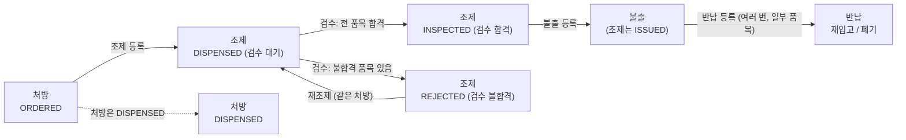
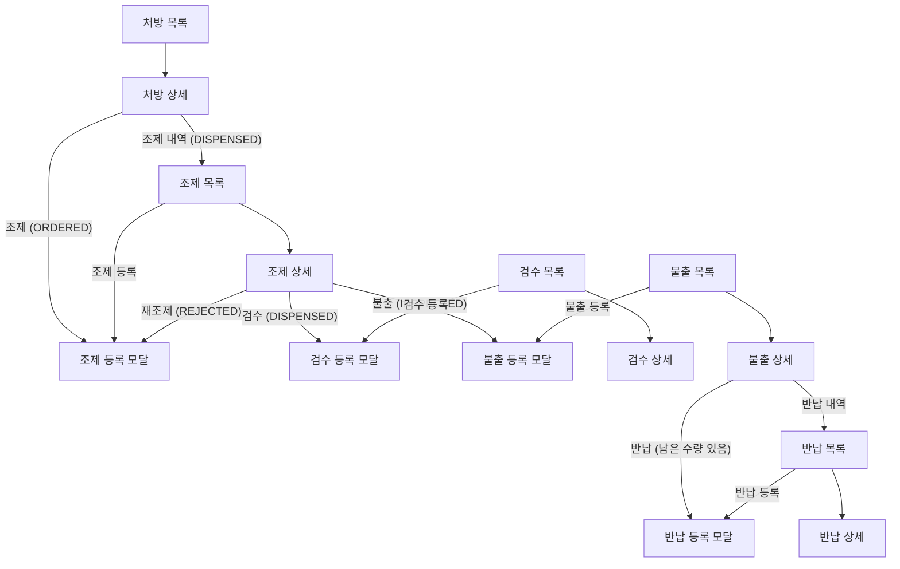
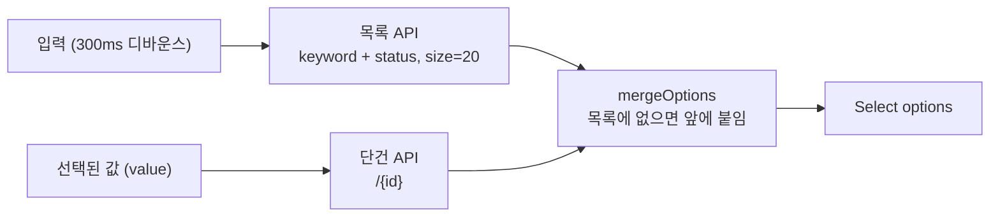
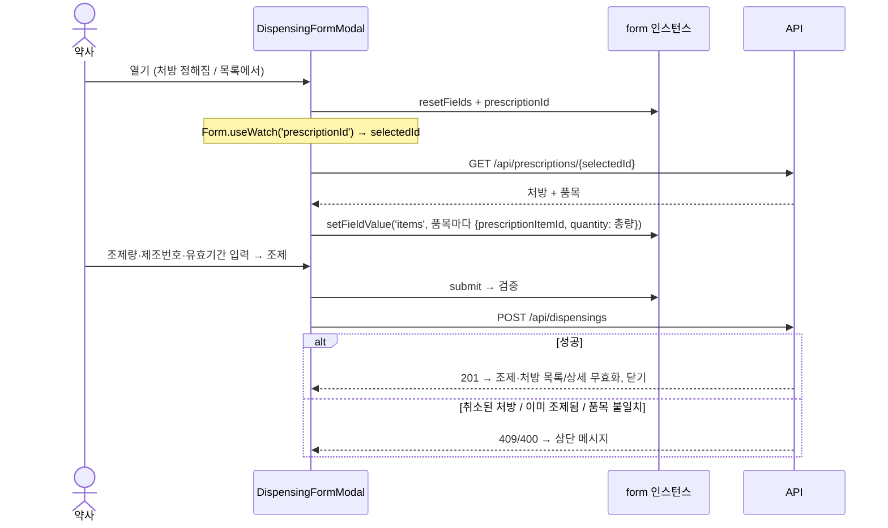
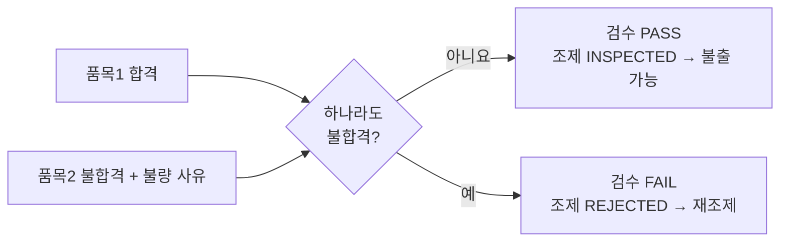

# 약제 업무 프로그램 설명서 (조제 · 검수 · 불출 · 반납)

> 처방 화면은 [처방 프로그램 설명서](prescription-program-spec.md), 코드 읽는 법은 [목록](prescription-list-page-study.md) · [상세](prescription-detail-drawer-study.md) · [등록](prescription-form-modal-study.md) 해설과 [React 훅](react-hooks-study.md)에 있다.
> 이 문서는 처방 다음 네 단계의 화면 구성, 흐름, 업무 규칙, 함수와 **처방 화면에 없던 새 기법**을 설명한다.
> 백엔드(API·테이블)는 13단계에 이미 있었고, 이번 작업은 화면이다. 업무 규칙의 원본은 `docs/design.md` 13단계다.

---

## 1. 전체 구성

### 1.1 업무 흐름과 상태



| 단계 | 앞 단계에서 고르는 것 | 입력 | 결과 |
|---|---|---|---|
| 조제 | 조제 전(ORDERED) 처방 | 품목마다 조제량·제조번호·유효기간 | 조제 DISPENSED, 처방 DISPENSED |
| 검수 | 검수 대기(DISPENSED) 조제 | 품목마다 합격/불합격, 불합격이면 불량 사유 | 조제 INSPECTED 또는 REJECTED |
| 불출 | 검수 합격(INSPECTED) 조제 | 불출처 코드·이름, 수령자 (품목 입력 없음) | 불출 생성, 조제 ISSUED |
| 반납 | 불출 | 반납 사유, 반납할 품목의 수량·처리 방법 | 반납 생성, 불출 품목의 반납 합계 증가 |

### 1.2 파일 목록

```
frontend/src/features/
├── pharmacy/                     약제 공용 (새로 만듦)
│   ├── pharmacyFields.ts         코드표(조제 상태·검수 결과·반납 처리), pickCode/pickDate/pickId, 수량 함수
│   ├── pharmacyParts.tsx         codeTag(코드값 → 색 태그), DateRangeFilter(기간 입력)
│   └── PharmacySelects.tsx       PrescriptionSelect · DispensingSelect · IssueSelect (앞 단계 기록 서버 검색)
├── dispensings/                  조제 /dispensings
│   ├── dispensingFields.ts       생성 타입 별칭
│   ├── DispensingListPage.tsx    목록 (keyword·status·기간·prescriptionId)
│   ├── DispensingDetailDrawer.tsx 상세 + 다음 단계 버튼 (검수 · 불출 · 재조제)
│   └── DispensingFormModal.tsx   조제 등록
├── inspections/                  검수 /inspections
│   ├── inspectionFields.ts
│   ├── InspectionListPage.tsx    목록 (keyword·result·기간)
│   ├── InspectionDetailDrawer.tsx 상세 (버튼 없음)
│   └── InspectionFormModal.tsx   검수 등록
├── issues/                       불출 /issues
│   ├── issueFields.ts
│   ├── IssueListPage.tsx         목록 (keyword·destinationCode·기간)
│   ├── IssueDetailDrawer.tsx     상세 + 반납 · 반납 내역
│   └── IssueFormModal.tsx        불출 등록
├── returns/                      반납 /returns
│   ├── returnFields.ts           생성 타입 별칭 + 폼 값 타입 ReturnFormValues
│   ├── ReturnListPage.tsx        목록 (keyword·기간·issueId)
│   ├── ReturnDetailDrawer.tsx    상세 (버튼 없음)
│   └── ReturnFormModal.tsx       반납 등록
└── prescriptions/
    ├── PrescriptionDetailDrawer.tsx  (수정) "조제" · "조제 내역" 버튼 추가
    └── prescriptionFields.ts         (수정) formatQuantity를 공용 모듈에서 다시 내보냄

frontend/src/layouts/screens.tsx  (수정) 네 경로를 PAGES에 등록
frontend/src/index.css            (수정) .item-header, .item-source (등록 모달 품목 줄)
```

### 1.3 화면 연결 (어디서 무엇이 열리나)



- **등록 모달은 두 곳에서 열린다.**
  - 목록의 "○○ 등록": 대상이 없으므로 모달 안의 선택 박스로 앞 단계 기록을 고른다.
  - 앞 단계 상세의 버튼: 대상이 정해져 있어 선택 박스가 잠긴다.
  - 그래서 모달은 `prescriptionId | dispensingId | issueId: number | null`을 받는다.
- **다음 단계 버튼은 상태와 권한이 모두 맞을 때만 보인다**(`can(다음 메뉴, 'create')`). 최종 검사는 서버가 한다.

### 1.4 API

| 화면 동작 | API | 비고 |
|---|---|---|
| 조제 목록 | `GET /api/dispensings?keyword&status&from&to&prescriptionId` | |
| 조제 상세 | `GET /api/dispensings/{id}` | 품목에 처방량·조제량 |
| 조제 등록 | `POST /api/dispensings` | `{prescriptionId, remark, items:[{prescriptionItemId, quantity, lotNo, expiryDate}]}` |
| 검수 목록 · 상세 · 등록 | `GET /api/inspections`, `GET /api/inspections/{id}`, `POST /api/inspections` | `{dispensingId, remark, items:[{dispensingItemId, result, defectReason}]}` |
| 불출 목록 · 상세 · 등록 | `GET /api/issues`, `GET /api/issues/{id}`, `POST /api/issues` | 등록에 품목 없음. 상세 품목에 `returnedQuantity` |
| 반납 목록 · 상세 · 등록 | `GET /api/returns`, `GET /api/returns/{id}`, `POST /api/returns` | `{issueId, reason, remark, items:[{issueItemId, quantity, disposition}]}` |
| 선택 박스 검색 | 위 목록 API + `size=20` | 처방은 `status=ORDERED`, 조제는 `status=DISPENSED/INSPECTED` |

권한은 메뉴 `/dispensings`, `/inspections`, `/issues`, `/returns`의 조회·등록이다(`ApiPermissionRules`). USER 기본 권한은 조회만이다.

---

## 2. 공용 모듈 (`features/pharmacy`)

네 화면이 같은 모양이라 반복되는 것을 모았다. 처방 목록(`PrescriptionListPage`)은 학습 문서가 그 파일의 줄을 설명하고 있어 그대로 두었다(같은 `pickCode`/`pickDate`가 파일 안에 있다).

### 2.1 `pharmacyFields.ts`

| 이름 | 설명 |
|---|---|
| `DispensingStatus`, `InspectionResult`, `ReturnDisposition` | 생성 타입에서 꺼낸 문자열 유니언 (`NonNullable<...['status']>`) |
| `DISPENSING_STATUSES` | DISPENSED 검수 대기 · INSPECTED 검수 합격 · REJECTED 검수 불합격 · ISSUED 불출됨 |
| `INSPECTION_RESULTS` | PASS 합격 · FAIL 불합격 |
| `RETURN_DISPOSITIONS` | RESTOCK 재입고 · DISPOSE 폐기 |
| `optionsOf(table)` | 코드표 → 선택 박스 항목 `{value, label}[]`. 반환 타입이 `{ value: T }`라 Radio·Select 값도 유니언 타입이 된다 |
| `pickCode(value, table)` | 주소의 문자열이 코드표의 키면 그 값, 아니면 `undefined` |
| `pickDate(value)` | `yyyy-MM-dd` 형식이면 그 값 |
| `pickId(value)` | 양의 정수면 숫자. `?issueId=abc`를 그대로 보내면 서버가 400을 주므로 거른다 |
| `formatQuantity(n)` | `9` → `9`, `1.5` → `1.5`, `undefined` → `-` (처방 화면도 다시 내보내 쓴다) |
| `subtractQuantity(a, b)` | `a − b`를 소수 3자리로 반올림. `0.3 − 0.1 = 0.19999…` 같은 부동소수점 오차 제거 (반납 가능 수량) |
| `trimToUndefined(s)` | 앞뒤 공백을 떼고 비면 `undefined` (선택 입력 정리) |

### 2.2 `pharmacyParts.tsx`

| 이름 | 설명 |
|---|---|
| `codeTag(table, value)` | 값이 있으면 `<Tag color label>`, 없으면 `-`. 목록 열·상세에 같은 모양 |
| `DateRangeFilter({ from, to, label, onChange })` | 시작일 ~ 종료일 입력. `max={to}`/`min={from}`으로 거꾸로 고르지 못하게 하고, 바뀐 쪽만 `onChange({ from })`로 알린다. 목록의 `updateFilter`를 그대로 넘길 수 있다 |

### 2.3 `PharmacySelects.tsx` — 앞 단계 기록 선택



| 이름 | 설명 |
|---|---|
| `PrescriptionSelect` | 조제 전(ORDERED) 처방. 라벨 `처방전번호 · 환자명 (환자번호)` |
| `DispensingSelect({ status })` | 검수 등록은 `DISPENSED`, 불출 등록은 `INSPECTED`. 라벨에 조제 일시 |
| `IssueSelect` | 불출. 라벨 `처방전번호 · 환자명 → 불출처` |
| `SearchSelect` | 세 선택 박스가 함께 쓰는 Ant Design `Select` 모양 (`showSearch={{ filterOption: false, onSearch }}`) |
| `mergeOptions(listed, selected)` | 상세에서 대상을 정해 열면 검색 결과에 그 대상이 없을 수 있다(예: 재조제할 처방은 ORDERED가 아니다). 단건 조회 결과를 앞에 붙여 라벨이 보이게 한다 |

- `disabled`(대상이 정해진 경우)이면 목록 검색을 하지 않는다(`enabled: !disabled`).
- 단건 조회는 등록 모달의 조회와 **같은 쿼리 키**(`/api/dispensings/{id}` 등)라 요청이 한 번만 나간다.
- `Form.Item` 안에 두므로 `value`/`onChange` props를 받기만 하면 폼과 연결된다.

---

## 3. 조제

### 3.1 등록 흐름



### 3.2 규칙 (화면 = 서버)

| 규칙 | 화면 | 서버 |
|---|---|---|
| 처방 품목마다 정확히 한 줄 | 줄을 처방 품목에서 만들고 추가·삭제 버튼이 없다 | `INVALID_DISPENSING_ITEMS` (400) |
| 조제량 > 0, 소수 3자리 | `InputNumber min={0.001}`, 필수 | `@DecimalMin(0, 제외) @Digits(9,3)` |
| 제조번호 50자, 유효기간 선택 | `max: 50`, `type="date"` | `@Size(max=50)`, `LocalDate` |
| 취소된 처방 불가 | 안내 + 조제 버튼 꺼짐 | `PRESCRIPTION_CANCELLED` (409) |
| 이미 조제된 처방(불합격 아님) 불가 | 처방 선택 박스는 ORDERED만 | `DISPENSING_ALREADY_EXISTS` (409) |
| 재조제 | 조제 상세(REJECTED)의 "재조제" → 같은 처방으로 모달 | 불합격 조제만 있으면 허용 |

### 3.3 함수

| 이름 | 설명 |
|---|---|
| `DispensingListPage` | 처방 목록과 같은 골격. `prescriptionId` 조건이 있으면 닫을 수 있는 Tag로 보여준다(처방 상세 "조제 내역"에서 들어온 경우) |
| `DispensingDetailDrawer` | 상세 + 품목(처방량·조제량·제조번호·유효기간). 다음 단계 모달 세 개를 `nextStep` state 하나로 연다 |
| `NextStep` 타입 | `'inspect' \| 'issue' \| 'redispense' \| null`. 모달마다 boolean을 두면 "둘이 동시에 열림" 같은 불가능한 상태가 생긴다 |
| `DispensingFormModal` | 처방 선택 → 품목 줄 생성 → 등록. `okButtonProps.disabled`로 처방이 없거나 취소된 처방이면 버튼을 끈다 |
| `handleFinish` | 비고·제조번호 `trimToUndefined`, 빈 유효기간(`''`) → `undefined` |
| 무효화 | `/api/dispensings`, `/api/dispensings/{id}`, `/api/prescriptions`, `/api/prescriptions/{id}` (처방 상태가 바뀐다) |

---

## 4. 검수

### 4.1 품목별 결과와 전체 결과



- 줄의 처음 값은 **합격**이다. 대부분 합격이라 불합격만 고치면 된다.
- 모달 아래에 저장될 전체 결과를 **미리** 보여준다(`failCount`).

### 4.2 규칙

| 규칙 | 화면 | 서버 |
|---|---|---|
| 조제 품목마다 정확히 한 줄 | 줄을 조제 품목에서 생성 | `INVALID_INSPECTION_ITEMS` |
| 검수 대기 조제만 | 선택 박스 `status=DISPENSED`, 아니면 안내 + 버튼 꺼짐 | `DISPENSING_NOT_INSPECTABLE` (409) |
| 불합격이면 불량 사유 필수 (500자) | 의존 검증(4.3) | `DEFECT_REASON_REQUIRED` (400) |
| 합격 품목의 불량 사유는 무시 | 보낼 때 `undefined`로 | 서버도 무시 |

### 4.3 새 기법: 다른 칸에 따라 달라지는 검증 (`dependencies`)

```tsx
<Form.Item
    name={[field.name, 'defectReason']}
    dependencies={[['items', field.name, 'result']]}
    rules={[
        { max: 500 },
        ({ getFieldValue }) => ({
            validator: async (_, value?: string) => {
                const result = getFieldValue(['items', field.name, 'result'])
                if (result === 'FAIL' && !value?.trim()) {
                    throw new Error('불합격 품목은 불량 사유를 입력하세요.')
                }
            },
        }),
    ]}
>
```
- **함수형 규칙** `({ getFieldValue }) => ({ validator })`: 규칙 안에서 폼의 다른 값을 읽을 수 있다.
- **`dependencies`**: 나열한 칸이 바뀌면 이 칸을 다시 검사한다. 결과를 "불합격 → 합격"으로 바꾸면 불량 사유 칸의 빨간 오류가 바로 사라진다.
- `Form.List` 안에서는 `name`은 줄 기준 상대 경로(`[field.name, 'defectReason']`)지만, `dependencies`와 `getFieldValue`는 **폼 전체 기준 경로**(`['items', field.name, 'result']`)를 쓴다.

### 4.4 새 기법: 입력 중인 값을 화면에 쓰기 (`Form.useWatch`)

```tsx
const watchedItems = Form.useWatch('items', form)
const failed = watchedItems?.[index]?.result === 'FAIL'       // 불량 사유 칸 켜기/끄기
const failCount = (watchedItems ?? []).filter((item) => item?.result === 'FAIL').length
```
- Ant Design Form은 입력할 때 컴포넌트 전체를 다시 그리지 않는다([등록 모달 해설 2.1](prescription-form-modal-study.md)). 입력값으로 **다른 부분의 화면**을 바꾸려면 `useWatch`로 구독한다. 값이 바뀌면 이 컴포넌트가 다시 렌더링된다.
- 처음 렌더링에는 `undefined`일 수 있어 `?.`와 `?? []`로 받는다.
- 네 등록 모달 모두 `Form.useWatch('prescriptionId' | 'dispensingId' | 'issueId', form)`로 고른 대상을 지켜보고, 그 값을 조회 키에 넣는다. **선택 → 다시 렌더링 → 새 쿼리 키 → 조회**가 이어진다.

### 4.5 함수

| 이름 | 설명 |
|---|---|
| `InspectionListPage` | 결과(합격/불합격) 필터 |
| `InspectionDetailDrawer` | 품목별 결과·불량 사유. 버튼 없음(다음 단계는 조제 상세에서). 결과에 따라 "불출 가능 / 재조제 필요" 안내 |
| `InspectionFormModal` | 조제 선택 → 결과 줄 → 등록. 결과는 `Radio.Group optionType="button"` |
| 무효화 | `/api/inspections`, `/api/inspections/{id}`, `/api/dispensings`, `/api/dispensings/{id}` |

---

## 5. 불출

### 5.1 규칙

| 규칙 | 화면 | 서버 |
|---|---|---|
| 검수 합격 조제만 | 선택 박스 `status=INSPECTED`, 아니면 안내 + 버튼 꺼짐 | `DISPENSING_NOT_ISSUABLE` (409) |
| 품목은 조제 품목 그대로 | 입력 없음, 미리보기 표만 | 요청에 품목 없음 |
| 불출처 코드 20자, 이름·수령자 100자 필수 | `required` + `whitespace` + `max` | `@NotBlank @Size` |
| 불출처 코드는 대문자 | 입력 그대로 보낸다 (`w71`도 됨) | 저장·검색 시 대문자로 (`W71`) |

### 5.2 함수

| 이름 | 설명 |
|---|---|
| `IssueListPage` | 불출처 코드 필터는 `Input.Search`(정확히 일치, 서버가 대문자로 맞춤). 검색어 칸과 마찬가지로 `key`로 주소 변경을 반영 |
| `IssueDetailDrawer` | 품목에 불출량 · 반납량 · **반납 가능**(`subtractQuantity`). 남은 수량이 있고 반납 등록 권한이 있으면 "반납", 반납 조회 권한이 있으면 "반납 내역" |
| "반납 내역" | `onClose()` 후 `navigate('/returns?issueId=…')`. 화면 탭 구조라 반납 탭이 그 조건으로 열린다 |
| `IssueFormModal` | 조제 선택 → 불출처·수령자 입력 → 등록. 아래 표는 `dispensing.items`를 그대로 보여주는 미리보기 |
| 무효화 | `/api/issues`, `/api/issues/{id}`, `/api/dispensings`, `/api/dispensings/{id}` (조제가 ISSUED) |

---

## 6. 반납

### 6.1 수량 계산

```
반납 가능 = 불출량 − 지금까지 반납 합계(returnedQuantity)
```

| 예 | 불출량 | 반납 합계 | 반납 가능 | 이번에 넣을 수 있는 값 |
|---|---|---|---|---|
| 처음 | 3 | 0 | 3 | 0 ~ 3 |
| 1.5 반납 뒤 | 3 | 1.5 | 1.5 | 0 ~ 1.5 |
| 전부 반납 | 3 | 3 | 0 | 칸이 꺼짐("모두 반납됨") |

### 6.2 규칙

| 규칙 | 화면 | 서버 |
|---|---|---|
| 일부 품목만 반납 가능, 여러 번 가능 | 줄은 불출 품목 전부, **반납량을 넣은 줄만 보낸다** | 품목 부분 집합 (`requireSubset`) |
| 하나 이상 반납 | `Form.List` validator: 반납량 > 0인 줄이 있어야 | `@NotEmpty` |
| 반납 합계 ≤ 불출량 | `InputNumber max` + 줄 validator | `RETURN_QUANTITY_EXCEEDED` (409) |
| 같은 품목 두 번 불가 | 품목마다 한 줄이라 생기지 않음 | `INVALID_RETURN_ITEMS` (400) |
| 반납 사유 필수 500자, 처리 방법 필수 | `required` | `@NotBlank`, `@NotNull` |

- 두 사람이 동시에 같은 품목을 반납하면 둘 다 한도 검사를 통과할 수 있다(서버에 잠금 없음, `docs/design.md`). 화면의 한도는 **모달을 연 시점**의 값이다.

### 6.3 새 기법: 폼 값 타입 ≠ 요청 타입

```ts
// returnFields.ts
export interface ReturnFormValues {
    issueId: number
    reason: string
    remark?: string
    items: { issueItemId: number; quantity?: number | null; disposition: ReturnDisposition }[]
}
```
- 다른 모달은 `Form.useForm<요청 DTO>()`로 폼과 요청이 같은 모양이다. 반납은 화면에 **모든 품목**을 두고 일부만 보내므로, 반납량이 빈 줄(`null`, `InputNumber`를 비운 값)이 있다. 요청 타입 `quantity: number`(필수)로는 이 상태를 표현할 수 없다.
- 그래서 폼 전용 타입을 따로 두고 `handleFinish`에서 요청으로 **변환**한다.
  ```ts
  items: values.items
      .filter((item) => (item.quantity ?? 0) > 0)
      .map((item) => ({ issueItemId: item.issueItemId, quantity: item.quantity as number, disposition: item.disposition }))
  ```
- 같은 이유로 서버의 `fieldErrors` 경로(`items[0]` = **보낸** 첫 줄)는 화면 줄 위치와 다를 수 있다. 이 모달은 `applyFieldErrors`를 쓰지 않고 상단 메시지로 보여준다(같은 검사를 화면 규칙이 먼저 한다).

### 6.4 함수

| 이름 | 설명 |
|---|---|
| `ReturnListPage` | `issueId` 조건(불출 상세 "반납 내역")을 Tag로 보여준다 |
| `ReturnDetailDrawer` | 불출량 · 반납량 · 처리(재입고/폐기). 버튼 없음 |
| `ReturnFormModal` | 불출 선택 → 품목 줄(반납량 비움, 처리 재입고) → 등록 |
| 무효화 | `/api/returns`, `/api/returns/{id}`, `/api/issues`, `/api/issues/{id}` (반납 합계가 바뀐다) |

---

## 7. 네 등록 모달의 공통 구조

| 순서 | 코드 | 설명 |
|---|---|---|
| 1 | `Form.useForm<T>()`, `$api.useMutation('post', …)` | 폼 인스턴스, 등록 요청 |
| 2 | `const selectedId = Form.useWatch('xxxId', form)` | 고른 앞 단계 기록 |
| 3 | `$api.useQuery('get', '/api/…/{id}', …, { enabled: open && selectedId !== undefined })` | 앞 단계 상세(품목) |
| 4 | `useEffect([open, xxxId])` → `resetFields()` + `setFieldsValue({ xxxId })` | 열 때 초기화 |
| 5 | `useEffect([open, 상세 데이터])` → `setFieldValue('items', 품목마다 한 줄)` | 품목이 오면 줄 생성 (불출은 없음) |
| 6 | `Form.Item name="xxxId"` + `XxxSelect disabled={xxxId !== null}` | 대상 선택 / 잠금 |
| 7 | `Form.List name="items"` + `sourceItems[index]` | 줄마다 앞 단계 품목 정보(읽기 전용) + 입력 칸 |
| 8 | `<Form.Item name={[field.name, 'xxxItemId']} hidden>` | 보이지 않는 칸: 요청에 넣을 품목 ID |
| 9 | `okButtonProps={{ disabled: !진행가능 }}` | 상태가 맞지 않으면 저장 버튼 꺼짐 |
| 10 | `handleFinish` → `mutate` → `onSuccess`(알림·무효화·닫기) / `onError` | |

### 7.1 새 기법: 서버 데이터로 `Form.List` 줄 만들기

처방 등록은 사용자가 "품목 추가"로 줄을 늘렸지만, 조제·검수·반납은 **앞 단계 품목 수만큼** 줄이 정해진다.

```tsx
useEffect(() => {
    if (!open || !prescription) return
    form.setFieldValue('items', (prescription.items ?? []).map((item) => ({
        prescriptionItemId: item.id,
        quantity: item.totalQuantity,
    })))
}, [open, prescription, form])
```
- 줄을 처방 품목 **순서대로** 만들었으므로 렌더링에서 `sourceItems[index]`가 그 줄의 대상 품목이다. 줄을 더하거나 빼지 않으므로(추가·삭제 버튼 없음) 위치가 어긋나지 않는다.
- 의존값에 `prescription`(조회 결과 객체)을 넣었다. TanStack Query는 다시 조회해도 내용이 같으면 **같은 객체**를 돌려주므로(structural sharing) 창을 다시 볼 때마다 입력이 지워지지 않는다. 다른 처방을 고르면 새 객체라 줄을 다시 만든다.
- 다른 처방으로 바꾸는 동안에는 새 데이터가 없어 `prescription`이 `undefined`이므로 저장 버튼이 꺼진다. 이전 처방의 줄로 저장되는 일이 없다.

### 7.2 보이지 않는 칸 (`hidden`)

```tsx
<Form.Item name={[field.name, 'prescriptionItemId']} hidden>
    <Input />
</Form.Item>
```
- 화면에는 없지만 폼 값에 남아 `onFinish(values)`에 들어간다. 줄과 대상 품목 ID를 함께 들고 다니는 방법이다.

---

## 8. 오류 처리 정리

| 오류 | 언제 | 화면 |
|---|---|---|
| 화면 규칙 위반 | 저장 전 | 칸 아래 빨간 문구, 목록 오류는 `Form.ErrorList` |
| `fieldErrors` (400 `INVALID_INPUT`) | 서버 Bean Validation | 조제·검수·불출: `applyFieldErrors`로 해당 칸 / 반납: 상단 메시지 |
| 상태 오류 (409 `PRESCRIPTION_CANCELLED`, `DISPENSING_ALREADY_EXISTS`, `DISPENSING_NOT_INSPECTABLE`, `DISPENSING_NOT_ISSUABLE`) | 다른 사람이 먼저 처리 | 상단 `message.error` (모달은 열린 채) |
| 품목 오류 (400 `INVALID_*_ITEMS`, `DEFECT_REASON_REQUIRED`) | 화면 규칙을 우회한 경우 | 상단 메시지 |
| 수량 초과 (409 `RETURN_QUANTITY_EXCEEDED`) | 동시에 반납 등 | 상단 메시지 |
| 목록·상세 조회 실패 | | `Alert` |

---

## 9. 확인한 것

- `npm run typecheck`, `npm run build` 통과.
- 로컬 백엔드(Oracle)에 개발 서버 프록시(5173)로, 화면이 보내는 것과 같은 본문으로 전체 흐름을 호출했다.
  - 처방 등록 → 조제 → 검수 **불합격**(조제 REJECTED) → 재조제 → 검수 합격 → 불출(조제 ISSUED, 불출처 `w71` → `W71`) → 반납 1.5 → 반납 1.5 + 0.3 → 추가 반납 시 `RETURN_QUANTITY_EXCEEDED`.
  - 이미 조제된 처방 재조제 시 `DISPENSING_ALREADY_EXISTS`.
  - 선택 박스 검색(`keyword` 앞부분 + `status`), `prescriptionId`/`issueId`/`destinationCode` 필터.
  - `?issueId=abc`를 그대로 보내면 400이다. `pickId`가 이런 값을 조건에서 뺀다.
- 브라우저 화면 조작(클릭·입력)은 이번에 직접 확인하지 못했다.

## 10. 메뉴

기본 메뉴(`MenuInitializer`)에는 약제 아래 처방·조제·검수·불출·반납이 모두 있다. 단, **메뉴가 이미 있는 DB에는 새로 만들지 않는다.** 그런 DB에서는 메뉴 관리(`/menus`)에서 약제 아래에 다음 경로로 하위 메뉴를 추가한다.

| 이름 | 경로 | 아이콘(기본 메뉴 기준) |
|---|---|---|
| 조제 | `/dispensings` | appstore |
| 검수 | `/inspections` | file-search |
| 불출 | `/issues` | folder |
| 반납 | `/returns` | history |

경로는 권한의 이름이다(`MenuPaths`). 다른 경로로 만들면 API 권한 규칙과 이어지지 않는다.
