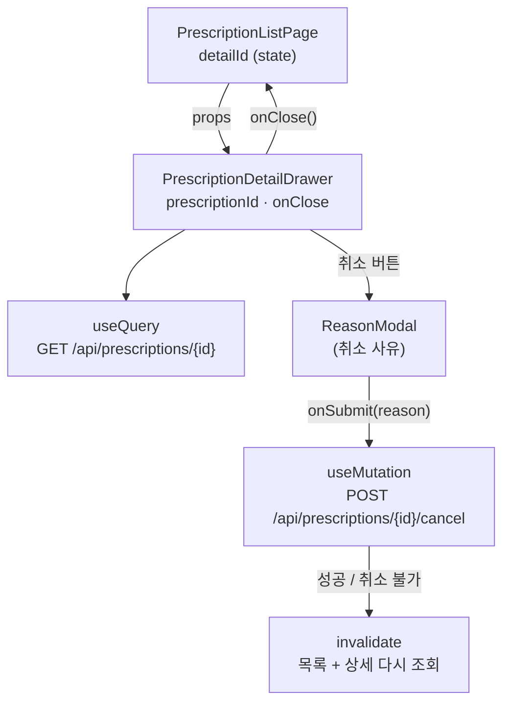
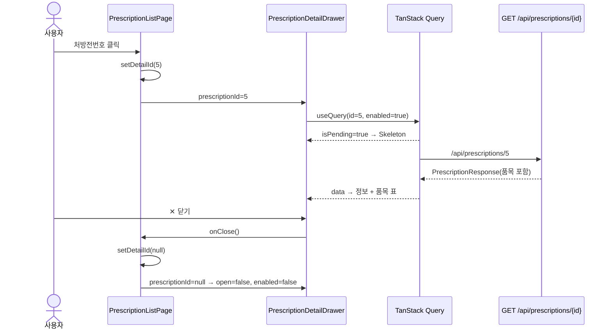
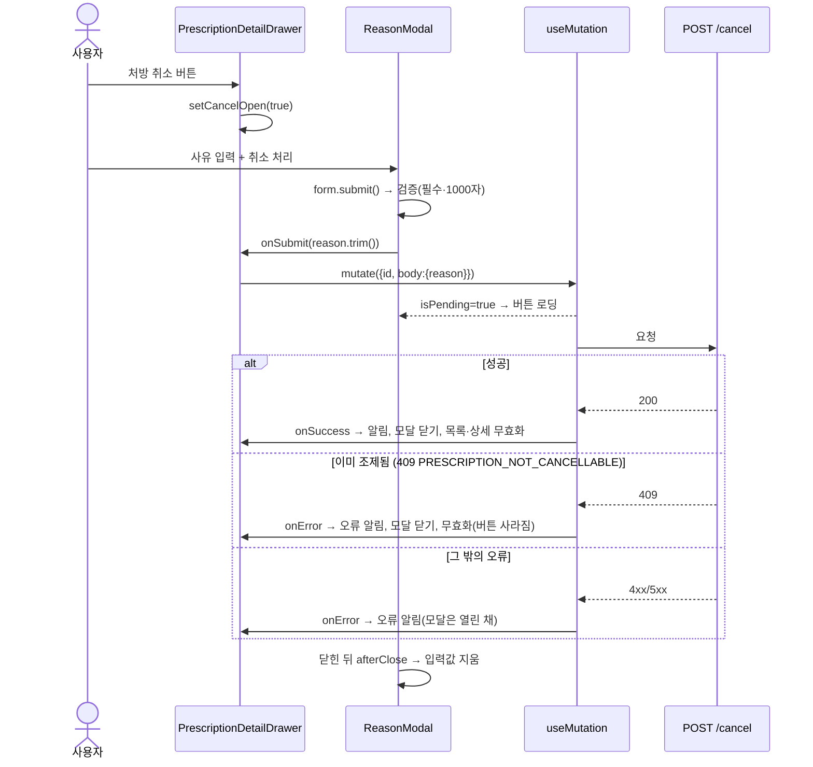

# PrescriptionDetailDrawer 해설 (React · TypeScript 학습용)

> 대상 파일: `frontend/src/features/prescriptions/PrescriptionDetailDrawer.tsx`
> 함께 보는 파일: `prescriptionFields.ts`, `components/ReasonModal.tsx`, `hooks/useInvalidateApi.ts`, `api/errors.ts`
> 관련 문서: [목록 화면 해설](prescription-list-page-study.md)(기본 문법은 여기서 설명했다) · [등록 모달 해설](prescription-form-modal-study.md) · [처방 프로그램 설명서](prescription-program-spec.md) · 개념: [React 훅](react-hooks-study.md)
>
> **이후 변경(17단계):** 이 해설을 쓴 뒤 다음 단계(조제)로 가는 "조제" · "조제 내역" 버튼이 추가됐다(`useNavigate`, `dispenseOpen` state, `DispensingFormModal`, 제목 줄 `extra`가 `<Space>`로 감싸짐). 그래서 아래 줄 번호는 import 이후부터 몇 줄씩 밀려 있다. 추가된 부분은 [약제 업무 프로그램 설명서](pharmacy-workflow-program-spec.md) 1.3에서 설명한다.

---

## 0. 한눈에 보기

목록에서 처방전번호를 누르면 오른쪽에서 열리는 드로어다. 하는 일은 두 가지다.

1. **조회:** 단건 API(`GET /api/prescriptions/{id}`)로 처방 정보와 품목을 불러와 보여준다.
2. **취소:** 권한이 있고 아직 조제 전이면 "처방 취소" 버튼을 보여주고, 사유를 받아 `POST /api/prescriptions/{id}/cancel`을 호출한다.



**목록 행의 데이터를 넘겨받지 않고 ID만 받는다.** 목록 응답(`PrescriptionSummaryResponse`)에는 품목이 없고, 목록을 연 뒤 다른 사람이 상태를 바꿨을 수도 있기 때문이다. 상세는 항상 서버에서 최신 값을 받는다.

| 줄 | 덩어리 |
|---|---|
| 1–14 | import |
| 16–20 | props 타입 |
| 22–39 | 품목 표 열 정의(모듈 상수) |
| 42–85 | 컴포넌트 본문: 조회, 권한, 취소 처리 |
| 87–181 | JSX: 드로어 → (로딩 / 오류 / 내용) + 취소 사유 모달 |

---

## 1. 한 줄씩 해설

### 1.1 import (1–14줄)

```tsx
import { Alert, App, Button, Descriptions, Drawer, Skeleton, Table, Tag, Typography, type TableColumnsType } from 'antd'
```
| 컴포넌트 | 용도 |
|---|---|
| `Drawer` | 화면 옆에서 밀려 나오는 패널 |
| `Descriptions` | "라벨: 값" 칸을 표처럼 늘어놓는 정보 표시 |
| `Skeleton` | 불러오는 동안 회색 막대로 자리를 채우는 로딩 표시 |
| `App` | `App.useApp()`으로 `message`·`modal`·`notification`을 꺼낸다 |
| `Table`, `Tag`, `Alert`, `Button`, `Typography` | 목록 화면과 같다 |

```tsx
import { errorMessage, isApiError } from '@/api/errors'
```
- `isApiError(value)`: 값이 백엔드 오류 응답(`{ code, message, fieldErrors }`)인지 검사하는 **타입 가드**(2.5 참고).

```tsx
import { ReasonModal } from '@/components/ReasonModal'
import { useInvalidateApi } from '@/hooks/useInvalidateApi'
```
- `ReasonModal`: 사유 한 줄만 받는 공용 모달. 신청 사유·반려 의견에도 쓴다.
- `useInvalidateApi`: 조회 캐시를 무효화해 다시 불러오게 하는 함수를 돌려주는 훅.

```tsx
import { PRESCRIPTION_STATUSES, PRESCRIPTION_TYPES, formatQuantity, type PrescriptionItemResponse } from './prescriptionFields'
```
- `formatQuantity(30)` → `'30'`, `formatQuantity(1.5)` → `'1.5'`, `formatQuantity(12345.678)` → `'12,345.678'`, `undefined` → `'-'`.
  서버는 수량을 소수 3자리(`30.000`)로 주지만 화면에는 필요한 자리만 보여준다(`toLocaleString`의 `maximumFractionDigits: 3`).

### 1.2 props 타입 (16–20줄)

```tsx
interface PrescriptionDetailDrawerProps {
    /** 보여줄 처방 ID. null이면 닫힌다 */
    prescriptionId: number | null
    onClose: () => void
}
```
- `interface`: 객체의 모양(속성 이름과 타입)을 정의한다. 컴포넌트 props 타입은 보통 `컴포넌트명Props`로 짓는다.
- `prescriptionId: number | null`: **열림 여부와 대상을 값 하나로 표현한다.** `open: boolean` + `id: number`를 따로 두면 "열렸는데 ID가 없음" 같은 말이 안 되는 상태가 생길 수 있다.
  - `undefined`가 아니라 `null`을 쓴 이유: "값이 아직 없음"이 아니라 "일부러 비워 둠(닫힘)"을 뜻한다. 부모(`useState<number | null>(null)`)와 맞춘다.
- `onClose: () => void`: 매개변수가 없고 반환값을 쓰지 않는 함수 타입. 자식은 "닫아 달라"고 알리기만 하고, 실제로 닫는 것(`setDetailId(null)`)은 부모가 한다.

### 1.3 품목 표 열 (22–39줄)

```tsx
/** 품목 표의 열. props나 state를 쓰지 않으므로 컴포넌트 밖에 둔다. */
const ITEM_COLUMNS: TableColumnsType<PrescriptionItemResponse> = [
```
- 목록 화면의 `columns`는 `setDetailId`(state)를 쓰므로 컴포넌트 **안**에 있어야 했다. 여기 열은 props·state를 쓰지 않으니 **밖**에 둔다. 렌더링마다 배열을 새로 만들지 않는다.
- 이름을 대문자 `SNAKE_CASE`로 지어 "모듈 상수"임을 드러낸다.

```tsx
{ title: '순번', dataIndex: 'lineNo', width: 60, align: 'center' },
{ title: '약품코드', dataIndex: 'drugCode', width: 110, render: (value: string) => <span className="mono">{value}</span> },
{ title: '약품명', dataIndex: 'drugName', ellipsis: true },
```
- `ellipsis: true`: 칸보다 긴 글자는 `…`로 줄인다. 폭(`width`)이 없는 열은 남은 폭을 차지한다.

```tsx
{
    title: '1회량',
    key: 'dose',
    width: 100,
    align: 'right',
    render: (_, item) => `${formatQuantity(item.dose)} ${item.doseUnit ?? ''}`,
},
```
- **`dataIndex` 대신 `key`:** 한 칸에 두 필드(`dose` + `doseUnit`)를 합쳐 보여주므로 특정 필드를 가리키지 않는다. 그래도 React가 열을 구분할 이름이 필요해 `key`를 준다.
- `(_, item)`: 첫 번째 매개변수(`value`)를 쓰지 않는다는 표시로 `_`라고 짓는다. 두 번째가 행 전체.
- 결과 예: `1.5 TAB`. 단위가 없으면 `1.5 `(뒤 공백은 화면에서 보이지 않는다).
- `align: 'right'`: 숫자는 오른쪽 정렬해 자릿수를 맞춘다.

```tsx
{ title: '총량', key: 'totalQuantity', width: 90, align: 'right', render: (_, item) => formatQuantity(item.totalQuantity) },
```
- 숫자 하나지만 `formatQuantity`로 바꿔야 해서 `render`를 쓴다.

### 1.4 컴포넌트 선언 (41–43줄)

```tsx
export function PrescriptionDetailDrawer({ prescriptionId, onClose }: PrescriptionDetailDrawerProps) {
    const open = prescriptionId !== null
```
- 매개변수 자리에서 props 객체를 **구조 분해**한다. `props.prescriptionId` 대신 `prescriptionId`로 쓴다.
- `open`은 state가 아니라 props에서 **계산한 값**이다. 따로 `useState`에 두면 props와 어긋날 수 있다. "계산할 수 있는 값은 state에 두지 않는다"가 React의 기본 원칙이다.

### 1.5 단건 조회 (45–51줄)

```tsx
const detailQuery = $api.useQuery(
    'get',
    '/api/prescriptions/{id}',
    { params: { path: { id: prescriptionId ?? 0 } } },
    { enabled: open },
)
const prescription = detailQuery.data
```
- 경로의 `{id}`는 **경로 파라미터**라 `params.path`로 넘긴다(목록의 `params.query`와 다르다). openapi-fetch가 `/api/prescriptions/5`로 바꿔 부른다.
- **`prescriptionId ?? 0`와 `enabled: open`은 짝이다.**
  - 훅은 조건문 안에서 부를 수 없으므로(훅 규칙), 드로어가 닫혀 있어도 `useQuery`는 매번 불린다.
  - 그런데 `id` 타입은 `number`라 `null`을 넣을 수 없다. 그래서 자리만 채우는 값 `0`을 넣고,
  - `enabled: false`로 **실제 요청은 보내지 않게** 한다. `0`으로 요청이 나가는 일은 없다.
- `prescription`: 이름을 짧게 붙여 둔 별칭. 타입은 `PrescriptionResponse | undefined`(아직 안 왔거나 실패하면 `undefined`).

### 1.6 알림 · 권한 · 무효화 · 취소 상태 (53–57줄)

```tsx
const { message } = App.useApp()
```
- Ant Design의 `message.success('...')`는 화면 위쪽에 잠깐 뜨는 알림이다.
- 정적 함수 `message.success()`(import한 것) 대신 `App.useApp()`으로 꺼내 쓰는 이유: 앱의 테마(`ConfigProvider`) 설정을 따르게 하려면 컨텍스트 안에서 꺼내야 한다. `main.tsx`가 `<AntdApp>`으로 감싸 두었다.

```tsx
const { can } = useMenus()
const invalidate = useInvalidateApi()
const [cancelOpen, setCancelOpen] = useState(false)
const cancelPrescription = $api.useMutation('post', '/api/prescriptions/{id}/cancel')
```
- `cancelOpen`: 취소 사유 모달 열림 여부.
- **`useMutation`**: 조회(`useQuery`)와 달리 **자동으로 실행되지 않는다.** `cancelPrescription.mutate(...)`를 불러야 요청이 나간다. 등록·수정·삭제·취소처럼 서버 데이터를 바꾸는 요청에 쓴다.
  - `cancelPrescription.isPending`: 요청이 진행 중이면 `true`. 버튼 로딩 표시에 쓴다.

### 1.7 취소 버튼 표시 조건 (59–60줄)

```tsx
const cancellable = can('/prescriptions', 'update') && prescription?.status === 'ORDERED'
```
- 두 조건이 모두 참이어야 한다: **수정 권한** + **조제 전(ORDERED)**.
- `prescription?.status`: 아직 조회 전이면 `undefined` → `=== 'ORDERED'`가 거짓 → 버튼 없음.
- `'ORDERED'`는 `PrescriptionStatus` 유니언의 멤버라, `'ORDER'`처럼 오타를 내면 "이 비교는 항상 거짓"이라는 컴파일 오류가 난다.
- 화면 조건은 버튼을 숨길 뿐이다. 서버도 같은 조건을 검사한다(`Prescription.isCancellable()`, 권한 규칙).

### 1.8 취소 처리 함수 (62–85줄)

```tsx
const handleCancel = (reason: string | undefined) => {
    if (prescriptionId === null || !reason) {
        return
    }
```
- `ReasonModal`이 확인을 누르면 부른다. 사유를 비우면 `undefined`가 온다.
- **조기 반환(early return)**: 진행할 수 없는 경우를 먼저 걸러 아래 코드의 들여쓰기를 줄인다.
- 이 검사 뒤로 TypeScript는 `prescriptionId`를 `number`, `reason`을 `string`으로 **좁혀서** 안다(제어 흐름 분석). 그래서 아래에서 `id: prescriptionId`를 그대로 넣을 수 있다.
- 모달이 `required`라 빈 사유는 오지 않지만, 함수가 스스로 안전하도록 한 번 더 막는다.

```tsx
    cancelPrescription.mutate(
        { params: { path: { id: prescriptionId } }, body: { reason } },
        {
            onSuccess: () => { ... },
            onError: (error: unknown) => { ... },
        },
    )
```
- 첫 번째 인자: 요청(경로 파라미터 + 본문 `{ "reason": "..." }`). 본문 타입은 백엔드 `PrescriptionCancelRequest`에서 생성된다.
- 두 번째 인자: 이번 호출에만 쓰는 콜백.

```tsx
onSuccess: () => {
    message.success('처방을 취소했습니다.')
    setCancelOpen(false)
    invalidate('/api/prescriptions', '/api/prescriptions/{id}')
},
```
- 성공하면 알림 → 사유 모달 닫기 → **캐시 무효화**.
- 무효화하면 목록(상태 열이 "취소"로)과 이 드로어(취소 안내 Alert, 버튼 사라짐)가 서버에서 다시 받아 바뀐다. 화면 데이터를 손으로 고치지 않고 **서버에 다시 묻는다.** 서버가 정한 취소 일시·사유까지 정확히 보인다.
- 드로어는 닫지 않는다. 취소 결과를 바로 확인할 수 있게.

```tsx
onError: (error: unknown) => {
    message.error(errorMessage(error))
    if (isApiError(error) && error.code === 'PRESCRIPTION_NOT_CANCELLABLE') {
        setCancelOpen(false)
        invalidate('/api/prescriptions', '/api/prescriptions/{id}')
    }
},
```
- `error: unknown`: 오류 응답은 API 문서에 없어 생성 타입이 `never`다. `unknown`으로 받고 검사해서 쓴다.
- 어떤 오류든 메시지는 보여준다.
- **`PRESCRIPTION_NOT_CANCELLABLE`(409)**: 드로어를 연 뒤 다른 사람이 조제한 경우다. 화면이 낡았으므로 모달을 닫고 다시 조회한다. 그러면 상태가 "조제됨"으로 바뀌고 취소 버튼이 사라진다.
- 그 밖의 오류(네트워크 등)는 모달을 열어 둬 사유를 다시 입력하지 않고 재시도할 수 있게 한다.
- `isApiError(error) &&`를 먼저 해야 `error.code`에 접근할 수 있다(2.5).

### 1.9 드로어 틀 (87–100줄)

```tsx
<Drawer
    open={open}
    onClose={onClose}
    size="large"
    title={prescription ? `처방 ${prescription.prescriptionNo}` : '처방 상세'}
    extra={cancellable && (<Button danger onClick={() => setCancelOpen(true)}>처방 취소</Button>)}
>
```
- `onClose={onClose}`: 닫기(✕)·바깥 클릭·Esc 때 부모의 함수를 그대로 부른다.
- `size="large"`: 넓은 드로어(품목 표가 넓다).
- `title`: 데이터가 오면 `처방 RX2026...`, 오기 전에는 `처방 상세`.
- `extra`: 제목 줄 오른쪽. `danger`는 빨간 버튼(되돌릴 수 없는 동작).

### 1.10 본문: 로딩 / 오류 / 내용 (101–162줄)

```tsx
{detailQuery.isPending && open ? (
    <Skeleton active />
) : detailQuery.isError ? (
    <Alert type="error" showIcon title={errorMessage(detailQuery.error)} />
) : (
    prescription && ( <> ... </> )
)}
```
- **삼항 연산자를 이어 쓴 3갈래 분기**다. `if / else if / else`와 같다. JSX 안에서는 `if` 문을 쓸 수 없어(식만 가능) 이렇게 쓴다.

| 조건 | 보여줄 것 |
|---|---|
| 처음 불러오는 중 (`isPending && open`) | 회색 막대 `Skeleton` |
| 실패 (`isError`) | 오류 `Alert` |
| 그 밖 | 데이터가 있으면 내용 |

- **`isPending`**: "아직 데이터가 한 번도 없음"이다. 쿼리가 꺼져 있을 때(`enabled: false`)도 데이터가 없으니 `true`다.
  드로어가 닫히면 `prescriptionId`가 `null` → 키가 `id: 0`인 꺼진 쿼리로 바뀌어 `isPending`이 `true`가 된다. `&& open`이 없으면 **닫히는 애니메이션 동안 Skeleton이 번쩍인다.**
- 마지막 `prescription && (...)`: 타입상 `undefined`일 수 있으므로 한 번 더 확인한다. 이 안에서 `prescription`은 `PrescriptionResponse`로 좁혀진다.
- 다시 조회 중(`isFetching`, 무효화 뒤)일 때는 `isPending`이 아니라 기존 내용이 그대로 보이다가 바뀐다.

#### 처방 정보 (108–136줄)

```tsx
<Descriptions column={2} bordered size="small">
    <Descriptions.Item label="처방전번호">
        <span className="mono">{prescription.prescriptionNo}</span>
    </Descriptions.Item>
```
- `column={2}`: 한 줄에 라벨-값 두 쌍. `bordered`: 칸 테두리.
- `Descriptions.Item`: 점(`.`)으로 묶인 하위 컴포넌트. 관련 컴포넌트를 한 이름 아래 모으는 Ant Design의 관례다.

```tsx
<Descriptions.Item label="상태">
    {prescription.status && (
        <Tag color={PRESCRIPTION_STATUSES[prescription.status].color}>
            {PRESCRIPTION_STATUSES[prescription.status].label}
        </Tag>
    )}
</Descriptions.Item>
```
- 생성 타입에서 `status`는 선택 속성이라 `&&`로 확인한 뒤 코드표에서 색·이름을 꺼낸다. 목록 화면의 상태 열과 같은 코드표라 모양이 같다.

```tsx
<Descriptions.Item label="환자">
    {prescription.patientName} ({prescription.patientNo})
</Descriptions.Item>
```
- JSX 안에서 글자와 `{식}`을 섞어 쓸 수 있다 → `홍길동 (P000123)`.

```tsx
<Descriptions.Item label="비고" span={2}>
    {prescription.remark || '-'}
</Descriptions.Item>
```
- `span={2}`: 두 칸을 차지한다(긴 글).
- `||`: `undefined`·빈 문자열이면 `-`.

#### 취소 안내 (138–147줄)

```tsx
{prescription.status === 'CANCELLED' && (
    <Alert
        type="warning"
        showIcon
        className="page-notice"
        title={`${formatDateTime(prescription.cancelledAt)}에 취소된 처방입니다.`}
        description={`사유: ${prescription.cancelReason ?? '-'}`}
    />
)}
```
- 취소된 처방에만 보이는 노란 안내. 템플릿 문자열 안에서 함수 호출(`formatDateTime(...)`)과 `??`를 쓸 수 있다.

#### 품목 표 (149–159줄)

```tsx
<Typography.Title level={5} className="section-title">
    처방 품목 ({prescription.items?.length ?? 0}건)
</Typography.Title>
<Table<PrescriptionItemResponse>
    rowKey="id"
    size="small"
    columns={ITEM_COLUMNS}
    dataSource={prescription.items}
    pagination={false}
    scroll={{ x: 760 }}
/>
```
- `items?.length ?? 0`: `items`가 없으면 `undefined` → `0`.
- `pagination={false}`: 품목은 최대 100줄이라 한 번에 다 보여준다.

### 1.11 취소 사유 모달 (163–179줄)

```tsx
<ReasonModal
    open={cancelOpen}
    title="처방 취소"
    description={
        <Typography.Paragraph type="secondary">
            {prescription?.prescriptionNo} ({prescription?.patientName}) 처방을 취소합니다. 취소한 처방은 되돌릴 수 없고 조제할 수 없습니다.
        </Typography.Paragraph>
    }
    okText="취소 처리"
    label="취소 사유"
    placeholder="예: 처방 변경으로 재처방"
    required
    danger
    confirmLoading={cancelPrescription.isPending}
    onSubmit={handleCancel}
    onCancel={() => setCancelOpen(false)}
/>
```
- `description`에 **JSX를 props로** 넘긴다(`ReactNode` 타입). 문자열만이 아니라 화면 조각도 넘길 수 있다.
- `required`, `danger`: 값 없이 쓰면 `true`. 사유 필수, 확인 버튼 빨강.
- `confirmLoading={cancelPrescription.isPending}`: 요청 중에는 확인 버튼이 로딩 상태가 되어 **두 번 누르지 못한다.**
- `onSubmit={handleCancel}`: 함수를 호출하지 않고 **함수 자체를 넘긴다.** 모양 `(reason: string | undefined) => void`가 같다.
- `Drawer` 안에 두었지만 `Modal`은 화면 맨 위(document.body)에 그려진다(포털). 위치가 아니라 **소유 관계**(드로어의 state를 쓴다)로 자리를 정한 것이다.

---

## 2. 함수 동작 원리

### 2.1 열고 닫힐 때의 흐름



- 같은 처방을 다시 열면 캐시(`['get', '/api/prescriptions/{id}', {id: 5}]`)가 있어 Skeleton 없이 바로 보이고, 뒤에서 최신 값을 다시 받는다(TanStack Query 기본 동작: 캐시를 먼저 보여주고 오래됐으면 다시 조회).

### 2.2 `enabled` — 조건부 조회

| `enabled` | 동작 |
|---|---|
| `true`(기본) | 키가 바뀌거나 처음 마운트되면 조회 |
| `false` | 요청을 보내지 않는다. `isPending: true`, `data: undefined`(캐시가 없을 때) |

"훅은 항상 부르되, 실행 여부는 옵션으로 정한다." 조건부 조회의 표준 방법이다. `if (open) useQuery(...)`는 훅 규칙 위반이다.

### 2.3 `useQuery` vs `useMutation`

| | `useQuery` | `useMutation` |
|---|---|---|
| 용도 | 읽기(GET) | 바꾸기(POST·PUT·DELETE) |
| 실행 | 렌더링하면 자동 | `mutate()`를 불러야 |
| 캐시 | 키별로 저장·공유 | 저장 안 함 |
| 상태 | `data`, `isPending`, `isFetching`, `isError` | `isPending`, `isSuccess`, `isError` |
| 결과 반영 | 자동 | `onSuccess`에서 무효화 → 관련 `useQuery`가 다시 조회 |

### 2.4 `useInvalidateApi` — 무효화의 원리

```ts
(...apiPaths: (keyof paths)[]) => {
  for (const path of apiPaths) {
    void queryClient.invalidateQueries({ queryKey: ['get', path] })
  }
}
```
- `...apiPaths`: **나머지 매개변수**. `invalidate('a', 'b')`처럼 개수 제한 없이 받아 배열로 모은다.
- `keyof paths`: `schema.d.ts`의 경로 이름들만 허용한다. 없는 경로를 쓰면 컴파일 오류.
- 쿼리 키는 `['get', 경로, 파라미터]`다. `['get', '/api/prescriptions/{id}']`로 무효화하면 **앞부분이 같은 모든 키**가 대상이다 → id가 5든 7이든 모든 처방 상세. `/api/prescriptions`도 마찬가지로 검색 조건·페이지가 다른 모든 목록.
- 무효화된 쿼리 중 지금 화면에 쓰이는 것은 즉시 다시 조회되고, 안 쓰이는 것은 다음에 쓰일 때 다시 조회된다.
- `void`: Promise를 일부러 기다리지 않는다는 표시(린트 경고 방지).

### 2.5 `isApiError` — 타입 가드

```ts
export function isApiError(value: unknown): value is ApiError {
  return typeof value === 'object' && value !== null
      && typeof (value as ApiError).code === 'string'
      && typeof (value as ApiError).message === 'string'
}
```
- 반환 타입 `value is ApiError`가 핵심이다. 이 함수가 `true`를 돌려준 `if` 블록 안에서 TypeScript는 `error`를 `ApiError`로 본다.
- `typeof null === 'object'`라서 `value !== null` 검사가 필요하다(JavaScript의 유명한 함정).

```ts
if (isApiError(error) && error.code === 'PRESCRIPTION_NOT_CANCELLABLE') { ... }
//  ^ 여기서 error: unknown → ApiError로 좁혀짐  ^ 그래서 .code 접근 가능
```

### 2.6 취소 전체 흐름



### 2.7 `ReasonModal` 안에서 일어나는 일

- `Form.useForm()`으로 폼 인스턴스를 만들고 `Modal`의 확인 버튼(`onOk`)이 `form.submit()`을 부른다. 검증을 통과하면 `onFinish`가 실행된다.
- `onFinish={({ reason }) => onSubmit(reason?.trim() || undefined)}`: 앞뒤 공백을 떼고, 비면 `undefined`.
- `forceRender`: 모달이 열리기 전에도 폼을 그려 둬 form 인스턴스가 연결되게 한다(없으면 "useForm is not connected" 경고).
- `afterClose={() => form.resetFields()}`: 닫힘 애니메이션이 끝난 뒤 입력값을 지운다. 다음에 열면 빈 칸이다.

---

## 3. 이 파일에서 새로 나온 문법·개념

| 문법·개념 | 예 (줄) | 뜻 |
|---|---|---|
| `interface` | 16 | 객체(props) 모양 정의 |
| 함수 타입 | 19 `() => void` | 매개변수·반환 타입으로 함수 모양 표현 |
| props 구조 분해 | 42 | `function C({ a, b }: Props)` |
| 계산된 값 | 43 `open` | props에서 얻을 수 있는 값은 state로 두지 않는다 |
| 쓰지 않는 매개변수 `_` | 32, 37 | 관례상 이름 |
| 경로 파라미터 | 48 `params.path` | `/{id}` 자리 값 |
| `enabled` | 49 | 조건부 조회 |
| `useMutation` / `mutate` | 57, 66 | 바꾸는 요청 |
| 조기 반환 + 타입 좁히기 | 63–65 | 검사 뒤 `null` 아님이 보장됨 |
| 타입 가드 `value is T` | `isApiError` | 검사 함수로 타입 좁히기 |
| 삼항 연쇄 | 101–162 | JSX 안의 if / else if / else |
| JSX를 props로 | 166 `description={<... />}` | `ReactNode` |
| 나머지 매개변수 | `useInvalidateApi` `...apiPaths` | 여러 인자를 배열로 |
| 포털 | `Modal` | 그리는 위치와 소유 위치가 다르다 |

---

## 4. 스스로 확인해 볼 것

1. `{ enabled: open }`을 지우고 개발자 도구 Network 탭을 열어 목록 화면에 들어가 보자. 어떤 요청이 나가는가?
2. `detailQuery.isPending && open`에서 `&& open`을 지우고 드로어를 닫아 보자. 닫히는 동안 무엇이 보이는가?
3. 두 브라우저 창에서 같은 처방 상세를 열고, 한쪽에서 취소한 뒤 다른 쪽에서 취소해 보자. 어떤 메시지가 나오고 화면은 어떻게 바뀌는가?
4. `onSuccess`의 `invalidate(...)`를 지우고 취소해 보자. 목록의 상태 열과 드로어는 어떻게 되는가?
5. `ITEM_COLUMNS`를 컴포넌트 안으로 옮겨도 동작은 같다. 그런데도 밖에 두는 이유는 무엇인가?
