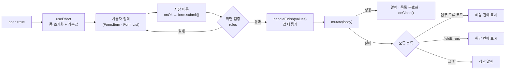
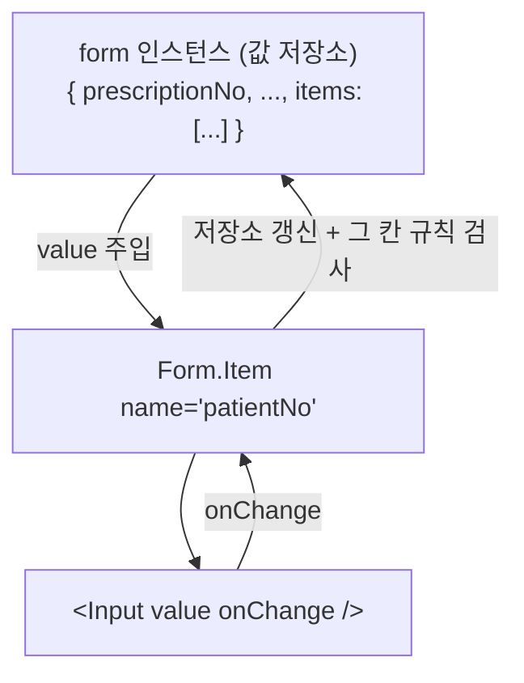
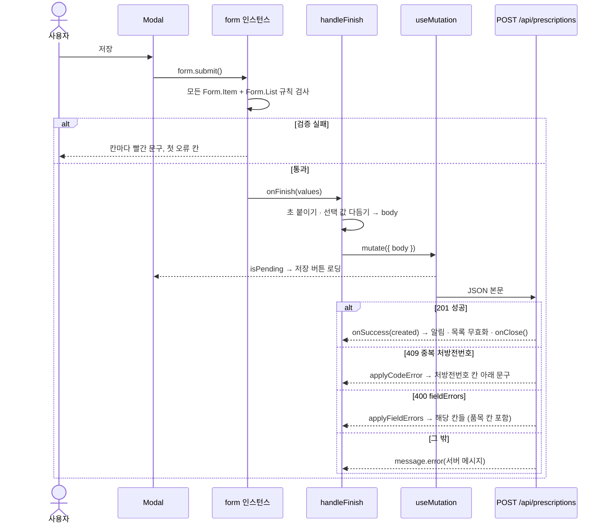

# PrescriptionFormModal 해설 (React · TypeScript 학습용)

> 대상 파일: `frontend/src/features/prescriptions/PrescriptionFormModal.tsx`
> 함께 보는 파일: `prescriptionFields.ts`, `api/errors.ts`, `hooks/useInvalidateApi.ts`
> 관련 문서: [목록 화면 해설](prescription-list-page-study.md) · [상세 드로어 해설](prescription-detail-drawer-study.md)(useMutation·무효화·타입 가드 설명) · [처방 프로그램 설명서](prescription-program-spec.md)(입력 규칙 표) · 개념: [React 훅](react-hooks-study.md)

---

## 0. 한눈에 보기

처방 정보(처방전번호·환자·진료과·처방의 …)와 **품목 1~100줄**을 한 화면에서 입력해 `POST /api/prescriptions` 한 번으로 저장하는 모달이다. 처방은 수정하지 않으므로(바꾸려면 취소 후 재처방) **등록 전용**이다.



Ant Design `Form`을 쓰면 **입력값을 state로 직접 관리하지 않는다.** 값·검증·오류 표시를 `form` 인스턴스가 모두 들고 있고, 컴포넌트는 "어떤 칸이 있고 규칙이 뭔지"만 선언한다.

| 줄 | 덩어리 |
|---|---|
| 1–13 | import |
| 15–21 | props 타입, 새 품목 기본값 |
| 30–47 | 폼 인스턴스·mutation, 열 때 초기화(`useEffect`) |
| 50–75 | 제출 처리 `handleFinish` |
| 77–248 | JSX: 모달 → 폼 → 처방 정보 칸 → 품목 목록(`Form.List`) |

---

## 1. 한 줄씩 해설

### 1.1 import (1–13줄)

```tsx
import { MinusCircleOutlined, PlusOutlined } from '@ant-design/icons'
import { App, Button, Col, Divider, Form, Input, InputNumber, Modal, Row, Select, Typography } from 'antd'
import { useEffect } from 'react'
```
| 이름 | 용도 |
|---|---|
| `Form` | 폼 전체. `Form.Item`(칸 하나), `Form.List`(반복 줄), `Form.ErrorList`(목록 오류), `Form.useForm`(인스턴스) |
| `Row`, `Col` | 24칸 그리드 배치. `span={8}`은 24칸 중 8칸(1/3) |
| `InputNumber` | 숫자 입력. 값이 `number`(비우면 `null`)로 나온다 |
| `Divider` | 구분선 + 제목 |
| `useEffect` | 렌더링 **뒤에** 실행할 부수 효과(여기서는 폼 초기화) |

```tsx
import { applyCodeError, applyFieldErrors, errorMessage } from '@/api/errors'
```
- 서버 오류를 폼 칸에 연결하는 도우미 두 개(2.5 참고).

```tsx
import { PRESCRIPTION_ERROR_FIELDS, PRESCRIPTION_TYPE_OPTIONS, nowForDateTimeInput, type PrescriptionItemRequest, type PrescriptionRequest } from './prescriptionFields'
```
| 이름 | 내용 |
|---|---|
| `PRESCRIPTION_ERROR_FIELDS` | `{ DUPLICATE_PRESCRIPTION_NO: 'prescriptionNo' }` — 오류 코드 → 보여줄 칸 |
| `PRESCRIPTION_TYPE_OPTIONS` | 구분 선택 항목 `[{ value: 'OUTPATIENT', label: '외래' }, ...]` |
| `nowForDateTimeInput()` | 지금 시각을 `yyyy-MM-ddTHH:mm` 문자열로 |
| `PrescriptionRequest` | 등록 요청 본문 타입(백엔드 DTO에서 생성) |
| `PrescriptionItemRequest` | 품목 한 줄 요청 타입 |

### 1.2 props와 새 품목 기본값 (15–21줄)

```tsx
interface PrescriptionFormModalProps {
    open: boolean
    onClose: () => void
}
```
- 상세 드로어는 `prescriptionId: number | null` 하나로 열림을 표현했지만, 등록은 대상이 없으니 `open: boolean`이면 된다.

```tsx
const NEW_ITEM: Partial<PrescriptionItemRequest> = {dose:1, days:1};
```
- 품목 줄을 추가할 때 채워 둘 값. 1회량 1, 일수 1이 가장 흔하다.
- `Partial<...>`: 품목 요청 타입은 약품코드·약품명 등이 **필수**라 `{ dose: 1, days: 1 }`만으로는 타입이 맞지 않는다. `Partial`로 "일부만 있는 품목"을 허용한다.
- 컴포넌트 밖 상수라 한 번만 만들어진다. 대신 **같은 객체를 여러 줄이 공유하지 않도록** 쓸 때 복사한다(`{ ...NEW_ITEM }`, 238줄).

### 1.3 JSDoc과 컴포넌트 선언 (23–30줄)

```tsx
/**
 * 처방 등록 모달. 처방 정보와 품목(1~100줄)을 한 번에 저장한다. (POST /api/prescriptions).
 * ...
 */

export function PrescriptionFormModal({ open, onClose }: PrescriptionFormModalProps) {
```
- 주석과 함수 사이에 빈 줄이 있으면 일부 에디터는 JSDoc을 함수에 붙이지 않는다. 마우스를 올렸을 때 설명이 보이게 하려면 빈 줄을 없앤다.
- "코드성 값은 서버가 대문자로 저장" — `im`을 입력해도 서버가 `IM`으로 저장하므로 화면에서 변환하지 않는다(규칙은 한 곳에).

### 1.4 훅 준비 (31–34줄)

```tsx
const { message } = App.useApp()
const invalidate = useInvalidateApi()
const [form] = Form.useForm<PrescriptionRequest>()
const createPrescription = $api.useMutation('post', '/api/prescriptions')
```
- **`Form.useForm<T>()`**: 폼 인스턴스를 만든다. 배열로 돌려주므로 `[form]`으로 첫 번째를 꺼낸다.
  - 제네릭 `<PrescriptionRequest>`를 주면 `form.setFieldsValue({...})`, `onFinish(values)`의 타입이 요청 DTO가 된다.
  - 인스턴스는 렌더링이 반복돼도 **같은 객체**다(내부적으로 `useRef`처럼 유지).
- `createPrescription`: 등록 mutation. `createPrescription.isPending`으로 저장 중 여부를 안다.

### 1.5 열 때 초기화 — `useEffect` (36–47줄)

```tsx
useEffect(() => {
    if (!open) {
        return
    }
    form.resetFields()
    form.setFieldsValue({
        prescriptionType: 'OUTPATIENT',
        prescribedAt: nowForDateTimeInput(),
        items: [NEW_ITEM as PrescriptionItemRequest],
    })
}, [open, form])
```
- **`useEffect(함수, [의존값])`**: 렌더링이 화면에 반영된 **뒤** 실행된다. 의존값이 이전 렌더링과 달라졌을 때만 다시 실행된다.
  - `open`이 `false → true`로 바뀔 때(모달을 열 때) 실행되어 폼을 채운다.
  - `open`이 `true → false`가 될 때도 실행되지만 `if (!open) return`으로 아무것도 하지 않는다.
  - `form`은 바뀌지 않지만, 효과 안에서 쓰는 값은 의존 배열에 모두 적는 것이 규칙이다(eslint `react-hooks/exhaustive-deps`).
- `form.resetFields()`: 지난번 입력값과 오류 표시를 모두 지운다. (취소 버튼으로 닫으면 입력값이 남아 있다.)
- `form.setFieldsValue({...})`: 기본값을 넣는다. 구분은 외래, 처방 일시는 **지금**, 품목은 한 줄.
- **왜 `Form`의 `initialValues`가 아니라 여기서 넣나?** `initialValues`는 처음 그릴 때 한 번 계산된다. 처방 일시는 "모달을 연 그 시각"이어야 하므로 열 때마다 새로 넣는다.
- `NEW_ITEM as PrescriptionItemRequest`: `items`의 타입은 완전한 품목 배열이라 `Partial`을 그대로 넣을 수 없다. 빈 칸은 사용자가 채우고 검증이 막아 주므로 단언으로 넘긴다.

> **주의 (`nowForDateTimeInput` 버그):** 이 함수가 월을 두 자리로 맞추지 않는다(`${now.getMonth()+1}`). 1~9월에는 `2026-5-03T09:30`이 만들어진다. 이 값은 `datetime-local` 입력칸 형식에 맞지 않아 칸이 비어 보이지만 **폼 값에는 남아** 필수 검사를 통과하고, 서버에서 날짜 변환 오류(400)가 난다. `pad(now.getMonth() + 1)`로 고쳐야 한다.

### 1.6 제출 처리 — `handleFinish` (50–75줄)

```tsx
const handleFinish = (values: PrescriptionRequest) => {
```
- `Form`의 `onFinish`에 연결한다. **화면 검증을 모두 통과했을 때만** 불린다. 검증에 실패하면 Ant Design이 칸마다 빨간 글을 띄우고 이 함수는 불리지 않는다.

```tsx
    const body: PrescriptionRequest = {
        ...values,
        prescribedAt: values.prescribedAt.length === 16 ? `${values.prescribedAt}:00` : values.prescribedAt,
        remark: values.remark?.trim() || undefined,
        items: values.items.map((item) => ({ ...item, usageNote: item.usageNote?.trim() || undefined })),
    }
```
- **보낼 본문을 새로 만든다.** `values`를 직접 고치지 않고 전개 연산자로 복사한 뒤 몇 필드만 덮어쓴다(불변성).
- `prescribedAt`: `datetime-local` 값은 초가 없다(`2026-11-04T09:30`, 16글자). 서버 `LocalDateTime`에 맞춰 `:00`을 붙인다.
- `remark?.trim() || undefined`: 비고는 선택 입력이다.
  - `?.`: 입력하지 않으면 `undefined`라 `.trim()`을 부르지 않는다.
  - `|| undefined`: 공백만 넣었으면 `''` → `undefined`.
  - `undefined`인 속성은 `JSON.stringify`가 빼므로 본문에 `remark`가 아예 없다 → 서버에서 `null`.
- `items.map(...)`: 품목마다 복사하면서 용법(선택)만 같은 방식으로 다듬는다. `({ ...item, ... })`처럼 객체를 반환할 때는 괄호로 감싼다.
- 필수 문자열(약품코드 등)은 `whitespace: true` 규칙이 공백만 있는 값을 막고, 앞뒤 공백 정리는 서버가 한다.

```tsx
    createPrescription.mutate(
        { body },
        {
            onSuccess: (created) => {
                message.success(`처방 ${created.prescriptionNo}을(를) 등록했습니다.`)
                invalidate('/api/prescriptions')
                onClose()
            },
```
- `{ body }`: 경로 파라미터가 없으니 본문만. `{ body: body }`의 줄임.
- `created`: 응답 본문. 타입이 `PrescriptionResponse`라 `created.prescriptionNo`가 자동완성된다.
- 목록을 무효화해 새 처방이 보이게 하고, 부모에게 닫아 달라고 알린다. 다음에 열 때 `useEffect`가 폼을 비우므로 여기서 지우지 않는다.

```tsx
            onError: (error: unknown) => {
                if (applyCodeError(form, error, PRESCRIPTION_ERROR_FIELDS) || applyFieldErrors(form, error)) {
                    return
                }
                message.error(errorMessage(error))
            },
```
- 오류를 **세 단계로** 처리한다.
  1. `applyCodeError`: 오류 코드가 `DUPLICATE_PRESCRIPTION_NO`(409)면 처방전번호 칸 아래에 서버 메시지를 띄우고 `true`.
  2. `applyFieldErrors`: 서버 Bean Validation 오류(400, `fieldErrors`)가 있으면 해당 칸들에 띄우고 `true`.
  3. 둘 다 아니면(권한 없음, 서버 오류 …) 위쪽 알림.
- `A || B`: `A`가 `true`면 `B`를 실행하지 않는다(단락 평가). "코드 오류로 처리했으면 필드 오류는 보지 않는다"를 한 줄로 쓴 것.
- 모달은 닫지 않는다. 사용자가 고쳐서 다시 저장할 수 있게.

### 1.7 모달 (78–87줄)

```tsx
<Modal
open={open}
title="처방 등록"
okText="저장"
confirmLoading={createPrescription.isPending}
onOk={() => form.submit()}
onCancel={onClose}
forceRender
width={960}
>
```
- **저장 버튼이 폼 바깥(모달 아래쪽)에 있다.** 그래서 `<button type="submit">`을 쓸 수 없고, `onOk`에서 `form.submit()`을 부른다. `submit()` = 검증 → 통과하면 `onFinish`.
- `confirmLoading`: 저장 중에는 버튼이 로딩이 되어 중복 저장을 막는다.
- `onCancel={onClose}`: 취소·✕·Esc·바깥 클릭.
- **`forceRender`**: 모달이 처음 열리기 전에도 내용(폼)을 그려 둔다. 이게 없으면 닫혀 있을 때 `<Form form={form}>`이 없어서, `useEffect`의 `form.resetFields()`가 연결되지 않은 인스턴스를 건드리게 된다(콘솔 경고 "Instance created by `useForm` is not connected to any Form element").
- `width={960}`: 품목 줄이 넓다.
- (들여쓰기가 어긋나 있다. 동작에는 영향 없지만 Prettier 등으로 정리하면 읽기 쉽다.)

### 1.8 폼과 처방 정보 칸 (88–153줄)

```tsx
<Form form={form} layout="vertical" onFinish={handleFinish}>
```
- `form={form}`: 위에서 만든 인스턴스를 이 폼에 연결한다.
- `layout="vertical"`: 라벨을 입력칸 위에.

```tsx
<Row gutter={12}>
<Col span={8}>
    <Form.Item
        name="prescriptionNo"
        label="처방전번호"
        rules={[
            { required: true, whitespace: true, message: '처방전번호를 입력하세요.' },
            { max: 30, message: '30자 이하로 입력하세요.' },
        ]}
    >
        <Input placeholder="예: RX20261104-0001" className="mono" />
    </Form.Item>
</Col>
```
- `Row gutter={12}`: 열 사이 간격 12px. `Col span={8}` ×3 = 24칸(한 줄 가득).
- **`Form.Item`이 하는 일**
  - `name="prescriptionNo"`: 폼 값의 어느 필드인지. `onFinish(values)`의 `values.prescriptionNo`가 된다. `PrescriptionRequest`에 없는 이름이면 타입 오류(제네릭을 줬기 때문).
  - 자식 `<Input>`에 `value`와 `onChange`를 **자동으로 꽂아 준다.** 그래서 `<Input>`에 `value`를 직접 쓰지 않는다(제어 입력을 폼이 대신 해 준다).
  - `rules`: 검증 규칙 배열. 위에서부터 검사한다.
- 규칙 해설
  | 규칙 | 뜻 |
  |---|---|
  | `required: true` | 비면 오류 |
  | `whitespace: true` | 공백만 있어도 빈 값으로 본다 |
  | `max: 30` | 문자열이면 글자 수, 숫자면 값의 최대 |
  | `message` | 오류 문구. 없으면 Ant Design 기본 문구(`{ max: 20 }`처럼) |
- 화면 규칙은 서버 DTO의 `@NotBlank`·`@Size`와 같게 맞춘다. 화면은 빠른 안내, 최종 검사는 서버다.

```tsx
<Form.Item name="prescriptionType" label="구분" rules={[{ required: true }]}>
    <Select options={PRESCRIPTION_TYPE_OPTIONS} />
</Form.Item>
```
- `Select`도 `Form.Item`이 `value`/`onChange`를 꽂아 준다.

```tsx
<Form.Item name="prescribedAt" label="처방 일시" rules={[{ required: true, message: '처방 일시를 입력하세요.' }]}>
    <Input type="datetime-local" />
</Form.Item>
```
- 브라우저 기본 날짜·시각 선택기. 값은 `yyyy-MM-ddTHH:mm` 문자열(내 PC 시간대).

```tsx
<Row gutter={12}>
    <Col span={6}> 환자번호 </Col>
    <Col span={6}> 환자명 </Col>
    <Col span={6}> 진료과 코드 </Col>
    <Col span={6}> 처방의 </Col>
</Row>
<Form.Item name="remark" label="비고" rules={[{ max: 1000 }]}>
    <Input.TextArea rows={2} />
</Form.Item>
```
- 두 번째 줄은 `span={6}` ×4 = 24칸. 비고는 `Row` 밖이라 한 줄 전체.

```tsx
<Divider titlePlacement="start" plain>처방 품목</Divider>
```
- 제목이 왼쪽에 붙은 구분선. `titlePlacement`는 Ant Design 6 이름이다(5의 `orientation`). `plain`: 제목을 굵지 않게.

### 1.9 품목 목록 — `Form.List` (157–244줄)

```tsx
<Form.List
    name="items"
    rules={[
        {
            validator: async (_, items?: unknown[]) => {
                if (!items?.length) {
                    throw new Error('품목을 한 줄 이상 추가하세요.')
                }
                if (items.length > 100) {
                    throw new Error('품목은 100줄까지 넣을 수 있습니다.')
                }
            },
        },
    ]}
>
```
- **`Form.List`**: 같은 모양의 칸 묶음이 여러 줄 반복되는 배열 필드. 값은 `values.items: PrescriptionItemRequest[]`.
- `rules`의 `validator`: **목록 전체**를 검사하는 사용자 정의 규칙.
  - `async` 함수다. Ant Design은 Promise가 **거부(reject)되면 오류**, 성공하면 통과로 본다. `async` 함수 안에서 `throw`하면 거부된 Promise가 된다.
  - `Error`의 메시지가 그대로 오류 문구가 되어 아래 `Form.ErrorList`에 보인다.
  - `!items?.length`: `items`가 없거나 길이가 `0`이면.
- 화면에서는 삭제 버튼이 마지막 한 줄에서 꺼져 있어 0줄이 되기 어렵지만, 규칙으로도 막는다(서버 `@Size(min=1, max=100)`과 같다).

```tsx
    {(fields, { add, remove }, { errors }) => (
        <> ... </>
    )}
</Form.List>
```
- **render props 패턴**: 자식 자리에 JSX가 아니라 **함수**를 넣는다. `Form.List`가 이 함수를 불러 주면서 필요한 값을 넘긴다.
  | 인자 | 내용 |
  |---|---|
  | `fields` | 줄 정보 배열 `[{ key, name }, ...]` |
  | `add(기본값?)` | 줄 추가 |
  | `remove(name)` | 줄 삭제 |
  | `errors` | 위 `validator`가 낸 목록 오류 |

```tsx
{fields.map((field, index) => (
    <Row key={field.key} gutter={8} align="top">
```
- **`field.key`와 `field.name`의 차이**
  - `field.name`: 지금 배열에서의 **위치**(0, 1, 2 …). 가운데 줄을 지우면 뒷줄 번호가 당겨진다.
  - `field.key`: 줄이 만들어질 때 받은 **고유 번호**. 지워도 다른 줄의 key는 그대로다.
  - React `key`에는 `field.key`를 써야 한다. 위치를 쓰면 2번 줄을 지웠을 때 React가 "3번 줄이 2번이 됐다"를 "2번 줄의 내용이 바뀌었다"로 오해해 입력 상태가 엉킨다.
- `align="top"`: 오류 문구로 칸 높이가 달라져도 위쪽을 맞춘다.

```tsx
<Col flex="32px">
    <Typography.Text type="secondary" className="item-line-no">
        {index + 1}
    </Typography.Text>
</Col>
```
- 줄 번호(1부터). `index`는 `map`의 두 번째 인자(0부터). 서버도 품목 순번을 1부터 매긴다.
- `flex="32px"`: 24칸 비율이 아니라 고정 폭.

```tsx
<Col span={3}>
    <Form.Item name={[field.name, 'drugCode']} rules={[{ required: true, whitespace: true, message: '약품코드' }, { max: 30 }]}>
        <Input placeholder="약품코드" className="mono" />
    </Form.Item>
</Col>
```
- **`name={[field.name, 'drugCode']}`**: 배열 이름 경로. `Form.List` 안이라 앞에 `'items'`가 자동으로 붙어 실제 경로는 `['items', 0, 'drugCode']` → `values.items[0].drugCode`.
- 칸이 좁아 라벨이 없으므로 `placeholder`가 라벨 노릇을 하고, 오류 문구도 짧게(`'약품코드'`) 썼다.

```tsx
<Form.Item name={[field.name, 'dose']} rules={[{ required: true, message: '1회량' }]}>
    <InputNumber placeholder="1회량" min={0.001} step={0.5} className="full-width" />
</Form.Item>
```
- `InputNumber`: `min` 아래 값은 입력칸을 떠날 때 `min`으로 맞춘다. `step={0.5}`: 위/아래 화살표로 0.5씩.
- 비우면 값이 `null` → `required`가 막는다.
- 서버는 소수 3자리까지 받으므로 `min={0.001}`.

```tsx
<InputNumber placeholder="일수" min={1} max={365} precision={0} className="full-width" />
```
- `precision={0}`: 정수만(소수는 반올림).

```tsx
<Col flex="auto">
    <Form.Item name={[field.name, 'usageNote']} rules={[{ max: 500 }]}>
        <Input placeholder="용법 (선택)" />
    </Form.Item>
</Col>
```
- `flex="auto"`: 남은 폭을 모두 차지한다. 용법은 선택이라 `required`가 없다.

```tsx
<Col flex="32px">
    <Button
        type="text"
        danger
        icon={<MinusCircleOutlined />}
        aria-label={`${index + 1}번 품목 삭제`}
        disabled={fields.length === 1}
        onClick={() => remove(field.name)}
    />
</Col>
```
- 아이콘만 있는 버튼이라 `aria-label`로 화면 낭독기용 이름을 준다(템플릿 문자열로 몇 번째 줄인지까지).
- `disabled={fields.length === 1}`: 마지막 한 줄은 지울 수 없다.
- `remove(field.name)`: 삭제는 **위치**로 한다(`key`가 아니라 `name`).

```tsx
<Button type="dashed" block icon={<PlusOutlined />} onClick={() => add({ ...NEW_ITEM })}>
    품목 추가
</Button>
<Form.ErrorList errors={errors} />
```
- `add({ ...NEW_ITEM })`: 기본값의 **복사본**으로 새 줄을 만든다. 원본을 그대로 넘기면 여러 줄이 같은 객체를 가리킬 수 있다.
- `block`: 버튼을 가로로 꽉 채운다. `type="dashed"`: 점선 테두리(추가 버튼 관례).
- `Form.ErrorList`: 목록 전체 오류(`validator`의 문구)를 보여준다. 줄 안 칸의 오류는 각 `Form.Item`이 보여준다.

---

## 2. 함수 동작 원리

### 2.1 Ant Design Form의 데이터 흐름


- 입력할 때마다 **그 칸만** 다시 그린다. 컴포넌트 전체(`PrescriptionFormModal`)는 다시 렌더링되지 않는다. `useState`로 값 객체를 들고 있으면 한 글자마다 품목 100줄이 모두 다시 그려진다.
- 값을 읽고 쓰는 방법은 인스턴스 메서드다.
  | 메서드 | 하는 일 |
  |---|---|
  | `form.setFieldsValue(obj)` | 값 넣기(주어진 필드만) |
  | `form.resetFields()` | 값·오류를 처음 상태로 |
  | `form.submit()` | 전체 검증 → 통과하면 `onFinish(values)` |
  | `form.setFields([{ name, errors }])` | 특정 칸에 오류 표시(서버 오류 연결) |
  | `form.getFieldsValue()` | 지금 값 읽기 |

### 2.2 모달을 열 때

1. 부모가 `setFormOpen(true)` → `open={true}`로 다시 렌더링.
2. 모달이 보이기 시작한다(`forceRender`라 폼은 이미 그려져 있다).
3. 렌더링이 끝난 뒤 `useEffect`가 실행: `resetFields()` → `setFieldsValue(기본값)`.
4. 칸들이 기본값으로 채워진다(외래, 지금 시각, 품목 1줄 — 1회량 1, 일수 1).

`useEffect`는 렌더링 **뒤에** 실행되므로 아주 잠깐 이전 값이 보일 수 있지만, 모달 열림 애니메이션 중이라 눈에 띄지 않는다.

### 2.3 저장을 누를 때



### 2.4 `Form.List`가 줄을 관리하는 방법

`fields`의 변화를 따라가 보자.

| 동작 | `fields` (`{key, name}`) | `values.items` |
|---|---|---|
| 열기 | `[{0,0}]` | `[A]` |
| 추가 ×2 | `[{0,0}, {1,1}, {2,2}]` | `[A, B, C]` |
| 2번째 줄 삭제 `remove(1)` | `[{0,0}, {2,1}]` | `[A, C]` |
| 추가 | `[{0,0}, {2,1}, {3,2}]` | `[A, C, D]` |

- `name`(위치)은 당겨지고 `key`는 그대로다. C 줄은 React `key`가 2로 유지되어 입력칸이 새로 만들어지지 않는다.
- 줄 번호(`index + 1`)는 위치로 매기므로 삭제 후 자동으로 1, 2로 다시 매겨진다.

### 2.5 서버 오류를 칸에 연결하기

**업무 오류 — `applyCodeError(form, error, codeFields)`**

```ts
const field = codeFields[error.code]           // 'DUPLICATE_PRESCRIPTION_NO' → 'prescriptionNo'
if (!field) return false                         // 연결된 칸이 없는 오류
form.setFields([{ name: field, errors: [error.message] }])
return true
```

**형식 오류 — `applyFieldErrors(form, error)`**

서버 Bean Validation 오류는 `fieldErrors: [{ field: 'items[0].drugCode', reason: '...' }]` 모양이다. 문자열 경로를 폼의 이름 경로로 바꾼다.

```ts
'items[0].drugCode'
  .split(/[.[\]]/)          // ['items', '0', '', 'drugCode']   . [ ] 를 기준으로 자르기
  .filter(Boolean)           // ['items', '0', 'drugCode']        빈 문자열 버리기
  .map((part) => (/^\d+$/.test(part) ? Number(part) : part))
                             // ['items', 0, 'drugCode']          숫자는 number로
```
- 이 경로가 `Form.List` 안의 `name={[field.name, 'drugCode']}`(실제 `['items', 0, 'drugCode']`)와 **정확히 같아서** 1번 품목의 약품코드 칸 아래에 오류가 뜬다.
- 숫자를 `Number`로 바꾸는 이유: 폼은 배열 위치를 숫자로 다룬다. `'0'`(문자열)이면 `items`를 배열이 아닌 객체로 보고 칸을 찾지 못한다.
- 서버 DTO 필드 이름과 폼 `name`을 같게 지어야 이 연결이 된다. 생성 타입(`PrescriptionRequest`)으로 폼을 만들었기 때문에 자연히 같다.

### 2.6 화면 검증과 서버 검증

| 규칙 | 화면 (`rules`) | 서버 (DTO) |
|---|---|---|
| 처방전번호 필수·30자 | `required` + `whitespace` + `max: 30` | `@NotBlank @Size(max=30)` |
| 품목 1~100줄 | `Form.List` `validator` | `@Size(min=1, max=100)` |
| 1회량·총량 > 0 | `InputNumber min={0.001}` | `@Positive` 등 |
| 처방전번호 중복 | 없음(DB를 봐야 안다) | `DUPLICATE_PRESCRIPTION_NO` 409 |

화면 검증은 **빠른 안내**, 서버 검증은 **최종 판정**이다. 화면 규칙이 서버보다 느슨해도 데이터는 안전하지만 사용자가 서버 왕복 후에야 오류를 본다. 두 규칙이 어긋나면 서버 오류가 `applyFieldErrors`로 칸에 나오므로 그때 화면 규칙을 맞춘다. 전체 규칙 표는 [처방 프로그램 설명서 4.3](prescription-program-spec.md)에 있다.

---

## 3. 이 파일에서 새로 나온 문법·개념

| 문법·개념 | 예 (줄) | 뜻 |
|---|---|---|
| `Partial<T>` 상수 + `as` | 21, 45 | 일부만 있는 기본값을 완전한 타입 자리에 |
| 배열 반환 훅 | 33 `const [form] = ...` | 첫 번째만 꺼내기 |
| `useEffect` | 37–47 | 렌더링 뒤 부수 효과, 의존 배열 |
| 불변 복사 후 덮어쓰기 | 51–57 | `{ ...values, x: 새값 }` |
| `?.` + `\|\| undefined` | 55–56 | 선택 입력 정리(공백 → 없음) |
| `A \|\| B` 단락 평가로 분기 | 68 | 앞이 처리했으면 뒤는 건너뜀 |
| 바깥 버튼으로 제출 | 83 `form.submit()` | 폼 밖 버튼과 폼 연결 |
| `forceRender` | 85 | 닫힌 모달 안의 폼 미리 그리기 |
| `Form.Item`의 값 주입 | 91–100 | 자식 입력칸에 `value`/`onChange` 자동 |
| 검증 규칙 객체 | 94–97 | `required`, `whitespace`, `max`, `validator` |
| `async` 함수의 `throw` | 161–168 | 거부된 Promise = 검증 실패 |
| render props | 172 | 자식 자리에 함수 |
| `field.key` vs `field.name` | 175, 182, 233 | React 키는 고유값, 경로·삭제는 위치 |
| 이름 경로 배열 | 182 `[field.name, 'drugCode']` | 중첩 필드 |
| 24칸 그리드 | `Row`/`Col` | `span`, `flex`, `gutter` |

---

## 4. 스스로 확인해 볼 것

1. `forceRender`를 지우고 새로고침한 뒤 처방 등록을 열어 보자. 콘솔에 어떤 경고가 나오는가?
2. 품목 3줄을 넣고 각 줄 약품명에 A, B, C를 쓴 뒤 2번째 줄을 지워 보자. 그다음 `key={field.key}`를 `key={index}`로 바꿔 같은 일을 해 보자. 차이가 있는가? (`Form.Item`이 값을 들고 있어 차이가 작을 수 있다. 차이가 안 보이면 이유를 생각해 보자.)
3. 이미 있는 처방전번호로 저장해 보자. 오류가 어디에 나오는가? `PRESCRIPTION_ERROR_FIELDS`에서 그 줄을 지우면 어디로 가는가?
4. 화면 규칙 `{ max: 30 }`을 지우고 31자 처방전번호로 저장해 보자. 서버 오류가 어느 칸에 나오는가? (2.5의 경로 변환)
5. `handleFinish`에서 `:00`을 붙이는 줄을 지우면 어떻게 되는가? Network 탭에서 요청 본문과 응답을 확인해 보자.
6. `nowForDateTimeInput`의 월 버그를 고치고, PC 날짜를 5월로 바꿔 모달을 열어 보자(1.5 주의 참고).
