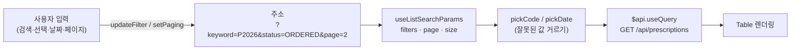
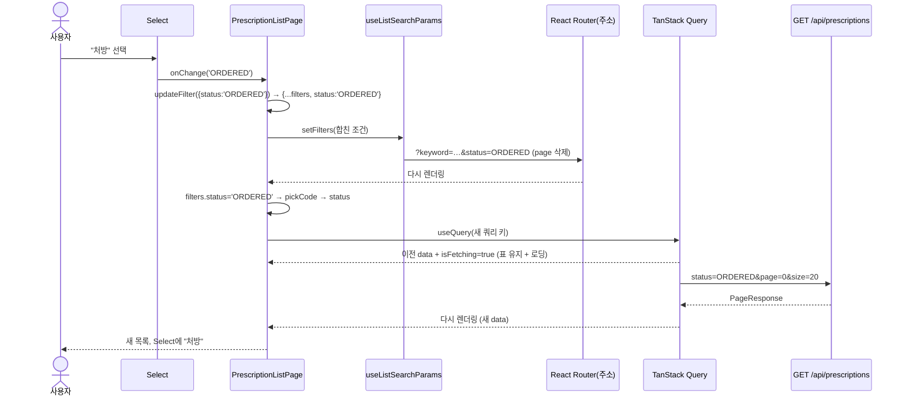

# PrescriptionListPage 해설 (React · TypeScript 학습용)

> 대상 파일: `frontend/src/features/prescriptions/PrescriptionListPage.tsx`
> 함께 보는 파일: `prescriptionFields.ts`, `hooks/useListSearchParams.ts`, `api/client.ts`
> 업무 흐름·서버 쪽 설명은 [처방 프로그램 설명서](prescription-program-spec.md)에 있다. 이 문서는 **코드 읽는 법**에 집중한다.
> 이어서 읽기: [상세 드로어 해설](prescription-detail-drawer-study.md) → [등록 모달 해설](prescription-form-modal-study.md) · 개념: [React 훅](react-hooks-study.md)

---

## 0. 한눈에 보기

이 화면은 "주소(URL) → 검색 조건 → API 조회 → 표"로 흐른다. 화면이 상태를 직접 들고 있지 않고 **주소가 곧 상태**다.



사용자가 무엇을 바꾸든 하는 일은 하나, **주소를 바꾸는 것**이다. 주소가 바뀌면 React Router가 컴포넌트를 다시 렌더링하고, 새 조건으로 쿼리 키가 바뀌어 TanStack Query가 다시 조회한다.

파일은 네 덩어리로 나뉜다.

| 줄 | 덩어리 | 언제 실행되나 |
|---|---|---|
| 1–19 | import | 모듈을 처음 불러올 때 한 번 |
| 21–39 | 모듈 상수·도우미 함수 | 모듈을 처음 불러올 때 한 번(상수), 호출할 때(함수) |
| 48–105 | 컴포넌트 본문(훅·계산·열 정의) | **렌더링할 때마다** |
| 107–194 | JSX 반환 | **렌더링할 때마다** |

---

## 1. 한 줄씩 해설

### 1.1 import (1–19줄)

```tsx
import { useState } from 'react'
```
- React 훅 `useState`를 가져온다. 컴포넌트 안에서 "다시 렌더링되어도 유지되는 값"(드로어·모달 열림 상태)을 만들 때 쓴다.
- `{ }`는 **이름 있는(named) import**다. `react` 모듈이 `export function useState`로 내보낸 것을 이름 그대로 받는다.

```tsx
import { PrescriptionDetailDrawer } from './PrescriptionDetailDrawer'
import { PrescriptionFormModal } from './PrescriptionFormModal'
```
- 같은 폴더(`./`)의 상세 드로어·등록 모달 컴포넌트. 확장자 `.tsx`는 생략한다(Vite·TypeScript가 찾아 준다).

```tsx
import { PlusOutlined, ReloadOutlined } from '@ant-design/icons'
```
- Ant Design 아이콘 컴포넌트. `<PlusOutlined />`처럼 JSX로 쓴다. 등록 버튼(+)과 초기화 버튼(↻)에 쓰인다.
- 줄 끝의 `// ⑤ ...` 주석은 학습 단계 표시다(⑤ 단계에서 추가한 것).

```tsx
import { keepPreviousData } from '@tanstack/react-query'
```
- TanStack Query가 주는 **함수**다. `placeholderData`에 넘기면 새 데이터를 받는 동안 이전 데이터를 보여준다(2.4 참고).

```tsx
import { Alert, Button, Card, Input, Select, Space, Table, Tag, Typography, type TableColumnsType } from 'antd'
```
- Ant Design UI 컴포넌트들.
- `type TableColumnsType`: 앞의 `type`은 **타입만 가져온다**는 뜻이다. 빌드 결과(JavaScript)에서는 지워지고, 타입 검사에만 쓰인다. 값과 타입을 한 줄에서 섞어 가져올 때 이렇게 표시한다.

```tsx
import { $api } from '@/api/client'
```
- `@/`는 `frontend/src/`의 별칭(`vite.config.ts`, `tsconfig`의 `paths` 설정)이다. `../../api/client`처럼 상대 경로를 세지 않아도 된다.
- `$api`는 백엔드 OpenAPI 문서에서 만든 타입이 붙은 TanStack Query 훅 묶음이다. `$`는 특별한 문법이 아니라 이름의 일부다.

```tsx
import { errorMessage } from '@/api/errors'
import { PageHeader } from '@/components/PageHeader'
import { useListSearchParams } from '@/hooks/useListSearchParams'
import { useMenus } from '@/layouts/MenuContext'
import { formatDateTime } from '@/utils/format'
```
| 이름 | 하는 일 |
|---|---|
| `errorMessage(error)` | 오류 객체가 백엔드 `ErrorResponse`면 그 `message`를, 아니면 기본 문구를 돌려준다 |
| `PageHeader` | 모든 화면이 같은 모양으로 쓰는 제목 줄(제목 + 오른쪽 버튼 영역 `extra`) |
| `useListSearchParams` | 검색 조건·페이지를 URL 쿼리스트링에 읽고 쓰는 커스텀 훅 |
| `useMenus` | 서버에서 받은 메뉴·권한 정보를 꺼내는 훅 (`can(경로, 동작)`) |
| `formatDateTime` | `2026-11-05T09:30:00` → `2026-11-05 09:30:00`, 값이 없으면 `-` |

```tsx
import {
    PRESCRIPTION_STATUSES,
    PRESCRIPTION_TYPES,
    type PrescriptionStatus,
    type PrescriptionSummaryResponse,
    type PrescriptionType,
} from './prescriptionFields'
```
- 처방 화면 공용 정의. 값 2개(코드표)와 타입 3개.
  - `PRESCRIPTION_STATUSES`: `{ ORDERED: { label: '처방', color: 'processing' }, ... }`
  - `PrescriptionStatus`: `'ORDERED' | 'DISPENSED' | 'CANCELLED'` (문자열 리터럴 유니언 타입)
  - `PrescriptionSummaryResponse`: 목록 한 줄의 응답 타입(`schema.d.ts`에서 생성)

### 1.2 모듈 상수 (21–29줄)

```tsx
const FILTER_KEYS = ['keyword', 'status', 'prescriptionType', 'from', 'to'] as const
```
- URL에 둘 검색 조건 이름 목록.
- **`as const`** 가 핵심이다.
  - 없으면 타입이 `string[]`이다. "아무 문자열 배열"이라 `filters.status`가 있는지 TypeScript가 모른다.
  - 붙이면 타입이 `readonly ['keyword', 'status', 'prescriptionType', 'from', 'to']`가 된다. 이 값을 받은 `useListSearchParams<K>`의 `K`가 `'keyword' | 'status' | ...`로 추론되어 `filters.status`는 되고 `filters.stauts`(오타)는 컴파일 오류가 난다.
- **컴포넌트 밖에 두는 이유:** 컴포넌트 안에 두면 렌더링마다 새 배열이 만들어진다. 내용이 같아도 참조가 달라져 훅 안의 `useMemo`·`useCallback`이 매번 다시 계산된다(2.2 참고).

```tsx
const STATUS_OPTIONS = Object.entries(PRESCRIPTION_STATUSES).map(([value, { label }]) => ({ value, label }))
const TYPE_OPTIONS = Object.entries(PRESCRIPTION_TYPES).map(([value, { label }]) => ({ value, label }))
```
- 코드표 객체를 선택 박스 항목 배열로 바꾼다.
- 단계별로 보면:
  1. `Object.entries(obj)` → `[['ORDERED', {label:'처방', color:'processing'}], ['DISPENSED', {...}], ...]`
  2. `.map(([value, { label }]) => ...)` — 매개변수 자리에서 **구조 분해**한다. 배열 `[키, 값]`을 `value`와 `{ label }`로 풀고, 값 객체에서 `label`만 꺼낸다(`color`는 버린다).
  3. `({ value, label })` — 객체를 반환하는 화살표 함수는 `{}`가 함수 본문으로 읽히지 않도록 **괄호로 감싼다**. `{ value, label }`은 `{ value: value, label: label }`의 줄임(단축 속성).
- 결과: `[{ value: 'ORDERED', label: '처방' }, { value: 'DISPENSED', label: '조제됨' }, ...]`
- 코드표 하나에서 표의 Tag와 선택 박스를 모두 만들어 **두 곳이 어긋날 수 없다**.

```tsx
const DATE_PATTERN = /^\d{4}-\d{2}-\d{2}$/
```
- 정규식 리터럴. `^` 시작, `\d{4}` 숫자 4개, `-`, 숫자 2개, `-`, 숫자 2개, `$` 끝. `2026-11-05`는 통과, `2026-1-5`·`abc`는 실패.
- 형식만 본다(`2026-99-99`도 통과). 날짜가 실제로 맞는지는 서버가 `@DateTimeFormat`으로 검사한다.

### 1.3 도우미 함수 (31–39줄)

```tsx
function pickCode<T extends string>(value: string | undefined, table: Record<T, unknown>): T | undefined {
    return value !== undefined && Object.hasOwn(table, value) ? (value as T) : undefined
}
```
- `<T extends string>`: **제네릭 타입 매개변수**. "`T`는 문자열 계열 타입 중 하나"라는 뜻. 호출할 때 `pickCode<PrescriptionStatus>(...)`로 `T = 'ORDERED' | 'DISPENSED' | 'CANCELLED'`를 정한다.
- `value: string | undefined`: URL에서 읽은 값. 없을 수도 있다.
- `table: Record<T, unknown>`: 키가 `T`인 객체. 값의 타입은 상관없어서 `unknown`.
- 반환 `T | undefined`: 맞는 코드값이면 좁혀진 타입으로, 아니면 `undefined`.
- 본문은 **삼항 연산자** `조건 ? 참일 때 : 거짓일 때`.
  - `value !== undefined &&` — 먼저 값이 있는지 본다. 없으면 `&&` 뒤는 실행하지 않는다(단락 평가).
  - `Object.hasOwn(table, value)` — 표에 그 키가 **직접** 있는지 본다. `value in table`을 쓰면 `'toString'` 같은 프로토타입 속성도 참이 되므로 `hasOwn`을 쓴다.
  - `value as T` — **타입 단언**. TypeScript는 `hasOwn` 결과로 타입을 좁혀 주지 못하므로 "방금 검사했으니 T가 맞다"고 알려 준다. `as`는 실행 시 아무 일도 하지 않는다. 검사 없이 `as`만 쓰면 거짓말이 되니 반드시 런타임 검사와 짝을 맞춘다.

```tsx
function pickDate(value: string | undefined): string | undefined {
    return value !== undefined && DATE_PATTERN.test(value) ? value : undefined
}
```
- 같은 모양. `RegExp.test(문자열)`은 일치하면 `true`.

> **왜 걸러야 하나?** 주소는 사용자가 직접 고칠 수 있다. `?status=HELLO`를 그대로 API로 보내면 서버가 enum 변환에 실패해 400을 주고, 선택 박스에는 `HELLO`라는 이상한 값이 보인다. 걸러 두면 "조건 없음"으로 조용히 처리된다.

### 1.4 컴포넌트 선언과 JSDoc (41–48줄)

```tsx
/**
 * 처방 목록 화면: 검색 · 목록.
 * ...
 */
export function PrescriptionListPage() {
```
- `/** */`는 **JSDoc 주석**. 에디터에서 `PrescriptionListPage`에 마우스를 올리면 이 설명이 보인다.
- `export`: 다른 파일(`layouts/screens.tsx`)이 `import { PrescriptionListPage }`로 가져가 `/prescriptions` 경로에 연결한다.
- **React 컴포넌트 = JSX를 반환하는 함수**. 이름은 대문자로 시작해야 JSX에서 `<PrescriptionListPage />`로 쓸 수 있다(소문자면 HTML 태그로 해석).
- 이 함수는 화면이 바뀔 때마다 **처음부터 다시 실행된다**. 그래서 함수 안의 일반 변수(`status`, `columns`)는 매번 새로 계산되고, 유지돼야 하는 값은 훅(`useState`, URL)에 둔다.

### 1.5 권한과 검색 조건 (49–57줄)

```tsx
const { can } = useMenus()
const canCreate = can('/prescriptions', 'create')
```
- `useMenus()`가 돌려주는 객체에서 `can` 함수만 **구조 분해**로 꺼낸다.
- `can('/prescriptions', 'create')`: 서버 `/api/menus` 응답에 담긴 "이 사용자가 처방 메뉴에 등록 권한이 있나"를 `boolean`으로 돌려준다.
- 화면은 버튼을 숨기기만 한다. 실제로 막는 것은 서버(`MenuAuthorizationManager`)다.

```tsx
const { filters, page, size, setFilters, setPaging } = useListSearchParams(FILTER_KEYS)
```
- 커스텀 훅에서 5개를 꺼낸다.
  - `filters`: `{ keyword?: string, status?: string, prescriptionType?: string, from?: string, to?: string }` 모양(정확히는 `Record<K, string | undefined>`)
  - `page`: 화면 기준 1부터, `size`: 기본 20
  - `setFilters(next)`, `setPaging(page, size)`: 주소를 바꾸는 함수
- 동작 원리는 2.2.

```tsx
const status = pickCode<PrescriptionStatus>(filters.status, PRESCRIPTION_STATUSES)
const prescriptionType = pickCode<PrescriptionType>(filters.prescriptionType, PRESCRIPTION_TYPES)
const from = pickDate(filters.from)
const to = pickDate(filters.to)
```
- URL 문자열을 검사한 값. 타입이 `string | undefined`에서 `PrescriptionStatus | undefined`로 **좁아진다**.
- 이 값을 **API 조회와 화면 입력칸이 함께 쓴다**(같은 값을 두 번 검사하지 않고, 둘이 어긋나지 않는다).
- `<PrescriptionStatus>`는 사실 생략해도 `PRESCRIPTION_STATUSES`의 타입(`Record<PrescriptionStatus, TagSpec>`)에서 추론된다. 명시하면 읽는 사람에게 의도가 분명해진다.

### 1.6 목록 조회 (59–66줄)

```tsx
const listQuery = $api.useQuery(
    'get',
    '/api/prescriptions',
    { params: { query: { keyword: filters.keyword, status, prescriptionType, from, to, page: page - 1, size } } },
    { placeholderData: keepPreviousData },
)
```
| 인자 | 의미 |
|---|---|
| `'get'` | HTTP 메서드 |
| `'/api/prescriptions'` | 경로. `schema.d.ts`에 있는 경로만 쓸 수 있다(오타면 컴파일 오류) |
| `{ params: { query: {...} } }` | 쿼리스트링. 키 이름·타입이 백엔드 DTO와 다르면 컴파일 오류 |
| `{ placeholderData: keepPreviousData }` | TanStack Query 옵션 |

- `status, prescriptionType, from, to`는 `status: status`의 **단축 속성**이다. 변수 이름을 API 파라미터 이름과 같게 지어 줄여 쓸 수 있다.
- `page: page - 1`: 화면은 1페이지부터, Spring `Pageable`은 0부터.
- 값이 `undefined`인 파라미터는 쿼리스트링에서 빠진다(조건 없음).
- `listQuery`에는 `data`, `error`, `isError`, `isFetching` 등이 들어 있다. `listQuery.data`의 타입은 백엔드 `PageResponse<PrescriptionSummaryResponse>`에서 생성된 타입이다.

### 1.7 조건 하나 바꾸기 (68–69줄)

```tsx
const updateFilter = (patch: Partial<typeof filters>) => setFilters({ ...filters, ...patch })
```
- **화살표 함수**를 변수에 담았다. 렌더링마다 새로 만들어지지만 가벼워서 괜찮다.
- `typeof filters`: 값 `filters`의 **타입을 가져오는** 타입 연산자. (JavaScript의 `typeof x === 'string'`과 다르다. 타입 자리에 쓰면 TypeScript 연산자다.)
- `Partial<T>`: T의 모든 속성을 선택(`?`)으로 만든다. 그래서 `updateFilter({ status: 'ORDERED' })`처럼 일부만 넘길 수 있다.
- `{ ...filters, ...patch }`: **전개 연산자**로 두 객체를 합친다. 같은 키는 뒤(`patch`)가 이긴다.
  - `filters = { keyword: 'P20', status: 'ORDERED' }`, `patch = { status: undefined }`
  - → `{ keyword: 'P20', status: undefined }` → 상태 조건만 지워지고 검색어는 남는다.
- **왜 합치나?** `setFilters`는 넘기지 않은 키를 주소에서 **지운다**(통째 교체). 합치지 않고 `setFilters({ status })`만 부르면 검색어·기간이 사라진다.

### 1.8 화면 상태 (70–72줄)

```tsx
const [detailId, setDetailId] = useState<number | null>(null)
const [formOpen, setFormOpen] = useState(false)
```
- `useState(초기값)`은 `[현재 값, 바꾸는 함수]` 배열을 돌려주고, **배열 구조 분해**로 이름을 붙인다.
- `<number | null>`: 초기값 `null`만 보고는 타입을 `null`로만 추론하므로 "숫자일 수도 있다"를 명시한다. `useState(false)`는 `boolean`으로 잘 추론돼 생략했다.
- `setDetailId(5)`를 부르면 React가 컴포넌트를 다시 렌더링하고, 그때 `detailId`는 `5`다. **값이 즉시 바뀌는 게 아니라 다음 렌더링에서 바뀐다.**
- 이 두 값은 URL에 두지 않았다. 열고 닫는 일시적인 UI 상태라 새로고침 후까지 남길 필요가 없기 때문이다.

### 1.9 표 열 정의 (73–105줄)

```tsx
const columns: TableColumnsType<PrescriptionSummaryResponse> = [
```
- `TableColumnsType<행 타입>`: Ant Design의 열 정의 배열 타입. 행 타입을 넣으면 `dataIndex`·`render`의 `record`가 그 타입으로 검사된다.

```tsx
{
    title: '처방전번호',
    dataIndex: 'prescriptionNo',
    width: 160,
    render: (value: string, record) => (
        <Typography.Link className="mono" onClick={() => record.id !== undefined && setDetailId(record.id)}>
            {value}
        </Typography.Link>
    )
},
```
- `title`: 머리글, `dataIndex`: 행 객체에서 읽을 속성 이름, `width`: 픽셀 폭.
- `render(value, record)`: 칸을 직접 그리는 함수. `value`는 `record.prescriptionNo`, `record`는 그 행 전체.
- `Typography.Link`: 링크 모양 텍스트. `className="mono"`는 고정폭 글꼴(전역 CSS).
- `onClick={() => ...}`: 클릭할 때 실행할 **함수를 넘긴다**. `onClick={setDetailId(record.id)}`라고 쓰면 렌더링 중에 바로 실행돼 무한 렌더링이 된다.
- `record.id !== undefined && setDetailId(record.id)`: 생성 타입에서 `id`는 선택 속성(`id?: number`)이라 `undefined` 검사 후 호출한다. `&&` 단락 평가로 `if`를 한 줄로 쓴 것.
- `{value}`: JSX 안의 `{ }`는 **JavaScript 식을 넣는 자리**.

```tsx
{ title: '환자번호', dataIndex: 'patientNo', width: 120 },
...
```
- `render`가 없으면 `dataIndex`의 값을 그대로 글자로 보여준다.

```tsx
{
    title: '구분',
    dataIndex: 'prescriptionType',
    width: 80,
    align: 'center',
    render: (value?: PrescriptionType) =>
        value ? <Tag color={PRESCRIPTION_TYPES[value].color}>{PRESCRIPTION_TYPES[value].label}</Tag> : '-',
},
```
- `value?: PrescriptionType`: 선택 매개변수(`PrescriptionType | undefined`).
- `value ? <Tag ...> : '-'`: 값이 있으면 색 태그, 없으면 `-`. 삼항 연산자는 JSX와 문자열 중 하나를 돌려줄 수 있다.
- `PRESCRIPTION_TYPES[value]`: `value`가 `PrescriptionType`이라 표에 반드시 있는 키다. 타입 덕분에 `undefined` 걱정 없이 `.color`를 읽는다.
- 상태 열도 같은 구조다.

```tsx
{ title: '처방 일시', dataIndex: 'prescribedAt', width: 170, render: (value?: string) => formatDateTime(value) },
```
- 서버의 ISO 문자열을 보기 좋은 모양으로 바꾼다.

### 1.10 JSX 반환 (107–194줄)

```tsx
return (
    <>
        ...
    </>
)
```
- `<> </>`는 **Fragment**. 컴포넌트는 루트 요소를 하나만 반환해야 하는데, 쓸데없는 `<div>`를 만들지 않고 묶는다.
- `return (` 뒤 괄호는 여러 줄 JSX를 감싸 자동 세미콜론 삽입 문제를 피한다.

#### 제목 줄 (109–118줄)

```tsx
<PageHeader
    title="처방"
    extra={
        canCreate && (
            <Button type="primary" icon={<PlusOutlined />} onClick={() => setFormOpen(true)}>
                처방 등록
            </Button>
        )
    }
/>
```
- **props**: 부모가 자식 컴포넌트에 넘기는 값. 문자열은 `title="처방"`, 그 밖의 식은 `extra={...}`.
- `canCreate && (<Button/>)`: 권한이 있으면 버튼, 없으면 `false`. React는 `false`·`null`·`undefined`를 **아무것도 그리지 않는다**. (주의: `0 && ...`은 `0`이 화면에 찍힌다. 숫자 조건은 `count > 0 &&`처럼 boolean으로 만든다.)
- `icon={<PlusOutlined />}`: JSX 요소 자체를 값으로 넘길 수 있다.
- `onClick={() => setFormOpen(true)}`: 누르면 모달 열림 → 다시 렌더링 → 아래 `PrescriptionFormModal`이 `open={true}`를 받는다.

#### 검색어 (122–130줄)

```tsx
<Input.Search
    key={filters.keyword ?? ''}
    defaultValue={filters.keyword}
    placeholder="처방전번호 · 환자번호 · 환자명 (앞부분)"
    allowClear
    enterButton
    className="search-input"
    onSearch={(keyword) => updateFilter({ keyword })}
/>
```
- `defaultValue`: **비제어(uncontrolled) 입력**. 처음 그릴 때만 값을 채우고 그 뒤 입력은 컴포넌트가 스스로 관리한다. 글자를 칠 때마다 주소가 바뀌지 않고, 엔터·검색 버튼을 눌렀을 때만 `onSearch`가 불린다.
- `key={filters.keyword ?? ''}`: **key 트릭**. `defaultValue`는 처음 한 번만 적용되므로, 초기화 버튼·뒤로 가기로 주소의 검색어가 바뀌어도 입력칸은 옛 글자를 들고 있다. `key`가 바뀌면 React는 그 요소를 **버리고 새로 만든다**. 새로 만들 때 새 `defaultValue`가 들어간다.
- `??`: **널 병합 연산자**. 왼쪽이 `null`/`undefined`일 때만 오른쪽(`''`)을 쓴다.
- `allowClear`, `enterButton`: 값 없이 쓰면 `true`(`allowClear={true}`와 같다). 지우기 ✕와 검색 버튼을 붙인다. ✕를 누르면 빈 문자열로 `onSearch`가 불려 검색어 조건이 빠진다.
- `onSearch={(keyword) => updateFilter({ keyword })}`: `{ keyword }` = `{ keyword: keyword }`.

#### 상태 · 구분 선택 (131–146줄)

```tsx
<Select
    value={status}
    options={STATUS_OPTIONS}
    placeholder="상태 전체"
    allowClear
    className="filter-select-narrow"
    onChange={(value?: string) => updateFilter({ status: value })}
/>
```
- `value={status}`: **제어(controlled) 입력**. 보이는 값이 항상 주소에서 온 `status`다. 선택해도 Select가 혼자 바뀌지 않고, `onChange` → 주소 변경 → 다시 렌더링 → 새 `value`로 바뀐다.
- 검사된 `status`를 넣었으므로 `?status=HELLO`면 `undefined` → placeholder "상태 전체"가 보인다.
- `allowClear`로 지우면 `onChange(undefined)` → `updateFilter({ status: undefined })` → 주소에서 `status`가 빠진다.

#### 기간 (147–165줄)

```tsx
<Space size={4}>
    <Input
        type="date"
        aria-label="처방 시작일"
        className="date-input"
        value={from ?? ''}
        max={to}
        onChange={(event) => updateFilter({ from: event.target.value || undefined })}
    />
    <Typography.Text type="secondary">~</Typography.Text>
    <Input type="date" ... value={to ?? ''} min={from} onChange={(event) => updateFilter({ to: event.target.value || undefined })} />
</Space>
```
- `Space`: 자식 사이에 간격(4px)을 둔다.
- `type="date"`: 브라우저 기본 날짜 선택기. 값은 항상 `yyyy-MM-dd` 문자열. (프로젝트에 `dayjs`가 없어 Ant Design `DatePicker` 대신 쓴다.)
- `aria-label`: 눈에 보이는 라벨이 없으니 화면 낭독기용 이름을 준다.
- `value={from ?? ''}`: 제어 입력. `undefined`를 넘기면 React가 "비제어로 바뀌었다"고 경고하므로 빈 문자열로 바꾼다.
- `max={to}` / `min={from}`: 시작일 달력에서 종료일 이후를, 종료일 달력에서 시작일 이전을 고르지 못하게 한다. `undefined`면 속성이 붙지 않는다.
- `event.target.value || undefined`: 지우면 `''`인데, `||`는 왼쪽이 거짓 같은 값(`''`, `0`, `null` …)이면 오른쪽을 쓴다. 빈 문자열을 "조건 없음"으로 바꾼다. (`??`는 `''`을 그대로 두므로 여기서는 `||`가 맞다.)
- 날짜는 고르는 즉시 조회한다(검색어처럼 버튼을 누르지 않는다).

#### 초기화 (166–168줄)

```tsx
<Button icon={<ReloadOutlined />} onClick={() => setFilters({})}>초기화</Button>
```
- 빈 객체를 넘기면 `FILTER_KEYS`의 모든 키가 주소에서 지워지고 1페이지로 간다. 페이지 크기(`size`)는 남는다.
- 검색어 입력칸은 `key`가 `''`로 바뀌어 새로 만들어지면서 비워진다.

#### 오류 · 표 (171–188줄)

```tsx
{listQuery.isError && <Alert type="error" showIcon className="page-notice" title={errorMessage(listQuery.error)} />}
```
- 조회가 실패했을 때만 경고를 보인다. Ant Design 6에서는 `message` 대신 `title`이다.
- `{/* ⑤ 검색 줄 */}`처럼 JSX 안의 주석은 `{/* */}`로 쓴다.

```tsx
<Table<PrescriptionSummaryResponse>
    rowKey="id"
    size="middle"
    columns={columns}
    dataSource={listQuery.data?.content}
    loading={listQuery.isFetching}
    scroll={{ x: 960 }}
    pagination={{ ... }}
/>
```
- `<Table<행 타입>>`: JSX에서도 제네릭을 직접 넘길 수 있다.
- `rowKey="id"`: 각 행을 구분하는 키. React가 목록을 다시 그릴 때 어떤 행이 같은 행인지 안다.
- `listQuery.data?.content`: **선택적 체이닝**. `data`가 아직 없으면(첫 조회 중) 에러 대신 `undefined`.
- `loading={listQuery.isFetching}`: 조회 중(페이지 이동 포함)이면 표 위에 로딩 표시.
- `scroll={{ x: 960 }}`: 바깥 `{}`는 JSX 식 자리, 안쪽 `{}`는 객체. 화면이 좁으면 가로 스크롤.
- `pagination`:
  | 속성 | 값 | 의미 |
  |---|---|---|
  | `current` | `page` | 현재 페이지(1부터) |
  | `pageSize` | `size` | 한 페이지 줄 수 |
  | `total` | `listQuery.data?.totalElements ?? 0` | 전체 건수(페이지 수 계산용) |
  | `showSizeChanger` / `pageSizeOptions` | `true` / `[20, 50, 100]` | 크기 선택 |
  | `showTotal` | `(total) => \`총 ${total.toLocaleString()}건\`` | 템플릿 문자열. `toLocaleString()`은 `12345` → `12,345` |
  | `onChange` | `setPaging` | Ant Design이 `(page, pageSize)`로 부르는데 `setPaging(nextPage, nextSize)`와 모양이 같아 그대로 넘긴다 |

#### 드로어 · 모달 (190–191줄)

```tsx
<PrescriptionDetailDrawer prescriptionId={detailId} onClose={() => setDetailId(null)} />
<PrescriptionFormModal open={formOpen} onClose={() => setFormOpen(false)} />
```
- 항상 그려 두고 **props로 열고 닫는다**. 드로어는 `prescriptionId`가 `null`이 아니면 열린다.
- 닫는 방법은 부모가 정한다(`onClose` 콜백). 자식은 "닫아 달라"고 알리기만 한다. 이것이 React의 **"상태는 위에, 이벤트는 위로"** 패턴이다.

---

## 2. 함수 동작 원리

### 2.1 렌더링 한 번에 일어나는 일

`PrescriptionListPage()`가 호출될 때마다 위에서 아래로 실행된다.

1. `useMenus()` → 메뉴 컨텍스트에서 `can`을 읽는다.
2. `useListSearchParams()` → 현재 주소에서 조건·페이지를 읽는다.
3. `pickCode`/`pickDate` → 값을 검사한다(일반 함수 호출).
4. `$api.useQuery()` → 쿼리 키로 캐시를 찾고, 없거나 오래됐으면 조회를 시작한다. **결과를 기다리지 않고** 지금 있는 상태(`data`, `isFetching`)를 바로 돌려준다.
5. `useState()` ×2 → 저장된 값을 꺼낸다.
6. `columns` 배열 생성, JSX 반환.

조회가 끝나면 TanStack Query가 컴포넌트를 **다시 렌더링시키고**, 그때 4번에서 `data`가 채워져 나온다. 컴포넌트 함수 안에 `await`가 없는 이유다.

> **훅 규칙:** `useXxx`는 항상 같은 순서로, 컴포넌트 최상단에서 불러야 한다. `if` 안이나 반복문 안에서 부르면 안 된다. React는 "몇 번째로 불린 훅인가"로 저장한 값을 찾기 때문이다.

### 2.2 `useListSearchParams` — 주소를 상태처럼 쓰기

```ts
const [searchParams, setSearchParams] = useSearchParams()   // React Router
```
- 주소의 `?a=1&b=2`를 `URLSearchParams` 객체로 준다. 주소가 바뀌면 이 훅을 쓰는 컴포넌트가 다시 렌더링된다.

```ts
const filters = useMemo(
  () => Object.fromEntries(filterKeys.map((key) => [key, searchParams.get(key) ?? undefined])) as Record<K, string | undefined>,
  [filterKeys, searchParams],
)
```
- `filterKeys.map(key => [key, 값])` → `[['keyword','P20'], ['status', undefined], ...]`
- `Object.fromEntries(...)` → `{ keyword: 'P20', status: undefined, ... }` (`Object.entries`의 반대)
- `searchParams.get(key)`는 없으면 `null`이라 `?? undefined`로 맞춘다.
- `useMemo(계산, [의존값])`: 의존값이 **이전 렌더링과 같은 참조**면 계산을 건너뛰고 지난 결과를 돌려준다. `FILTER_KEYS`가 모듈 상수라 참조가 늘 같고, 주소가 바뀔 때만 다시 계산된다.

```ts
const page = Math.max(1, Number(searchParams.get('page')) || 1)
```
- `get('page')`가 `null` → `Number(null)`은 `0` → `0 || 1`은 `1`.
- `'abc'` → `NaN` → `NaN || 1`은 `1`. `'-3'` → `-3` → `Math.max(1, -3)`은 `1`. 어떤 주소가 와도 1 이상이다.

```ts
const setFilters = useCallback((next) => {
  setSearchParams((previous) => {
    const params = new URLSearchParams(previous)
    for (const key of filterKeys) {
      const value = next[key]?.trim()
      if (value) params.set(key, value)
      else params.delete(key)
    }
    params.delete('page')
    return params
  })
}, [filterKeys, setSearchParams])
```
- `setSearchParams(이전 → 새 값)`: 함수를 넘기면 최신 주소를 받아 새 주소를 만든다.
- **`filterKeys` 전체를 돈다** → `next`에 없는 키는 `undefined` → 지워진다. 그래서 화면에서 `updateFilter`로 합쳐 넘긴다(1.7).
- `trim()`으로 앞뒤 공백을 떼고, 빈 값이면 주소에서 뺀다(주소를 깨끗하게).
- `page`를 지워 1페이지로 돌아간다. 조건이 바뀌었는데 5페이지에 머물면 빈 표가 보일 수 있기 때문이다.
- `useCallback`: 함수를 렌더링마다 새로 만들지 않고 같은 참조를 유지한다.

`setPaging(nextPage, nextSize)`는 크기가 바뀌면 1페이지로 가고, 기본값(1페이지, 20줄)은 주소에 남기지 않는다.

### 2.3 `$api.useQuery` — 타입이 붙은 조회

`$api`는 `openapi-react-query`의 `createQueryHooks(apiClient)`로 만들었다. `useQuery('get', 경로, 요청, 옵션)`은 내부에서 TanStack Query의 `useQuery`를 이렇게 부른다고 보면 된다.

```ts
useQuery({
  queryKey: ['get', '/api/prescriptions', { params: { query: {...} } }],
  queryFn: () => apiClient.GET('/api/prescriptions', { params: { query: {...} } }),  // 실패 시 오류 본문을 throw
  placeholderData: keepPreviousData,
})
```
- **쿼리 키 = 메서드 + 경로 + 파라미터.** 조건이나 페이지가 하나라도 바뀌면 키가 달라져 새로 조회한다. 같은 키로 돌아오면 캐시에서 바로 보여준다(뒤로 가기가 빠른 이유).
- `apiClient`에는 인증 미들웨어가 있어 Bearer 토큰을 붙이고, 401이면 로그아웃시킨다.
- 다른 화면에서 처방을 등록·취소하면 `useInvalidateApi()('/api/prescriptions')`로 이 키들을 무효화해 다시 조회하게 한다.
- 타입: 경로 문자열에서 `paths['/api/prescriptions']['get']`을 찾아 파라미터·응답 타입을 정한다. 백엔드 DTO가 바뀌고 `npm run api:generate`를 하면 어긋난 곳이 컴파일 오류로 드러난다.

### 2.4 `keepPreviousData` — 깜빡임 없애기

| 상황 | 옵션 없을 때 | `keepPreviousData` |
|---|---|---|
| 2페이지 → 3페이지 | 3페이지 키의 데이터가 없어 `data`가 `undefined` → 표가 비었다 채워진다 | 3페이지가 올 때까지 2페이지 데이터를 `data`로 준다. `isPlaceholderData`가 `true` |
| 로딩 표시 | 빈 표 + 로딩 | 기존 표 + 로딩(`isFetching`) |

첫 조회(이전 데이터가 없을 때)에는 `data`가 `undefined`라 `listQuery.data?.content`처럼 `?.`가 필요하다.

### 2.5 사용자가 "상태: 처방"을 고르면



### 2.6 처방전번호를 누르면

1. `onClick` → `setDetailId(record.id)`
2. React가 다시 렌더링 → `detailId`가 그 ID
3. `<PrescriptionDetailDrawer prescriptionId={ID}>` → 드로어가 열리고 자기 안에서 `GET /api/prescriptions/{id}`를 조회
4. 드로어 닫기 → `onClose()` → `setDetailId(null)` → 닫힘

주소는 바뀌지 않으므로 목록 조회는 다시 일어나지 않는다.

### 2.7 제어 입력 vs 비제어 입력

| | 제어 (`value`) | 비제어 (`defaultValue`) |
|---|---|---|
| 이 화면 | 상태·구분 Select, 날짜 Input | 검색어 Input.Search |
| 값의 주인 | 부모(여기서는 주소) | 입력칸 자신 |
| 입력할 때 | `onChange`로 부모를 바꿔야 화면이 바뀐다 | 입력칸이 알아서 바뀐다 |
| 바깥 값이 바뀌면 | 자동 반영 | 반영 안 됨 → `key`로 새로 만든다 |
| 고른 이유 | 고르는 즉시 조회해도 된다 | 글자마다 조회하지 않고 엔터 때만 조회 |

---

## 3. 이 파일에 나온 TypeScript · JavaScript 문법 모음

| 문법 | 예 (줄) | 뜻 |
|---|---|---|
| `import { type X }` | 6, 16–18 | 타입만 가져오기. 빌드 결과에서 지워진다 |
| `as const` | 22 | 배열·객체를 읽기 전용 리터럴 타입으로 |
| 매개변수 구조 분해 | 25 `([value, { label }])` | 배열·객체를 받으면서 바로 풀기 |
| 단축 속성 | 25 `{ value, label }`, 63 | `{ value: value }`의 줄임 |
| 제네릭 함수 | 32 `pickCode<T extends string>` | 타입을 매개변수처럼 받는다 |
| `Record<K, V>` | 32 | 키가 K, 값이 V인 객체 타입 |
| 유니언 타입 | 32 `string \| undefined` | 둘 중 하나 |
| 타입 단언 `as` | 33 | 컴파일러에게 타입을 알려 줌(실행 시 변화 없음) |
| 삼항 연산자 | 33, 94 | `조건 ? A : B` |
| `&&` 단락 평가 | 33, 79, 112, 171 | 왼쪽이 거짓이면 오른쪽 실행 안 함 / 조건부 렌더링 |
| 객체 구조 분해 | 49, 51 | `const { can } = obj` |
| 배열 구조 분해 | 71–72 | `const [a, setA] = useState()` |
| `typeof` (타입 위치) | 69 | 값에서 타입 꺼내기 |
| `Partial<T>` | 69 | 모든 속성을 선택으로 |
| 전개 연산자 | 69 `{ ...a, ...b }` | 객체 합치기(뒤가 이김) |
| 선택 매개변수 | 93 `value?: T` | `T \| undefined` |
| `??` 널 병합 | 123, 152, 182 | null/undefined일 때만 기본값 |
| `\|\|` | 154 | 거짓 같은 값(`''` 포함)이면 기본값 |
| `?.` 선택적 체이닝 | 176, 182 | 앞이 없으면 `undefined` |
| 템플릿 문자열 | 185 `` `총 ${n}건` `` | 문자열 안에 식 넣기 |
| JSX 제네릭 | 172 `<Table<Row>>` | 컴포넌트에 타입 인자 |
| Fragment | 108 `<> </>` | 감싸는 요소 없이 묶기 |

---

## 4. 스스로 확인해 볼 것

1. `FILTER_KEYS`의 `as const`를 지우고 `npm run typecheck`를 실행해 보자. 어떤 오류가 나는가?
2. `updateFilter`를 거치지 않고 `onChange={(value) => setFilters({ status: value })}`로 바꾸면, 검색어를 넣은 뒤 상태를 고를 때 무슨 일이 생기나?
3. `Input.Search`의 `key`를 지우고, 검색 → 초기화를 눌러 보자. 입력칸에 무엇이 남는가?
4. 주소에 `?status=HELLO&from=2026-13`을 직접 넣어 보자. 선택 박스와 개발자 도구 Network 탭의 요청 주소는 어떻게 되는가?
5. `placeholderData: keepPreviousData`를 지우고 페이지를 넘겨 보자. 표가 어떻게 달라지는가?
