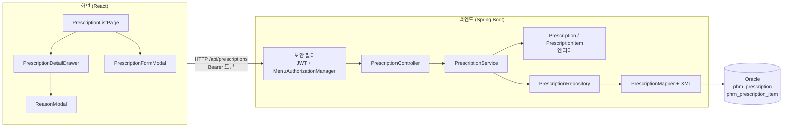
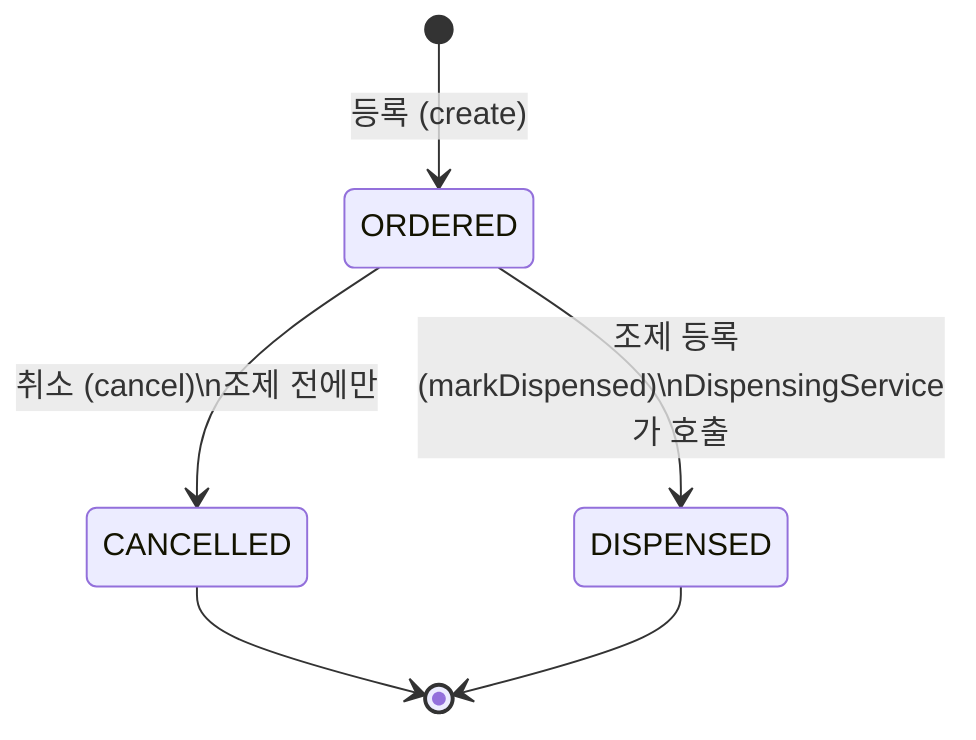
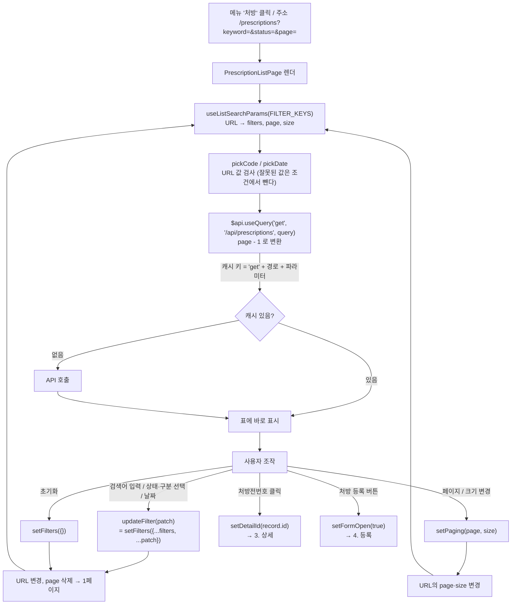
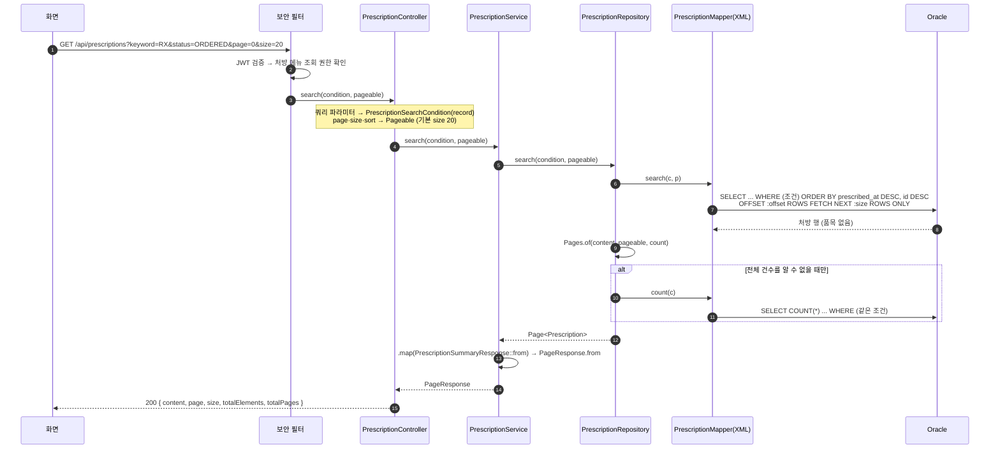
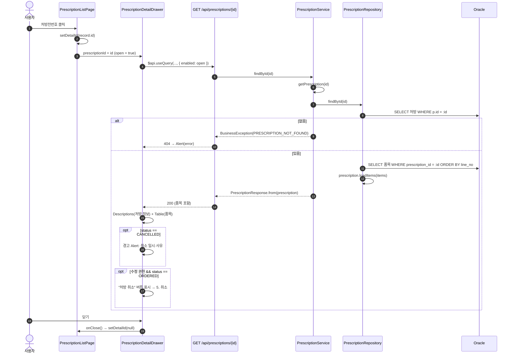
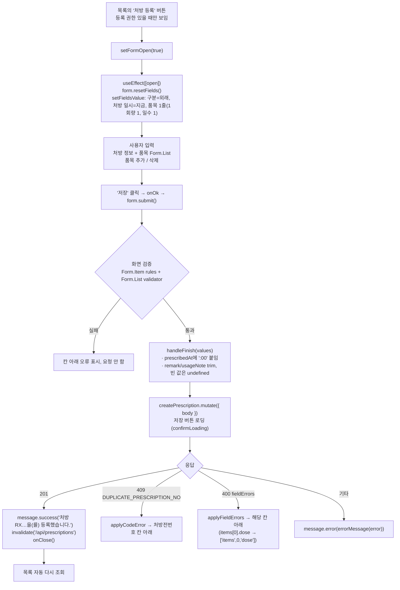
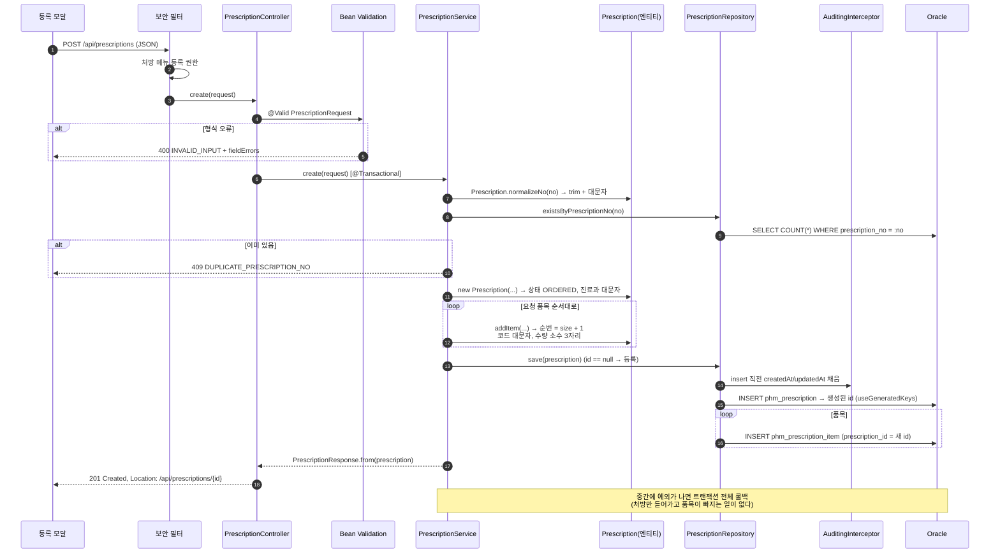
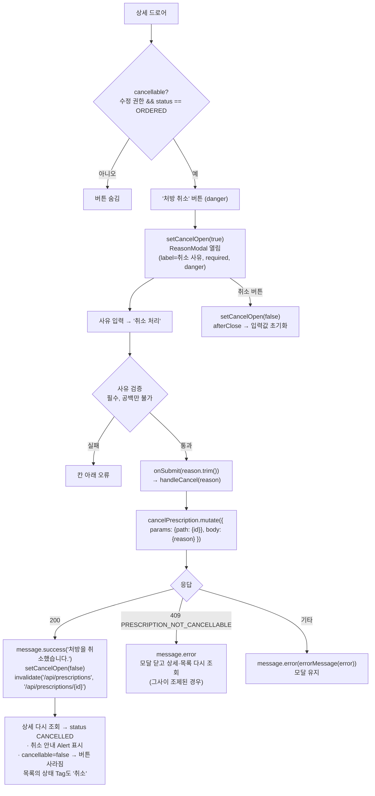
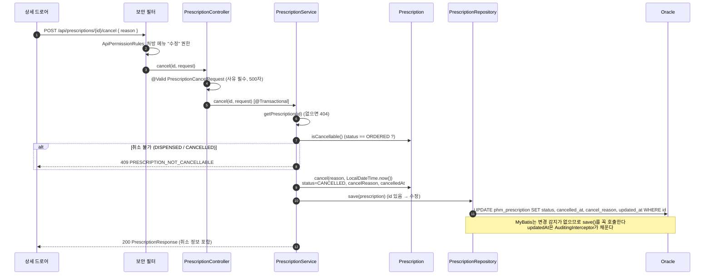

# 처방 프로그램 설명서 (목록 · 상세 · 등록 · 취소)

약제 업무(처방 → 조제 → 검수 → 불출 → 반납)의 첫 화면인 **처방**의 프로그램 흐름과 메서드를 설명한다.
화면(React)부터 API(Spring), DB(Oracle)까지 한 요청이 지나가는 길을 기능별로 따라간다.

- 화면 경로: `/prescriptions` (메뉴 "처방")
- API 경로: `/api/prescriptions`
- 테이블: `phm_prescription`(처방 마스터), `phm_prescription_item`(처방 품목)

> 다이어그램은 Mermaid 문법이다. IntelliJ(Markdown 플러그인)와 GitHub에서 그림으로 보인다.

---

## 1. 전체 구성

### 1.1 파일 목록

| 계층 | 파일 | 역할 |
|---|---|---|
| 화면 | `frontend/src/features/prescriptions/PrescriptionListPage.tsx` | 목록 화면: 검색 줄, 목록 표, 페이지, 등록 버튼 |
| 화면 | `frontend/src/features/prescriptions/PrescriptionDetailDrawer.tsx` | 상세 드로어: 처방 정보, 품목 표, 취소 버튼 |
| 화면 | `frontend/src/features/prescriptions/PrescriptionFormModal.tsx` | 등록 모달: 처방 정보와 품목(Form.List) 입력 |
| 화면 | `frontend/src/features/prescriptions/prescriptionFields.ts` | 타입, 코드값 표시(라벨·색), 선택 항목, 유틸 함수 |
| 화면 공통 | `components/ReasonModal.tsx` | 사유 한 줄 입력 모달 (취소 사유) |
| 화면 공통 | `hooks/useListSearchParams.ts` | 검색 조건·페이지를 URL 쿼리스트링에 둔다 |
| 화면 공통 | `hooks/useInvalidateApi.ts` | 등록·취소 뒤 조회 캐시 무효화 |
| 화면 공통 | `api/client.ts`, `api/errors.ts` | `$api` 훅(생성 타입), 오류 처리 함수 |
| 화면 공통 | `layouts/MenuContext.tsx` | `useMenus().can()` 메뉴 권한 확인 |
| 백엔드 | `pharmacy/prescription/PrescriptionController.java` | REST API 4개 |
| 백엔드 | `pharmacy/prescription/PrescriptionService.java` | 업무 규칙 (중복, 취소 가능 여부), 트랜잭션 |
| 백엔드 | `pharmacy/prescription/Prescription.java` | 처방 엔티티: 정규화, 상태 전이 |
| 백엔드 | `pharmacy/prescription/PrescriptionItem.java` | 처방 품목 엔티티: 코드 대문자화, 수량 자릿수 |
| 백엔드 | `pharmacy/prescription/PrescriptionRepository.java` | 처방 + 품목을 한 묶음으로 저장·조회 |
| 백엔드 | `pharmacy/prescription/PrescriptionMapper.java` + `resources/mapper/pharmacy/prescription/PrescriptionMapper.xml` | SQL |
| 백엔드 | `pharmacy/prescription/dto/*` | 요청·응답 record |
| 백엔드 공통 | `global/security/ApiPermissionRules`, `MenuAuthorizationManager` | API → 메뉴 권한 검사 |
| 백엔드 공통 | `global/error/GlobalExceptionHandler`, `ErrorCode` | 오류 응답 `{code, message, fieldErrors}` |
| 백엔드 공통 | `global/mybatis/*` | `AuditingInterceptor`, `Likes`, `SqlParams`, `Pages`, `ScaledDecimalTypeHandler` |

### 1.2 계층 구조

### 1.3 API 요약

| 기능 | 메서드 · 경로 | 필요 권한 | 성공 응답 | 주요 오류 |
|---|---|---|---|---|
| 목록 | `GET /api/prescriptions` | 처방 조회 | 200 `PageResponse<PrescriptionSummaryResponse>` | - |
| 상세 | `GET /api/prescriptions/{id}` | 처방 조회 | 200 `PrescriptionResponse` | 404 `PRESCRIPTION_NOT_FOUND` |
| 등록 | `POST /api/prescriptions` | 처방 등록 | 201 `PrescriptionResponse` + `Location` | 400 형식 오류, 409 `DUPLICATE_PRESCRIPTION_NO` |
| 취소 | `POST /api/prescriptions/{id}/cancel` | 처방 **수정** | 200 `PrescriptionResponse` | 404, 409 `PRESCRIPTION_NOT_CANCELLABLE`, 400 사유 없음 |

모든 요청은 보안 필터를 먼저 지난다. 토큰이 없으면 401이다. 권한이 없으면 403이며 `SecurityErrorHandler`가 응답한다.
취소는 등록된 처방의 상태를 바꾸므로 `ApiPermissionRules`가 **수정 권한**으로 따로 정해 두었다. 나머지는 HTTP 메서드로 동작을 정한다(GET → 조회, POST → 등록).

### 1.4 상태 전이

| 상태 | 화면 표시 | 설명 |
|---|---|---|
| `ORDERED` | 처방 (파랑) | 등록 직후. 취소할 수 있는 유일한 상태 |
| `DISPENSED` | 조제됨 (초록) | 조제가 등록됨. 취소 불가 |
| `CANCELLED` | 취소 (회색) | 취소 일시·사유가 남는다. 조제 불가 |

처방은 **수정하지 않는다.** 내용이 바뀌면 취소하고 새로 처방한다. 그래서 수정 화면과 수정 API가 없다.

### 1.5 테이블

| 테이블 | 주요 컬럼 | 제약·인덱스 |
|---|---|---|
| `phm_prescription` | id, prescription_no, patient_no, patient_name, department_code, prescriber_name, prescription_type, status, prescribed_at, remark, cancelled_at, cancel_reason, created_at, updated_at | `uk_phm_prescription_no`(유일), `ix_phm_prescription_patient`, `ix_phm_prescription_patient_name`, `ix_phm_prescription_prescribed_at` |
| `phm_prescription_item` | id, prescription_id, line_no, drug_code, drug_name, dose, dose_unit, route, frequency, days, total_quantity, usage_note | `uk_phm_prescription_item_line(prescription_id, line_no)`, FK → `phm_prescription` |

---

## 2. 목록 (검색 · 페이지)

### 2.1 화면 흐름

포인트:
- 검색 조건이 **URL에 있으므로** 새로고침, 뒤로 가기, 링크 공유, 탭 이동 뒤에도 조건이 남는다.
- `placeholderData: keepPreviousData`: 새 페이지를 불러오는 동안 이전 목록을 유지해 표가 깜빡이지 않는다.
- 조건이 바뀌면 쿼리 키가 바뀌어 TanStack Query가 자동으로 다시 조회한다. 조회 코드를 직접 부르지 않는다.

### 2.2 서버 흐름

### 2.3 검색 조건 (SQL `searchWhere`)

| 조건 | 파라미터 | SQL | 비고 |
|---|---|---|---|
| 검색어 | `keyword` | `(p.prescription_no LIKE 'RX%' OR p.patient_no LIKE 'kw%' OR p.patient_name LIKE 'kw%') ESCAPE '!'` | **앞부분 일치**만. 처방전번호는 검색어를 대문자로 바꾼다 |
| 상태 | `status` | `p.status = #{c.status}` | |
| 구분 | `prescriptionType` | `p.prescription_type = #{c.prescriptionType}` | |
| 진료과 | `departmentCode` | `p.department_code = #{departmentCode}` | `SqlParams.upper` |
| 시작일 | `from` (yyyy-MM-dd) | `p.prescribed_at >= 시작일 0시` | `SqlParams.startOfDay` |
| 종료일 | `to` (yyyy-MM-dd) | `p.prescribed_at < 종료일 다음 날 0시` | `SqlParams.startOfNextDay`, 종료일 포함 |

**앞부분 일치를 쓰는 이유:** 약제 데이터는 계속 쌓인다. `%키워드%`는 인덱스를 못 쓰고 전체를 스캔한다. OR 조건은 하나라도 인덱스를 못 쓰면 전체가 스캔이므로 세 조건 모두 `키워드%`다. 컬럼에 함수(`UPPER()` 등)도 씌우지 않는다.

### 2.4 메서드 설명

**화면 — `PrescriptionListPage.tsx`**

| 이름 | 종류 | 설명 |
|---|---|---|
| `FILTER_KEYS` | 상수 | URL에 두는 조건 이름 `['keyword','status','prescriptionType','from','to']`. 컴포넌트 밖에 둔다. 안에 두면 렌더마다 새 배열이 되어 `useMemo`가 매번 다시 계산된다 |
| `STATUS_OPTIONS`, `TYPE_OPTIONS` | 상수 | `PRESCRIPTION_STATUSES`/`PRESCRIPTION_TYPES` 표에서 만든 선택 박스 항목 `{value, label}[]` |
| `pickCode<T>(value, table)` | 함수 | URL 문자열이 표의 키(코드값)이면 `T` 타입으로, 아니면 `undefined`. `Object.hasOwn`으로 확인해 `?status=abc` 같은 잘못된 값이 API로 가지 않게 한다 |
| `pickDate(value)` | 함수 | `yyyy-MM-dd` 형식이면 그 값, 아니면 `undefined` |
| `PrescriptionListPage()` | 컴포넌트 | 목록 화면 본체 |
| `useMenus().can('/prescriptions','create')` | 훅 | 등록 버튼 표시 여부. 최종 검사는 서버가 한다 |
| `useListSearchParams(FILTER_KEYS)` | 훅 | `filters`, `page`(1부터), `size`, `setFilters`, `setPaging` |
| `listQuery` | `$api.useQuery` | 목록 조회. `page - 1`로 넘긴다(서버는 0부터) |
| `updateFilter(patch)` | 함수 | 조건 하나만 바꾼다. `setFilters`는 넘기지 않은 조건을 지우므로 기존 `filters`와 합쳐 넘긴다 |
| `detailId` / `setDetailId` | state | 상세 드로어에 보여줄 처방 ID. `null`이면 닫힘 |
| `formOpen` / `setFormOpen` | state | 등록 모달 열림 여부 |
| `columns` | 표 열 정의 | 처방전번호(링크), 환자번호, 환자명, 진료과, 처방의, 구분(Tag), 상태(Tag), 처방 일시 |

**화면 공통 — `useListSearchParams`**

| 이름 | 설명 |
|---|---|
| `filters` | URL에서 읽은 조건 `Record<키, string \| undefined>` |
| `page`, `size` | URL의 `page`(기본 1), `size`(기본 20) |
| `setFilters(next)` | 조건을 바꾼다. 빈 값은 URL에서 빼고, `page`를 지워 1페이지로 돌아간다 |
| `setPaging(page, size)` | 표의 `pagination.onChange`에 연결한다. 크기를 바꾸면 1페이지로 간다 |

**백엔드**

| 클래스 · 메서드 | 설명 |
|---|---|
| `PrescriptionController.search(condition, pageable)` | `@ParameterObject`로 쿼리 파라미터를 record와 `Pageable`로 받는다. `@PageableDefault(size = 20)` |
| `PrescriptionSearchCondition` | record. 모든 조건이 선택. `from`/`to`는 `@DateTimeFormat(ISO.DATE)` |
| `PrescriptionService.search(condition, pageable)` | `@Transactional(readOnly = true)`. 엔티티 페이지를 `PrescriptionSummaryResponse`로 바꾸고 `PageResponse`로 감싼다(Spring `Page`를 그대로 내보내지 않는다) |
| `PrescriptionRepository.search(condition, pageable)` | `Pages.of(mapper.search(...), pageable, () -> mapper.count(...))`. 품목은 읽지 않는다 |
| `Pages.of(content, pageable, count)` | `PageableExecutionUtils.getPage`. 첫 페이지인데 결과가 size보다 적으면 건수를 알 수 있으므로 `count`를 실행하지 않는다 |
| `PrescriptionMapper.search(c, p)` | `searchWhere` + 최신순 정렬 + `OFFSET/FETCH` 페이징 |
| `PrescriptionMapper.count(c)` | 같은 `searchWhere`로 건수 |
| `Likes.startsWith(kw)` / `startsWithUpper(kw)` | `%`, `_`, `!`를 `!`로 이스케이프하고 뒤에 `%`를 붙인다. 빈 값이면 `null`(조건 생략) |
| `SqlParams.upper/startOfDay/startOfNextDay` | 진료과 대문자화, 기간을 0시/다음 날 0시로 |

---

## 3. 상세 (드로어)

### 3.1 흐름

포인트:
- 목록 행 데이터를 넘기지 않고 **ID만** 넘겨 단건 API로 다시 읽는다. 목록에는 품목이 없고, 최신 상태(그사이 조제·취소됨)를 보여줘야 하기 때문이다.
- `enabled: open`: 닫혀 있을 때(`prescriptionId === null`)는 조회하지 않는다. `id ?? 0`은 타입을 맞추기 위한 값이며 실제로 호출되지 않는다.
- 일대다(처방 → 품목)를 조인하지 않고 **두 번 읽어 붙인다.** 목록 페이징이 깨지지 않게 하는 프로젝트 공통 규칙이다.

### 3.2 화면 상태별 표시

| 조건 | 표시 |
|---|---|
| `isPending && open` | `Skeleton` (불러오는 중) |
| `isError` | `Alert type="error"` + `errorMessage(error)` |
| 데이터 있음 | `Descriptions`(처방 정보 9항목) + 품목 `Table` |
| `status === 'CANCELLED'` | 경고 `Alert`: "○○에 취소된 처방입니다. 사유: ○○" |
| `cancellable` | 드로어 `extra`에 "처방 취소" 버튼 |

### 3.3 메서드 설명

**화면 — `PrescriptionDetailDrawer.tsx`**

| 이름 | 종류 | 설명 |
|---|---|---|
| `PrescriptionDetailDrawerProps` | 타입 | `prescriptionId: number \| null`, `onClose()` |
| `ITEM_COLUMNS` | 상수 | 품목 표의 열(순번, 약품코드, 약품명, 1회량+단위, 경로, 빈도, 일수, 총량, 용법). props·state를 쓰지 않아 컴포넌트 밖에 둔다 |
| `detailQuery` | `$api.useQuery` | 단건 조회. 캐시 키는 `['get','/api/prescriptions/{id}',{params}]` |
| `cancellable` | 계산값 | `can('/prescriptions','update') && status === 'ORDERED'` |

**화면 — `prescriptionFields.ts`**

| 이름 | 설명 |
|---|---|
| `PrescriptionSummaryResponse`, `PrescriptionResponse`, `PrescriptionItemResponse` | `schema.d.ts`(생성 타입)에서 꺼내 이름을 붙인 타입 |
| `PrescriptionStatus`, `PrescriptionType` | `NonNullable<...['status']>`로 꺼낸 코드값 유니언 타입 |
| `PRESCRIPTION_STATUSES`, `PRESCRIPTION_TYPES` | `Record<코드, {label, color}>`. 코드값 → 한글 이름·Tag 색. `Record`라서 코드를 빠뜨리면 타입 오류 |
| `formatQuantity(value)` | 서버의 `30.000`을 `30`, `1234.5`를 `1,234.5`로 보여준다(소수 최대 3자리) |

**백엔드**

| 클래스 · 메서드 | 설명 |
|---|---|
| `PrescriptionController.findById(id)` | `@PathVariable Long id` |
| `PrescriptionService.findById(id)` | `getPrescription(id)` 결과를 응답으로 변환 |
| `PrescriptionService.getPrescription(id)` | 없으면 `PRESCRIPTION_NOT_FOUND`(404). 조제 서비스도 이 메서드를 쓴다 |
| `PrescriptionRepository.findById(id)` | 처방을 읽고 품목을 따로 읽어 `loadItems`로 채운다 |
| `PrescriptionMapper.findById(id)` | `prescriptionColumns`(고정 별칭 `p_*`) + `resultMap="prescription"` |
| `PrescriptionMapper.findItemsByPrescriptionId(id)` | 순번(`line_no`) 순 |
| `Prescription.loadItems(items)` | 패키지 전용. 품목마다 `attachTo(this)`로 상위를 연결한다 |
| `PrescriptionResponse.from(entity)` | 엔티티 → 응답 record. 품목은 `PrescriptionItemResponse::from` |
| `ScaledDecimalTypeHandler` | Oracle이 `30.000`을 `30`으로 돌려주므로 컬럼 자릿수(3)로 맞춘다 |

---

## 4. 등록 (모달)

### 4.1 화면 흐름

### 4.2 서버 흐름

### 4.3 입력 규칙 (화면 = 서버)

| 항목 | 필수 | 규칙 | 저장 시 |
|---|---|---|---|
| 처방전번호 `prescriptionNo` | ✔ | 30자, 전체 유일 | trim + 대문자 |
| 구분 `prescriptionType` | ✔ | OUTPATIENT/INPATIENT/DISCHARGE/EMERGENCY | |
| 처방 일시 `prescribedAt` | ✔ | `yyyy-MM-ddTHH:mm:ss` | |
| 환자번호 `patientNo` | ✔ | 20자 | |
| 환자명 `patientName` | ✔ | 100자 | |
| 진료과 코드 `departmentCode` | ✔ | 20자 | trim + 대문자 |
| 처방의 `prescriberName` | ✔ | 100자 | |
| 비고 `remark` | | 1000자 | |
| 품목 `items` | ✔ | 1~100줄 | 순번 1부터 |
| └ 약품코드 `drugCode` | ✔ | 30자 | 대문자 |
| └ 약품명 `drugName` | ✔ | 200자 | |
| └ 1회량 `dose` | ✔ | 0 초과, 정수 9·소수 3자리 | 소수 3자리 |
| └ 단위 `doseUnit`, 경로 `route`, 빈도 `frequency` | ✔ | 각 20자 | 대문자 |
| └ 일수 `days` | ✔ | 1~365 정수 | |
| └ 총량 `totalQuantity` | ✔ | 0 초과, 정수 9·소수 3자리 | 소수 3자리 |
| └ 용법 `usageNote` | | 500자 | |

화면 검증은 사용자 편의용이고, **최종 검증은 서버**(`@Valid`)가 한다. 두 곳의 규칙을 같게 유지한다.

### 4.4 메서드 설명

**화면 — `PrescriptionFormModal.tsx`**

| 이름 | 종류 | 설명 |
|---|---|---|
| `PrescriptionFormModalProps` | 타입 | `open`, `onClose()` |
| `NEW_ITEM` | 상수 | 품목 한 줄의 처음 값 `{dose: 1, days: 1}`. "품목 추가"와 초기 한 줄에 쓴다 |
| `form` | `Form.useForm<PrescriptionRequest>()` | 폼 인스턴스. **반드시 `<Form form={form}>`로 연결해야** `form.submit()`·`setFieldsValue`가 동작한다 |
| `createPrescription` | `$api.useMutation('post','/api/prescriptions')` | 등록 요청. `isPending`으로 저장 버튼 로딩 |
| `useEffect([open, form])` | 효과 | 열릴 때마다 폼을 비우고 기본값을 넣는다 |
| `handleFinish(values)` | 함수 | 화면 검증 통과 뒤 호출. 값 정리 후 `mutate`. 성공·실패 처리 |
| `<Modal forceRender>` | 설정 | 모달이 닫혀 있어도 폼을 미리 렌더링해 form 인스턴스를 연결한다 |
| `<Form.List name="items">` | 컴포넌트 | 품목 줄 배열. `fields.map`으로 줄을 그리고 `add`/`remove`로 줄을 늘리고 줄인다. 필드 이름은 `[field.name, 'drugCode']` |
| Form.List `validator` | 규칙 | 0줄이면 "한 줄 이상", 100줄 초과면 오류. `Form.ErrorList`로 표시 |
| 삭제 버튼 `disabled={fields.length === 1}` | 설정 | 마지막 한 줄은 지울 수 없다 |

**화면 — `prescriptionFields.ts`**

| 이름 | 설명 |
|---|---|
| `PrescriptionRequest`, `PrescriptionItemRequest` | 생성 타입에서 꺼낸 요청 타입 |
| `PRESCRIPTION_TYPE_OPTIONS` | `Object.entries(PRESCRIPTION_TYPES).map(([value, {label}]) => ({value, label}))`. 구분 선택 박스 항목 |
| `PRESCRIPTION_ERROR_FIELDS` | `{DUPLICATE_PRESCRIPTION_NO: 'prescriptionNo'}`. 업무 오류 코드 → 표시할 필드 |
| `nowForDateTimeInput()` | 지금 시각을 `yyyy-MM-ddTHH:mm`(내 PC 시간대)로. 월·일·시·분은 두 자리로 채운다 |

**화면 공통 — `api/errors.ts`**

| 이름 | 설명 |
|---|---|
| `isApiError(value)` | 서버 오류 응답 `{code, message}` 모양인지 확인하는 타입 가드 |
| `errorMessage(error, fallback)` | 서버 메시지, 없으면 기본 문구 |
| `applyCodeError(form, error, codeFields)` | `error.code`가 표에 있으면 그 필드에 오류를 표시하고 `true` |
| `applyFieldErrors(form, error)` | 서버 `fieldErrors`의 경로(`items[0].dose`)를 폼 경로(`['items',0,'dose']`)로 바꿔 표시하고 `true` |

**백엔드**

| 클래스 · 메서드 | 설명 |
|---|---|
| `PrescriptionController.create(request)` | `@Valid @RequestBody`. 201 + `Location` 헤더 |
| `PrescriptionRequest`, `PrescriptionItemRequest` | record + Bean Validation(`@NotBlank`, `@Size`, `@DecimalMin`, `@Digits`, `@Min/@Max`, `@NotEmpty`) |
| `PrescriptionService.create(request)` | `@Transactional`. 정규화 → 중복 검사 → 엔티티 생성 → 품목 추가 → 저장 → 응답 |
| `Prescription.normalizeNo(no)` | `trim().toUpperCase(Locale.ROOT)`. 중복 검사 전에도 같은 규칙을 쓴다. `Locale.ROOT`는 터키어 로케일의 i/İ 문제를 막는다 |
| `new Prescription(...)` | 상태 `ORDERED`, 진료과 대문자 |
| `Prescription.addItem(...)` | 순번 = `items.size() + 1`. 품목은 이 메서드로만 만든다 |
| `new PrescriptionItem(...)` | 약품코드·단위·경로·빈도 대문자, `Quantities.normalize`로 수량 소수 3자리 |
| `PrescriptionRepository.existsByPrescriptionNo(no)` | `COUNT(*) > 0` |
| `PrescriptionRepository.save(p)` | id 없음 → `insert` 후 품목마다 `insertItem`. id 있음 → `updateStatus` |
| `PrescriptionMapper.insert` | `useGeneratedKeys="true" keyColumn="id"`. Oracle identity 값이 `prescription.id`에 채워진다 |
| `PrescriptionMapper.insertItem(prescriptionId, item)` | 품목 한 행. 생성 id는 `item.id`에 채워진다 |
| `AuditingInterceptor` | MyBatis `Executor.update` 가로채기. insert/update 직전 `createdAt`·`updatedAt`을 채운다 |
| `GlobalExceptionHandler` | `MethodArgumentNotValidException` → 400 `fieldErrors`, `BusinessException` → `ErrorCode`의 상태·코드 |

---

## 5. 취소

### 5.1 화면 흐름

### 5.2 서버 흐름

### 5.3 메서드 설명

**화면 — `PrescriptionDetailDrawer.tsx` (취소 부분)**

| 이름 | 종류 | 설명 |
|---|---|---|
| `cancelOpen` / `setCancelOpen` | state | 사유 모달 열림 여부 |
| `cancelPrescription` | `$api.useMutation('post','/api/prescriptions/{id}/cancel')` | 취소 요청. 경로 변수는 `params.path.id` |
| `cancellable` | 계산값 | 버튼 표시 조건. 서버 규칙(`isCancellable` + 수정 권한)과 같다 |
| `handleCancel(reason)` | 함수 | 사유가 없으면 무시(안전장치). 성공 시 닫고 무효화, 409면 닫고 새로 조회, 그 밖은 메시지만 |
| `invalidate('/api/prescriptions', '/api/prescriptions/{id}')` | 호출 | 목록(상태 열)과 상세를 함께 새로 고친다. 상태가 바뀌면 화면이 자동으로 따라 바뀌므로 직접 상태를 고치는 코드가 없다 |

**화면 공통 — `ReasonModal`**

| prop | 이 화면의 값 | 설명 |
|---|---|---|
| `title` | 처방 취소 | |
| `description` | 처방전번호(환자명) + 안내 문구 | 입력란 위 설명 |
| `okText` | 취소 처리 | |
| `label` / `placeholder` | 취소 사유 / 예: 처방 변경으로 재처방 | |
| `required` | `true` | 서버 `@NotBlank`와 맞춘다 |
| `danger` | `true` | 확인 버튼을 빨강으로 |
| `confirmLoading` | `cancelPrescription.isPending` | 중복 클릭 방지 |
| `onSubmit(reason)` | `handleCancel` | trim 후 빈 값이면 `undefined` |
| `afterClose` (내부) | | 닫힌 뒤 입력값을 지운다 |

**백엔드**

| 클래스 · 메서드 | 설명 |
|---|---|
| `PrescriptionController.cancel(id, request)` | `@PostMapping("/{id}/cancel")` |
| `PrescriptionCancelRequest` | `@NotBlank @Size(max = 500) String reason` |
| `ApiPermissionRules` | `POST /api/prescriptions/*/cancel` → `PRESCRIPTIONS` 메뉴 `UPDATE` |
| `PrescriptionService.cancel(id, request)` | `@Transactional`. 조회 → `isCancellable` 검사 → `cancel` → `save` → 응답 |
| `Prescription.isCancellable()` | `status == ORDERED` |
| `Prescription.cancel(reason, at)` | 상태 `CANCELLED`, 사유·일시 기록. 가능 여부는 서비스가 먼저 확인한다 |
| `PrescriptionRepository.save(p)` | id가 있으므로 `updateStatus` |
| `PrescriptionMapper.updateStatus(p)` | 상태·취소 일시·사유·수정 일시만 바꾼다(처방 내용은 수정하지 않는다) |

---

## 6. 오류 처리 정리

| 상황 | HTTP · 코드 | 응답을 만드는 곳 | 화면 처리 |
|---|---|---|---|
| 토큰 없음·만료 | 401 | `SecurityErrorHandler` | 미들웨어가 로그아웃 |
| 권한 없음 | 403 | `SecurityErrorHandler` | `message.error` (버튼은 애초에 숨김) |
| 입력 형식 오류 | 400 `INVALID_INPUT` + `fieldErrors` | `GlobalExceptionHandler` | `applyFieldErrors` → 해당 칸 |
| 처방 없음 | 404 `PRESCRIPTION_NOT_FOUND` | `PrescriptionService.getPrescription` | 드로어 `Alert` |
| 처방전번호 중복 | 409 `DUPLICATE_PRESCRIPTION_NO` | `PrescriptionService.create` | `applyCodeError` → 처방전번호 칸 |
| 취소 불가 | 409 `PRESCRIPTION_NOT_CANCELLABLE` | `PrescriptionService.cancel` | `message.error` + 다시 조회 |

오류 응답 형식: `{ "code": "DUPLICATE_PRESCRIPTION_NO", "message": "이미 등록된 처방전번호입니다.", "fieldErrors": [] }`

---

## 7. 설계 포인트 요약

1. **처방은 수정하지 않는다.** 바뀌는 것은 상태뿐이라 수정 SQL도 `updateStatus` 하나다.
2. **상태 규칙은 엔티티에 둔다**(`isCancellable`, `cancel`, `markDispensed`). 서비스는 묻고 오류를 던진다. 조제 서비스가 처방 상태를 바꿀 때도 `PrescriptionService.markDispensed`를 거친다.
3. **변경 감지가 없다**(MyBatis). 엔티티를 바꾼 뒤 반드시 `repository.save()`를 호출한다.
4. **처방과 품목은 한 묶음**이다. 리포지토리가 함께 저장하고(트랜잭션), 단건 조회만 품목을 읽는다.
5. **검색은 앞부분 일치 + 인덱스**를 쓴다. 약제 데이터가 계속 쌓이기 때문이다.
6. **정규화는 저장 전, 중복 검사 전**에 한다(처방전번호·코드 대문자). 그래서 `rx-1`과 `RX-1`은 같은 번호다.
7. **화면은 서버 상태를 다시 읽어 맞춘다.** 등록·취소 뒤 관련 경로를 무효화하면 목록·상세가 자동으로 최신이 된다.
8. **권한은 서버가 검사**하고 화면은 버튼만 숨긴다(`useMenus().can`).
